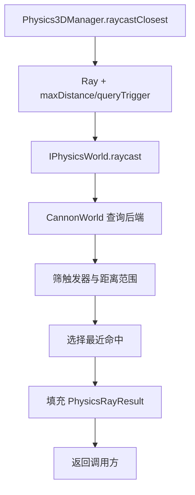

# 第 69 课：Creator 2.4.15 射线与物理查询

**本课问题：** 射线查询怎样返回最近命中及其所属物理对象？

## 本版路径

Physics3DManager.raycastClosest → IPhysicsWorld → CannonWorld → PhysicsRayResult。

## 源码位置

- [`physics-manager.ts`](<../../engine/2.4.15engine/cocos2d/core/3d/physics/framework/physics-manager.ts>)：核对 Physics3DManager.raycastClosest → IPhysicsWorld → CannonWorld → PhysicsRayResult。
- [`physics-ray-result.ts`](<../../engine/2.4.15engine/cocos2d/core/3d/physics/framework/physics-ray-result.ts>)：核对 Physics3DManager.raycastClosest → IPhysicsWorld → CannonWorld → PhysicsRayResult。
- [`cannon-world.ts`](<../../engine/2.4.15engine/cocos2d/core/3d/physics/cannon/cannon-world.ts>)：核对 Physics3DManager.raycastClosest → IPhysicsWorld → CannonWorld → PhysicsRayResult。

前置课程：[第 68 课](<../s68_contact_filter/README.md>)。

## 为什么这样设计

管理器提供与后端无关的查询 API，World 负责射线求交，结果对象统一承载碰撞体、距离、命中位置和法线，调用方无需认识 Cannon 返回对象。

## 源码流程图

## 本课必须保留的机制

保留最大距离和 trigger 查询选项对候选项的筛选、按距离返回最近命中，以及结果携带对象/距离/位置/法线的规则。

## 最小观察宿主

`src/main.ts` 只调用一次 `runLesson()` 并显示最近命中日志；无需场景、按钮或帧循环。

## 模型化简化与 Creator Runtime 边界

独立代码：[课程实现](<src/cocos2d/core/3d/physics/framework/PhysicsStudy.ts>)。候选项只是带标量距离的数组，示例排序后构造结果，不做射线几何求交或调用物理后端；省略 `Physics3DManager.raycastClosest → IPhysicsWorld.raycast → backend` 的 Runtime 查询阶段，也不加载 Cannon/Builtin。

## 运行

~~~sh
deno task check
deno task build
deno task serve
~~~

打开 `http://127.0.0.1:8000`。页面会显示：对候选物体做简化射线求交，按距离选择最近结果，并携带对象、位置和法线。
