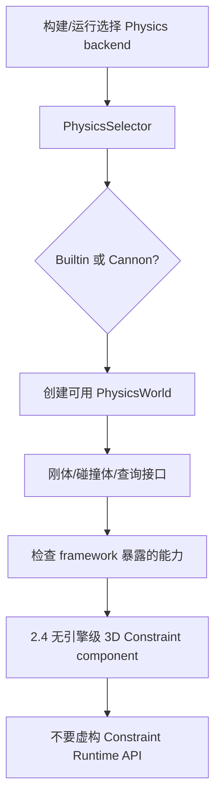

# 第 70 课：Creator 2.4.15 约束接口与后端能力边界

**本课问题：** 本版本如何表示约束；没有引擎级约束时边界在哪里？

## 本版路径

PhysicsSelector 选择 Builtin/Cannon；2.4 framework 没有引擎级 3D Constraint component。

## 源码位置

- [`physics-selector.ts`](<../../engine/2.4.15engine/cocos2d/core/3d/physics/framework/physics-selector.ts>)：核对 PhysicsSelector 选择 Builtin/Cannon；2.4 framework 没有引擎级 3D Constraint component。
- [`physics-interface.ts`](<../../engine/2.4.15engine/cocos2d/core/3d/physics/framework/physics-interface.ts>)：核对 PhysicsSelector 选择 Builtin/Cannon；2.4 framework 没有引擎级 3D Constraint component。
- [`physics-manager.ts`](<../../engine/2.4.15engine/cocos2d/core/3d/physics/framework/physics-manager.ts>)：核对 PhysicsSelector 选择 Builtin/Cannon；2.4 framework 没有引擎级 3D Constraint component。

前置课程：[第 69 课](<../s69_physics_queries/README.md>)。

## 为什么这样设计

后端选择器只负责选择已存在的物理实现，不代表公共框架自动拥有所有物理能力。明确接口缺失能防止把别的版本或后端特性误写成 Creator 2.4 API。

## 源码流程图

## 本课必须保留的机制

必须保留 Creator 2.4.15 的能力边界：PhysicsSelector 可选择 Builtin/Cannon，但本版 framework 没有引擎级 3D Constraint 组件；不能把其他版本或后端能力说成本版 Runtime API。

## 最小观察宿主

`src/main.ts` 只调用一次 `runLesson()` 并输出能力清单；无需场景、按钮或帧循环。

## 模型化简化与 Creator Runtime 边界

代码现在是可执行的源码能力审计：按 Builtin/Cannon 分别列出该快照已暴露的刚体、碰撞体和查询入口及证据，并断言 3D Constraint component 不在框架能力集合。它不会模拟约束；结论来自 Creator 2.4.15 本地快照，不外推到其他版本或后端库内部 API。
## 运行

~~~sh
deno task check
deno task build
deno task serve
~~~

打开 `http://127.0.0.1:8000`。页面会显示：在支持约束的版本里把 hinge 约束加入世界并停用时移除；Creator 2.4 输出源码边界，不造出不存在的约束组件。
