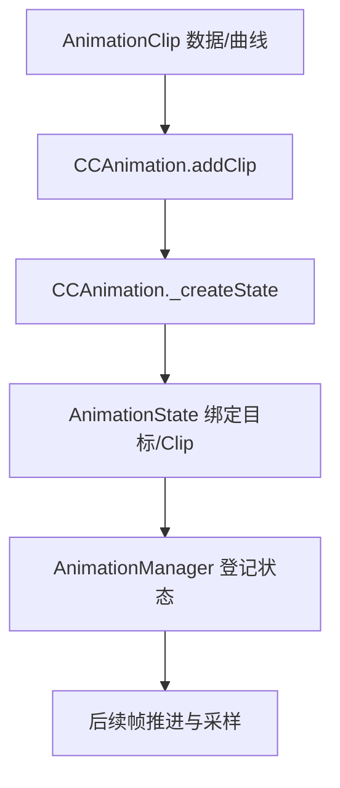

# 第 71 课：Creator 2.4.15 动画资源与片段

**本课问题：** 各版本的动画数据如何进入运行时播放器？

## 本版路径

CCAnimation 组件持有 AnimationClip 并创建可播放状态。

## 源码位置

- [`animation-clip.js`](<../../engine/2.4.15engine/cocos2d/animation/animation-clip.js>)：对应 CCAnimation 组件持有 AnimationClip 并创建可播放状态。
- [`CCAnimation.js`](<../../engine/2.4.15engine/cocos2d/core/components/CCAnimation.js>)：对应 CCAnimation 组件持有 AnimationClip 并创建可播放状态。

前置主题：[动作与时间推进](../s34_action_modifiers/README.md)。

## 为什么这样设计

AnimationClip 保存可复用的时间线数据，CCAnimation 组件根据剪辑创建运行时状态；资源与一次播放状态分离，才能让剪辑被多个对象使用。

## 源码流程图

## 本课必须保留的机制

保留 `CCAnimation` 持有 `AnimationClip` 并创建可播放状态这一资源到播放器的连接；课程关注的是 Clip 进入运行时的入口，而不只是时间数值。

## 最小观察宿主

`src/main.ts` 一次调用 `runLesson()`，把 Clip 名称、时长和关键帧数写入浏览器 `#log`；不需要场景、按钮或帧循环。

## 模型化简化与 Creator Runtime 边界

代码校验 Clip 名称、时长、采样率和曲线关键帧范围；按路径分组属性轨道，创建 AnimationState 并把曲线绑定到示例根节点，同时列出事件键。它使用教学数据而不是 Creator 序列化反序列化器；实际 Animator 的目标查找和曲线类型更广。
## 运行

~~~sh
deno task check
deno task build
deno task serve
~~~

打开 `http://127.0.0.1:8000`，页面列出本课的时间、采样或事件结果。
