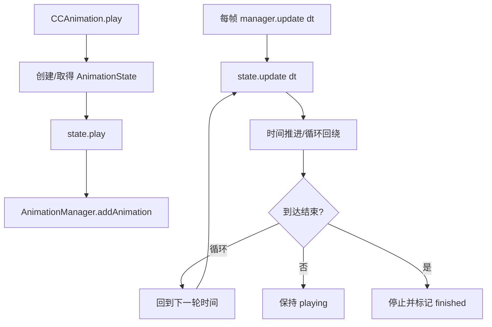

# 第 72 课：Creator 2.4.15 播放状态与时间推进

**本课问题：** 播放、暂停、循环和结束如何进入每帧更新？

## 本版路径

AnimationManager 每帧推进 AnimationState 时间，按循环模式处理结束。

## 源码位置

- [`animation-state.js`](<../../engine/2.4.15engine/cocos2d/animation/animation-state.js>)：对应 AnimationManager 每帧推进 AnimationState 时间，按循环模式处理结束。
- [`animation-manager.js`](<../../engine/2.4.15engine/cocos2d/animation/animation-manager.js>)：对应 AnimationManager 每帧推进 AnimationState 时间，按循环模式处理结束。

前置主题：[动作与时间推进](../s34_action_modifiers/README.md)。

## 为什么这样设计

AnimationState 表示单次播放的时间、速度、循环和结束状态；AnimationManager 统一逐帧推进所有状态，组件不用自己创建帧计时器。

## 源码流程图

## 本课必须保留的机制

保留播放状态按时间推进、达到总循环时长后停止并标记结束的规则；源码还展示 AnimationManager 在每帧推进 AnimationState 的职责。

## 最小观察宿主

`src/main.ts` 一次调用 `runLesson()`，用固定的 `0.2s` 与 `0.5s` 步长显示时间、采样序号和结束状态；没有交互控制或真实帧循环。

## 模型化简化与 Creator Runtime 边界

代码把 AnimationState 与 AnimationManager 分开，支持 play/pause/resume/stop、normal/loop/ping-pong、倍率和重复次数；大步长可跨多个循环边界，Manager 统一推进注册状态。没有实现 Creator 的全部 WrapMode 位组合、反向播放边界和曲线采样。
## 运行

~~~sh
deno task check
deno task build
deno task serve
~~~

打开 `http://127.0.0.1:8000`，页面列出本课的时间、采样或事件结果。
