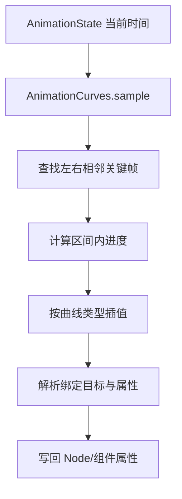

# 第 73 课：Creator 2.4.15 关键帧采样与属性写回

**本课问题：** 时间如何转换成节点属性、SpriteFrame 或骨骼姿态？

## 本版路径

AnimationCurves 按时间采样关键帧，再把结果写回目标属性。

## 源码位置

- [`animation-curves.js`](<../../engine/2.4.15engine/cocos2d/animation/animation-curves.js>)：对应 AnimationCurves 按时间采样关键帧，再把结果写回目标属性。
- [`animation-state.js`](<../../engine/2.4.15engine/cocos2d/animation/animation-state.js>)：对应 AnimationCurves 按时间采样关键帧，再把结果写回目标属性。

前置主题：[动作与时间推进](../s34_action_modifiers/README.md)。

## 为什么这样设计

曲线把播放时间与目标属性解耦：AnimationState 只提供当前时间，AnimationCurves 找到对应曲线并采样，再把结果应用到绑定对象。

## 源码流程图

## 本课必须保留的机制

保留关键帧时间区间定位、线性插值，以及将采样值写回目标属性（示例名为 `target.position.x`）的职责关系。

## 最小观察宿主

`src/main.ts` 一次调用 `runLesson()`，固定在 `0.75s` 计算插值并输出到浏览器 `#log`；不需要场景或帧循环。

## 模型化简化与 Creator Runtime 边界

代码在单调关键帧上二分查找采样区间，支持 linear/step/smooth，并将多个标量曲线写回具名目标属性；未知路径/属性会报错。Creator 2.4 曲线还支持更复杂的数据类型和组件属性绑定，本例不接入引擎绑定系统。
## 运行

~~~sh
deno task check
deno task build
deno task serve
~~~

打开 `http://127.0.0.1:8000`，页面列出本课的时间、采样或事件结果。
