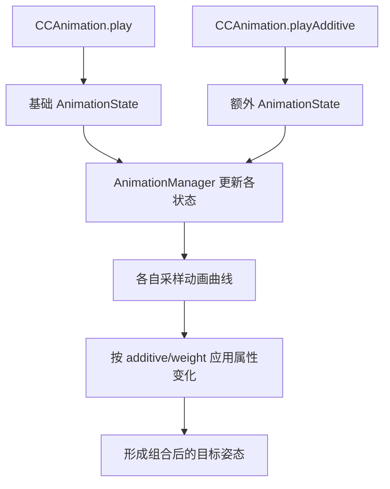

# 第 75 课：Creator 2.4.15 动画组合与过渡

**本课问题：** 各版本怎样组合、叠加或过渡动画？

## 本版路径

Animation.playAdditive 启动额外 AnimationState。

## 源码位置

- [`CCAnimation.js`](<../../engine/2.4.15engine/cocos2d/core/components/CCAnimation.js>)：对应 Animation.playAdditive 启动额外 AnimationState。
- [`animation-state.js`](<../../engine/2.4.15engine/cocos2d/animation/animation-state.js>)：对应 Animation.playAdditive 启动额外 AnimationState。
- [`playable.js`](<../../engine/2.4.15engine/cocos2d/animation/playable.js>)：对应 Animation.playAdditive 启动额外 AnimationState。

前置主题：[动作与时间推进](../s34_action_modifiers/README.md)。

## 为什么这样设计

基础状态和 additive 状态分别保留自己的时间与权重，允许在当前动画上叠加额外变化；这和直接替换当前播放状态不同。

## 源码流程图

## 本课必须保留的机制

保留基础动画状态与 additive 状态并存、各自具有权重的机制；源码主题是 `Animation.playAdditive` 启动额外 `AnimationState`，不是简单替换当前状态。

## 最小观察宿主

`src/main.ts` 一次调用 `runLesson()`，输出 base 与 additive 状态的采样值、权重、时间和合成数值；无需场景或交互。

## 模型化简化与 Creator Runtime 边界

课程代码保留一个 base 状态和多个 additive 状态，各自推进时间；示例将 base 采样值与按权重缩放的 additive 采样值相加，展示“叠加”对目标数值的影响。它用固定采样值替代真实曲线采样，不接入 Creator Runtime 的 `AnimationManager` 和属性曲线系统。

## 运行

~~~sh
deno task check
deno task build
deno task serve
~~~

打开 `http://127.0.0.1:8000`，页面列出本课的时间、采样或事件结果。
