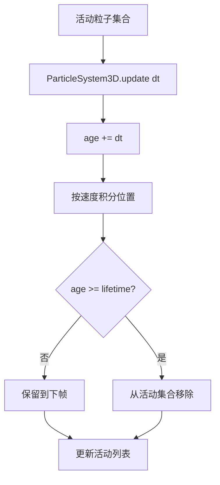

# 第 77 课：Creator 2.4.15 粒子模拟与生命周期

**本课问题：** 粒子如何逐帧更新并到期回收？

## 本版路径

ParticleSystem3D 推进粒子 age/remainingLifetime，并更新位置和存活集合。

## 源码位置

- [`particle-system-3d.ts`](<../../engine/2.4.15engine/cocos2d/core/3d/particle/particle-system-3d.ts>)：ParticleSystem3D 推进粒子 age/remainingLifetime，并更新位置和存活集合。
- [`particle.ts`](<../../engine/2.4.15engine/cocos2d/core/3d/particle/particle.ts>)：ParticleSystem3D 推进粒子 age/remainingLifetime，并更新位置和存活集合。

前置课程：[第 49 课：粒子绘制与结束](<../s49_particle_render_finish/README.md>)。

## 为什么这样设计

每个粒子保存自身年龄、寿命和运动状态，System 在同一帧推进它们并移除过期项。这样发射器与属性模块可以只处理活动粒子，不必各自管理生命周期。

## 源码流程图

## 本课必须保留的机制

保留每步推进粒子 `age`、按速度积分位置，以及超出 `lifetime` 后从存活集合移除的顺序。

## 最小观察宿主

[`src/main.ts`](<src/main.ts>) 一次调用 `runLesson()`，只做固定 `dt=0.2s` 的一步更新并打印存活数和位置；无需场景或帧循环。

## 模型化简化与 Creator Runtime 边界

代码按力更新速度、阻尼、再积分位置的顺序推进年龄与运动，超时粒子从活动列表移入池；之后 spawn 可复用记录。示例采用显式 Euler 和简单数组池，Creator 粒子模拟还运行多个 Animator 模块并使用自己的存储/回收路径。
## 运行

~~~sh
deno task check
deno task build
deno task serve
~~~

打开 `http://127.0.0.1:8000`，页面展示发射数量、存活状态或粒子顶点数。
