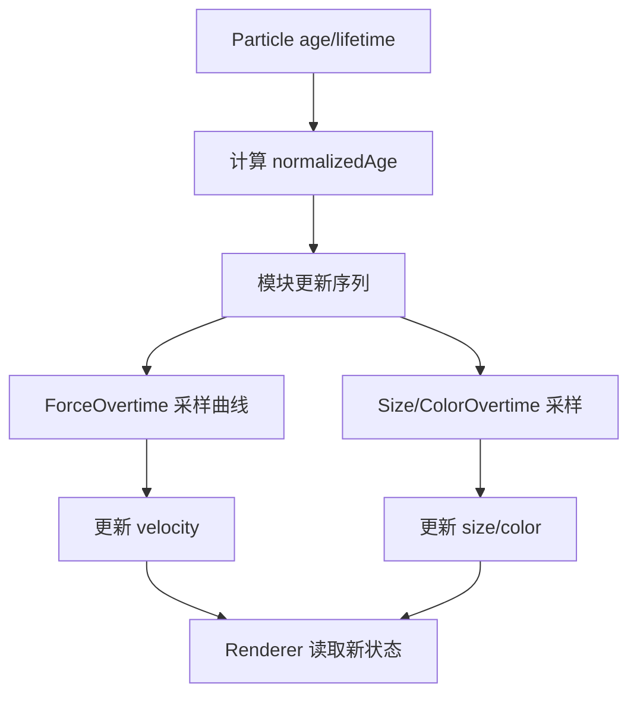

# 第 78 课：Creator 2.4.15 粒子属性模块与曲线

**本课问题：** 随时间变化的模块如何修改粒子状态？

## 本版路径

ForceOvertime 与 ColorOvertime 等模块按系统归一化时间修改粒子。

## 源码位置

- [`particle-system-3d.ts`](<../../engine/2.4.15engine/cocos2d/core/3d/particle/particle-system-3d.ts>)：ForceOvertime 与 ColorOvertime 等模块按系统归一化时间修改粒子。
- [`force-overtime.ts`](<../../engine/2.4.15engine/cocos2d/core/3d/particle/animator/force-overtime.ts>)：ForceOvertime 与 ColorOvertime 等模块按系统归一化时间修改粒子。
- [`color-overtime.ts`](<../../engine/2.4.15engine/cocos2d/core/3d/particle/animator/color-overtime.ts>)：ForceOvertime 与 ColorOvertime 等模块按系统归一化时间修改粒子。

前置课程：[第 49 课：粒子绘制与结束](<../s49_particle_render_finish/README.md>)。

## 为什么这样设计

属性模块以归一化生命周期作为统一输入，Force、Color 等模块各自负责一类属性变化。模块化让同一个粒子更新管线可按配置组合，而不用把所有效果写进一个大循环。

## 源码流程图

## 本课必须保留的机制

保留归一化寿命 `age/lifetime` 作为模块输入，以及力、尺寸、颜色随粒子时间更新的职责区别。

## 最小观察宿主

[`src/main.ts`](<src/main.ts>) 一次调用 `runLesson()`，用单个粒子和固定 `dt` 打印速度、尺寸与颜色；无需场景或帧循环。

## 模型化简化与 Creator Runtime 边界

课程代码实现分段曲线采样、按归一化年龄施加随时间变化的力，并更新粒子尺寸和颜色通道。它以单个粒子演示模块职责，不接入 Runtime 粒子调度，也不创建 GPU 资源。

## 运行

~~~sh
deno task check
deno task build
deno task serve
~~~

打开 `http://127.0.0.1:8000`，页面展示发射数量、存活状态或粒子顶点数。
