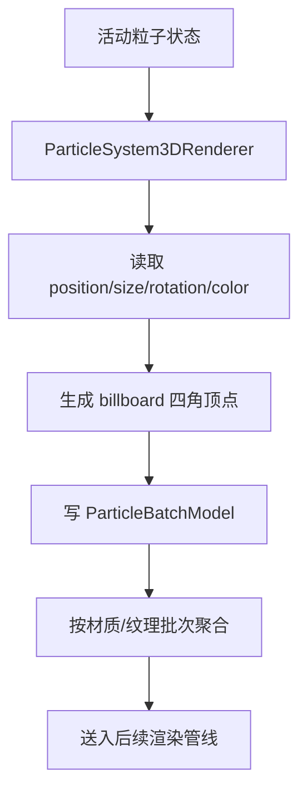

# 第 79 课：Creator 2.4.15 粒子渲染与批次

**本课问题：** 活动粒子如何变成各版本自己的绘制数据？

## 本版路径

ParticleSystem3DRenderer 把粒子交给 ParticleBatchModel 形成模型数据。

## 源码位置

- [`particle-system-3d-renderer.ts`](<../../engine/2.4.15engine/cocos2d/core/3d/particle/renderer/particle-system-3d-renderer.ts>)：ParticleSystem3DRenderer 把粒子交给 ParticleBatchModel 形成模型数据。
- [`particle-batch-model.ts`](<../../engine/2.4.15engine/cocos2d/core/3d/particle/renderer/particle-batch-model.ts>)：ParticleSystem3DRenderer 把粒子交给 ParticleBatchModel 形成模型数据。

前置课程：[第 49 课：粒子绘制与结束](<../s49_particle_render_finish/README.md>)。

## 为什么这样设计

模拟器只产生活动粒子状态，Renderer 才把它们转换成 billboard 顶点并组织批次。分离后，粒子模拟不必知道相机、材质和 GPU 缓冲细节。

## 源码流程图

## 本课必须保留的机制

保留活动粒子逐个变成 billboard 四边形顶点，并由 `ParticleSystem3DRenderer` 汇入批次模型的概念链路。

## 最小观察宿主

[`src/main.ts`](<src/main.ts>) 一次调用 `runLesson()`，用两个数值粒子计算四角数量并写日志；没有场景、相机或渲染循环。

## 模型化简化与 Creator Runtime 边界

课程代码将每个粒子展开为带 UV/颜色的四边形顶点和 6 个索引，并按材质聚合批次。它不接入真实 assembler、MeshBuffer 上传、RenderFlow 或 WebGL 绘制，也不创建 GPU 资源。

## 运行

~~~sh
deno task check
deno task build
deno task serve
~~~

打开 `http://127.0.0.1:8000`，页面展示发射数量、存活状态或粒子顶点数。
