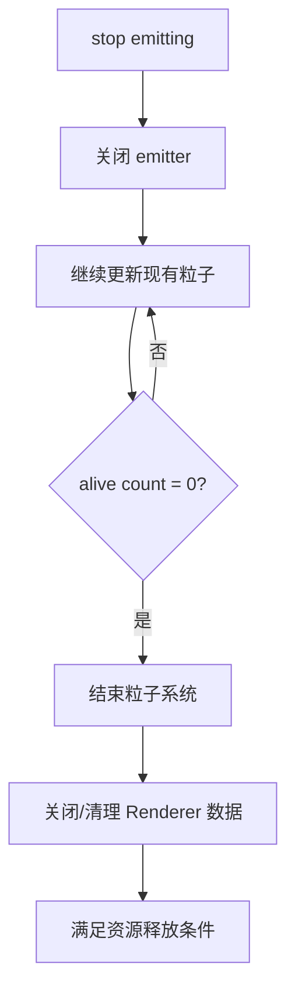

# 第 80 课：Creator 2.4.15 停止发射与资源回收

**本课问题：** 停止发射后如何处理存活粒子和资源？

## 本版路径

停止新发射后继续模拟剩余粒子，粒子清空后结束渲染。

## 源码位置

- [`particle-system-3d.ts`](<../../engine/2.4.15engine/cocos2d/core/3d/particle/particle-system-3d.ts>)：停止新发射后继续模拟剩余粒子，粒子清空后结束渲染。
- [`particle-system-3d-renderer.ts`](<../../engine/2.4.15engine/cocos2d/core/3d/particle/renderer/particle-system-3d-renderer.ts>)：停止新发射后继续模拟剩余粒子，粒子清空后结束渲染。

前置课程：[第 49 课：粒子绘制与结束](<../s49_particle_render_finish/README.md>)。

## 为什么这样设计

停止发射只改变生产状态，不应直接丢弃仍在飞行的粒子。系统等活动集合排空后再结束渲染和释放关联资源，保证停止效果自然收尾。

## 源码流程图

## 本课必须保留的机制

保留停止新发射后继续推进既有粒子的寿命，并仅在存活集合清空后满足资源释放条件；停止发射不等于立即销毁系统。

## 最小观察宿主

[`src/main.ts`](<src/main.ts>) 一次调用 `runLesson()`，用固定粒子和一步 `dt=0.2s` 展示停止发射后的排空状态；无需场景或帧循环。

## 模型化简化与 Creator Runtime 边界

课程代码停止发射后持续推进存活粒子，移除过期粒子，并在发射已停止且存活数归零时进入 released 终态。这个终态只表示生命周期状态，不接入 Runtime ParticleSystem3D/Renderer 的资源释放，也不创建 GPU 资源。

## 运行

~~~sh
deno task check
deno task build
deno task serve
~~~

打开 `http://127.0.0.1:8000`，页面展示发射数量、存活状态或粒子顶点数。
