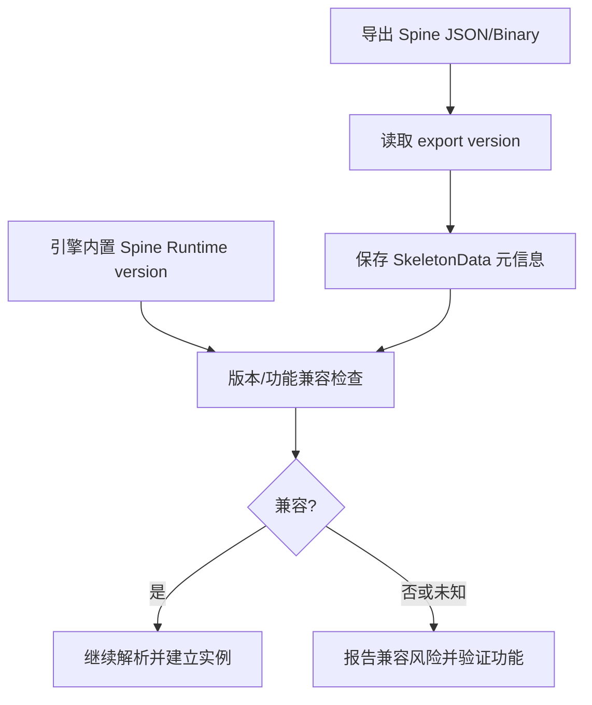

# 第 81 课：Creator 2.4.15 Runtime 与导出资源版本兼容

**本课问题：** 导出的 Spine 数据格式和版本如何与本版 Runtime 对接？

## 本版实现

解析器保存导出版本信息；单独比较导出器与本版 Runtime，不能把解析成功当作兼容证明。

## 源码位置

- [spine.js](../../engine/2.4.15engine/extensions/spine/lib/spine.js)：重点查看 SkeletonJson.readSkeletonData、SkeletonBinary.readSkeletonData。
- [skeleton-data.js](../../engine/2.4.15engine/extensions/spine/skeleton-data.js)：重点查看 getRuntimeData。

本阶段从 Runtime 版本检查开始。

## 为什么这样设计

导出器和 Runtime 的版本分别记录，解析成功只证明数据结构能读，不证明全部功能语义受支持。显式比较版本和功能能力，能尽早发现升级不兼容。

## 源码流程图

## 本课必须保留的机制

保留导出器版本与 Runtime 版本分开记录、分别比较的规则；“资源能解析”不能单独证明格式与功能兼容。缓存播放模式与实时模式的能力差异也必须分开说明。

## 最小观察宿主

[`src/main.ts`](<src/main.ts>) 一次调用 `runLesson()`，将版本元数据写入浏览器 `#log`；没有场景或帧循环。

## 模型化简化与 Creator Runtime 边界

代码分别检查 JSON/Binary 读取器是否存在、必要 skeleton payload/Atlas 是否具备，以及导出版本线是否符合内置 Runtime。Creator 2.4.15 本地 spine.js 标识 Runtime 3.8；本检查只是快速诊断，Binary 版本头用已解码字段替代真实解析，版本匹配也不能证明资源一定能读或功能完全兼容。
## 运行

~~~sh
deno task check
deno task build
deno task serve
~~~

打开 http://127.0.0.1:8000 查看本课输出。
