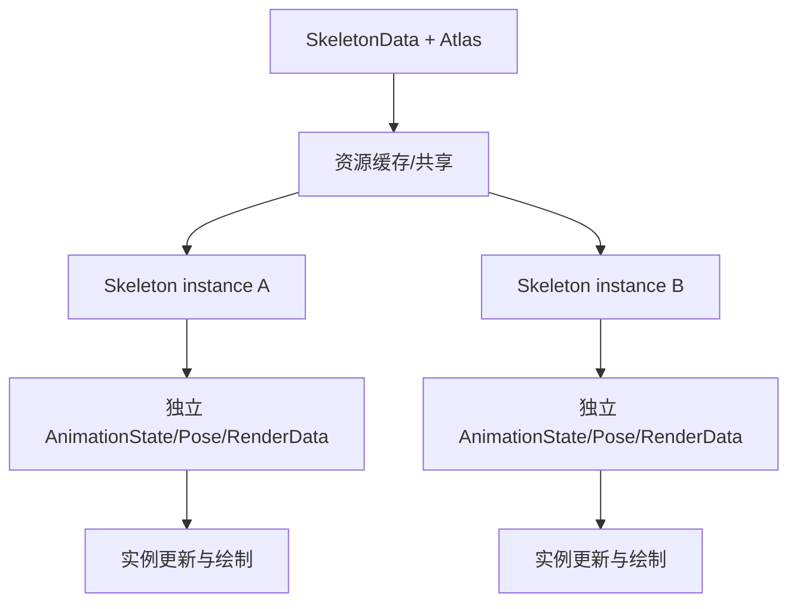

# 第 82 课：Creator 2.4.15 SkeletonData、Atlas 与实例所有权

**本课问题：** 哪些数据可以共享，哪些状态必须由 Skeleton 实例独占？

## 本版实现

SkeletonData / Atlas 或资源缓存可以跨实例共享；动画状态、当前姿态和渲染数据属于实例。

## 源码位置

- [skeleton-data.js](../../engine/2.4.15engine/extensions/spine/skeleton-data.js)：重点查看 getRuntimeData、destroy。
- [Skeleton.js](../../engine/2.4.15engine/extensions/spine/Skeleton.js)：重点查看 setSkeletonData、setAnimationCacheMode。
- [skeleton-cache.js](../../engine/2.4.15engine/extensions/spine/skeleton-cache.js)：重点查看 getSkeletonCache。

## 为什么这样设计

SkeletonData/Atlas 是可共享的静态资源，Skeleton 持有每个角色实例独有的姿态与渲染状态。共享和独占边界能避免多个角色播放动画时互相覆盖。

## 源码流程图

## 本课必须保留的机制

保留 SkeletonData/Atlas 或资源缓存可跨实例共享，而动画状态、姿态和渲染数据必须由各 Skeleton 实例独占的边界。

## 最小观察宿主

[`src/main.ts`](<src/main.ts>) 一次调用 `runLesson()`，将对象共享/独占关系写入页面 `#log`；不需要场景、按钮或帧循环。

## 模型化简化与 Creator Runtime 边界

课程代码用共享 `SkeletonData`/runtime cache 保存只读骨骼描述，并为不同实例分配各自的姿态与渲染数组，展示共享资源和实例状态的所有权边界。它不加载真实 Atlas/SkeletonData，也不调用 Spine Runtime 的 `getRuntimeData`。

## 运行

~~~sh
deno task check
deno task build
deno task serve
~~~

打开 `http://127.0.0.1:8000` 查看页面日志。前置课程：[第 81 课](../s81_spine_runtime_compatibility/README.md)。
