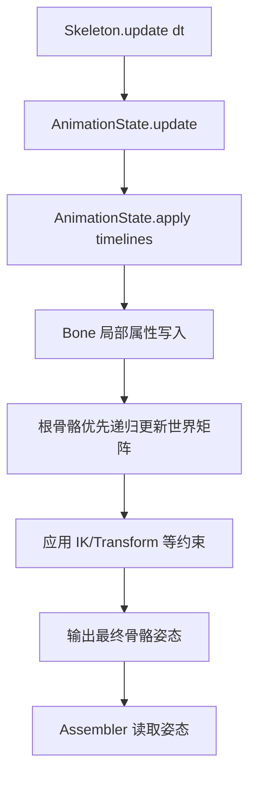

# 第 84 课：Creator 2.4.15 帧更新、骨骼层级与约束

**本课问题：** 每帧如何从动画时间推进到骨骼世界变换？

## 本版实现

从帧调度进入动画状态，再应用时间线并更新世界变换；Creator 3.8 由 SkeletonSystem.postUpdate 调度。

## 源码位置

- [Skeleton.js](../../engine/2.4.15engine/extensions/spine/Skeleton.js)：重点查看 update、_updateRealtime、updateWorldTransform。
- [spine.js](../../engine/2.4.15engine/extensions/spine/lib/spine.js)：重点查看 Bone.updateWorldTransform。

## 为什么这样设计

每帧先推进状态和应用时间线，再按骨骼父子顺序计算世界变换；约束在姿态数据上工作。保持阶段顺序，子骨骼和约束才能读取本帧最新局部姿态。

## 源码流程图

## 本课必须保留的机制

保留帧更新的职责顺序：推进 AnimationState、应用时间线、再计算骨骼世界变换；父子层级的局部变换需要组合成世界位置。

## 最小观察宿主

[`src/main.ts`](<src/main.ts>) 一次调用 `runLesson()`，打印更新顺序与一个父子 X 值示例；没有真实帧循环。

## 模型化简化与 Creator Runtime 边界

课程代码按父子层级组合位置、旋转和缩放，再运行一个示例旋转约束修正骨骼世界角度。它是二维教学变换，不包含 Spine 矩阵/skew/继承模式和完整约束求解，也不接入 2.4 的 `Skeleton.update → _updateRealtime → updateWorldTransform` 帧链；3.8 `SkeletonSystem.postUpdate` 只作版本对照。

## 运行

~~~sh
deno task check
deno task build
deno task serve
~~~

打开 `http://127.0.0.1:8000` 查看页面日志。前置课程：[第 83 课](../s83_spine_animation_state/README.md)。
