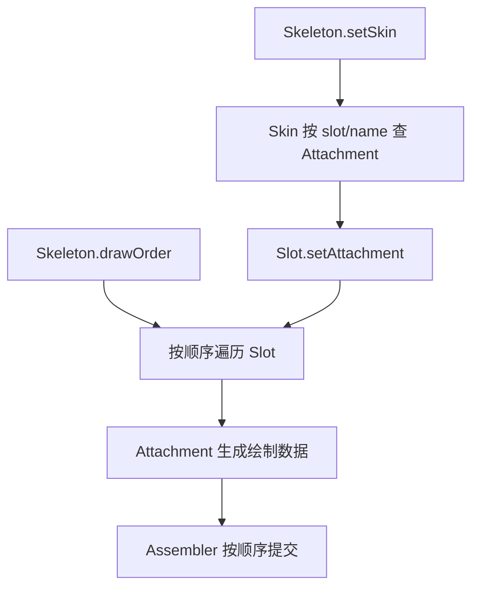

# 第 85 课：Creator 2.4.15 Skin、Slot、Attachment 与绘制顺序

**本课问题：** Skin 如何选附件，Slot 顺序如何决定绘制顺序？

## 本版实现

Skin 为 Slot 选择 Attachment，drawOrder 决定遍历顺序。

## 源码位置

- [Skeleton.js](../../engine/2.4.15engine/extensions/spine/Skeleton.js)：重点查看 setSkin、setSlotsToSetupPose。
- [spine.js](../../engine/2.4.15engine/extensions/spine/lib/spine.js)：重点查看 drawOrder、Skin.getAttachment、Slot.setAttachment。

## 为什么这样设计

Skin 负责按 Slot 名称提供附件，Slot 保存当前附件；Skeleton 的 drawOrder 独立决定 Slot 遍历次序。内容选择与前后绘制顺序分开，换皮和排序就不会混为一件事。

## 源码流程图

## 本课必须保留的机制

保留 Skin 为 Slot 选择 Attachment，以及 `drawOrder` 决定 Slot 遍历顺序的关系；两者分别影响显示内容与绘制先后。

## 最小观察宿主

[`src/main.ts`](<src/main.ts>) 一次调用 `runLesson()`，打印一个附件选择和 Slot 顺序；不需要场景或帧循环。

## 模型化简化与 Creator Runtime 边界

课程代码实现 Skin 的附件映射、Slot 的当前附件选择、区域附件顶点生成和独立 drawOrder 排序。它用普通对象表达数据关系，不解析 Spine 文件，也不调用 Runtime Skeleton 或 assembler。

## 运行

~~~sh
deno task check
deno task build
deno task serve
~~~

打开 `http://127.0.0.1:8000` 查看页面日志。前置课程：[第 84 课](../s84_spine_pose_update/README.md)。
