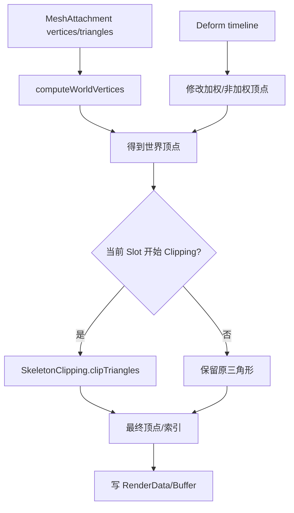

# 第 86 课：Creator 2.4.15 网格附件、Deform 与 Clipping

**本课问题：** 附件如何生成几何，哪些版本支持网格与裁剪？

## 本版实现

MeshAttachment 生成几何；Deform 修改顶点，Clipping 会生成裁剪后的三角形。

## 源码位置

- [spine-assembler.js](../../engine/2.4.15engine/extensions/spine/spine-assembler.js)：重点查看 updateRenderData、computeWorldVertices、clipTriangles。
- [spine.js](../../engine/2.4.15engine/extensions/spine/lib/spine.js)：重点查看 MeshAttachment、SkeletonClipping。

## 为什么这样设计

网格附件负责拓扑和局部顶点，Deform 可按动画修改顶点，Clipping 再按裁剪多边形裁切三角形。先得到最终几何再上传，避免 GPU 收到未裁剪数据。

## 源码流程图

## 本课必须保留的机制

保留 MeshAttachment 提供顶点/三角形、Deform 修改顶点、Clipping 在上传前产生裁剪几何的先后关系。

## 最小观察宿主

[`src/main.ts`](<src/main.ts>) 一次调用 `runLesson()`，打印网格计数及 Deform/Clipping 标签；不需要场景或帧循环。

## 模型化简化与 Creator Runtime 边界

课程代码先将 deform 偏移和节点平移应用到 MeshAttachment 顶点，再按三角形索引组装世界几何，并用 Sutherland–Hodgman 矩形裁剪算法裁切三角形。矩形裁剪是为讲解裁剪顺序所作的简化，不等同于 Spine 的多边形 SkeletonClipping，也不生成 GPU Buffer。

## 运行

~~~sh
deno task check
deno task build
deno task serve
~~~

打开 `http://127.0.0.1:8000` 查看页面日志。前置课程：[第 85 课](../s85_spine_slots_attachments/README.md)。
