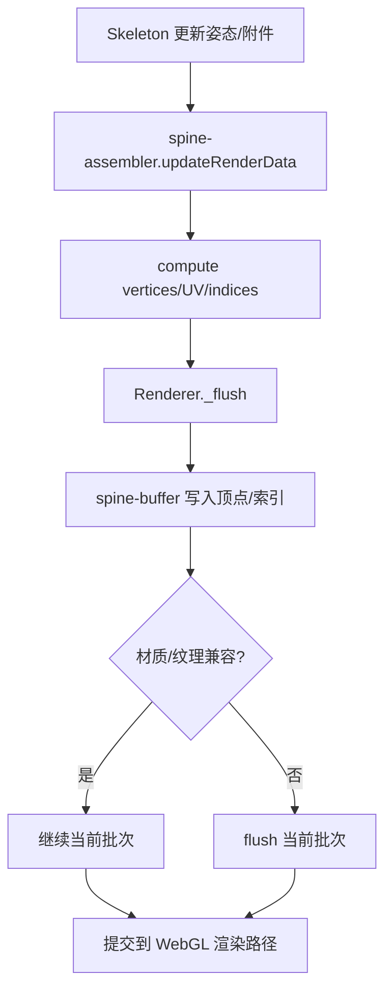

# 第 87 课：Creator 2.4.15 引擎渲染接线与批次

**本课问题：** Spine 几何如何进入各版本自己的渲染路径？

## 本版实现

各版保留自己的渲染提交链路与边界。

## 源码位置

- [spine-assembler.js](../../engine/2.4.15engine/extensions/spine/spine-assembler.js)：重点查看 updateRenderData、Renderer._flush。
- [spine-buffer.js](../../engine/2.4.15engine/cocos2d/core/renderer/webgl/spine-buffer.js)：重点查看 spine buffer 顶点/索引上传。

## 为什么这样设计

Spine Runtime 输出的是几何和材质需求，Assembler 把它接到 Creator 的渲染缓冲；批次边界由材质/纹理兼容性决定。Runtime 与 WebGL 提交分层后可复用引擎渲染设施。

## 源码流程图

## 本课必须保留的机制

保留 Spine assembler 更新渲染数据、写入 Spine buffer，并在材质/纹理边界刷新当前批次的提交职责。

## 最小观察宿主

[`src/main.ts`](<src/main.ts>) 一次调用 `runLesson()`，打印 assembler→MeshBuffer→WebGL 的概念路径与 flush 边界；页面不创建真实渲染对象。

## 模型化简化与 Creator Runtime 边界

课程代码合并相同纹理/材质的网格，将局部索引重映射到批次顶点数组，并在纹理或材质变化及结束时 flush。它不执行真实 assembler、MeshBuffer 上传、`Renderer._flush` 或 WebGL 绘制。

## 运行

~~~sh
deno task check
deno task build
deno task serve
~~~

打开 `http://127.0.0.1:8000` 查看页面日志。前置课程：[第 86 课](../s86_spine_mesh_clipping/README.md)。
