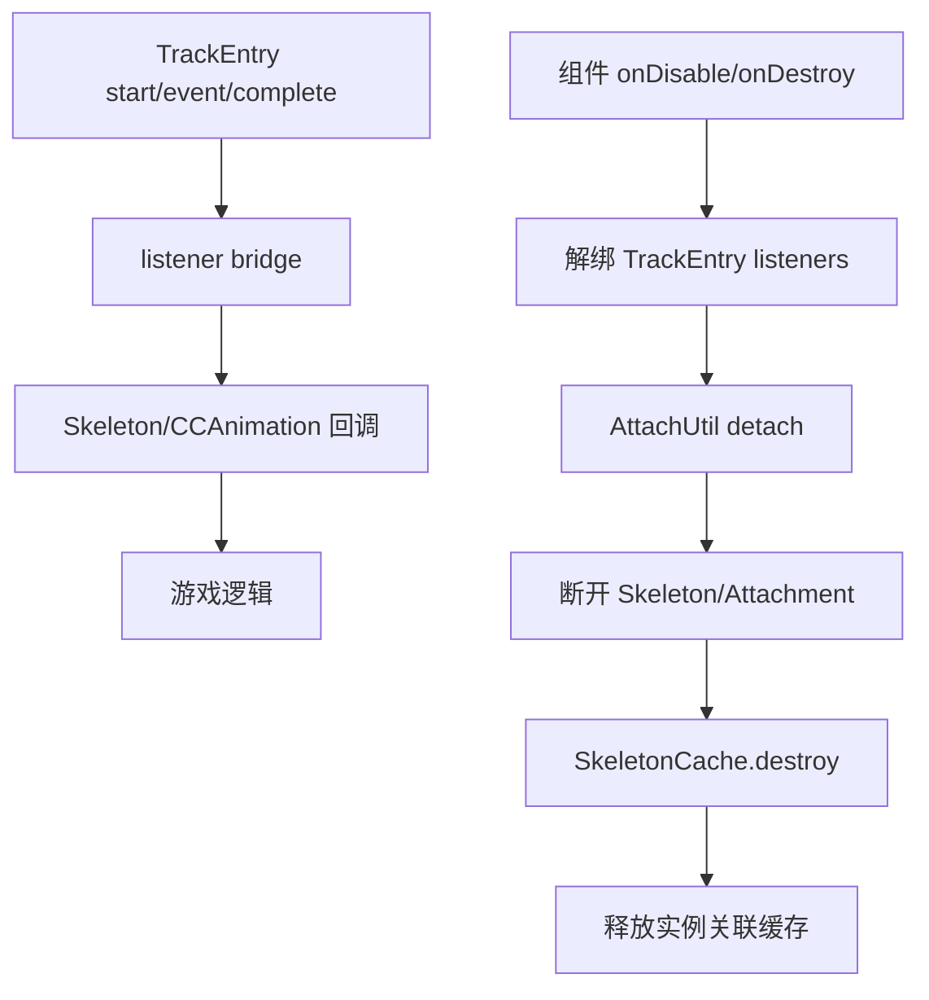

# 第 88 课：Creator 2.4.15 事件、调试观察与退出清理

**本课问题：** 事件如何回到游戏层，节点退出时由谁释放资源？

## 本版实现

回调通知游戏层；组件退出时解绑监听并释放实例缓存或渲染数据。

## 源码位置

- [track-entry-listeners.js](../../engine/2.4.15engine/extensions/spine/track-entry-listeners.js)：重点查看 setEventListener、setCompleteListener。
- [AttachUtil.js](../../engine/2.4.15engine/extensions/spine/AttachUtil.js)：重点查看 AttachUtil 的挂接和解绑。
- [skeleton-cache.js](../../engine/2.4.15engine/extensions/spine/skeleton-cache.js)：重点查看 SkeletonCache.destroy。

## 为什么这样设计

TrackEntry 回调把动画语义交还游戏层，AttachUtil 和缓存管理负责节点退出后的解绑与资源关联清理。把通知和所有权清理拆开，能避免动画结束与节点销毁后残留监听。

## 源码流程图

## 本课必须保留的机制

保留 TrackEntry 的 start/event/complete 回调返回游戏逻辑，以及节点退出时解绑监听、断开运行时实例并释放缓存关联的生命周期边界。

## 最小观察宿主

[`src/main.ts`](<src/main.ts>) 一次调用 `runLesson()`，打印回调名称和清理说明；没有 Spine 组件、事件触发器或场景帧循环。

## 模型化简化与 Creator Runtime 边界

代码把 TrackEntry 的 event/complete/dispose 通知排队，并在 lateUpdate drain；onDisable 保留可重启实例，onDestroy 清监听、清事件队列并释放组件持有的引用。缓存引用只是讲解计数；Creator 的 Skeleton.js、AttachUtil、SkeletonCache 会按 REALTIME/SHARED_CACHE/PRIVATE_CACHE 执行不同实例和数据清理。
## 运行

~~~sh
deno task check
deno task build
deno task serve
~~~

打开 `http://127.0.0.1:8000` 查看页面日志。前置课程：[第 87 课](../s87_spine_render_submission/README.md)。
