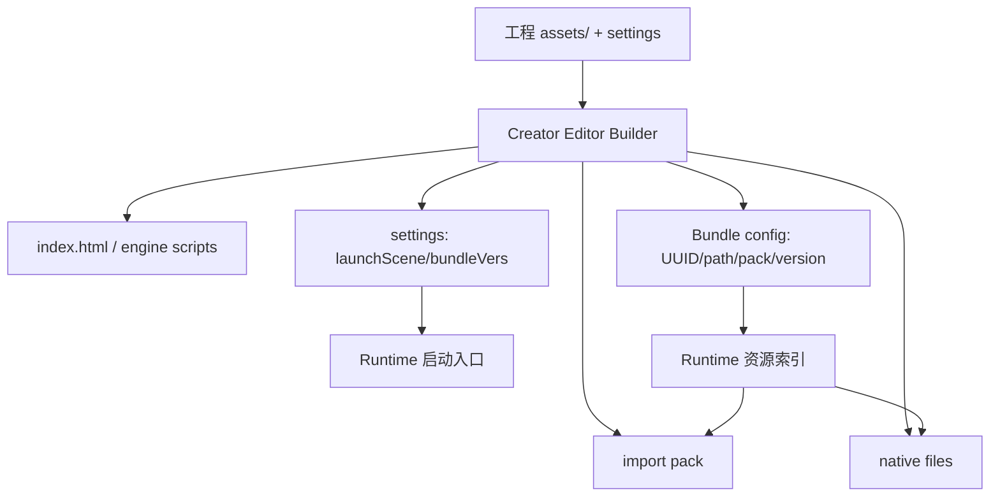

# 第 89 课：先看懂 Web 构建目录

**本课目标：** 打开一份已经构建好的 Web 项目，指出“页面入口、启动设置、资源索引、资源文件”各是什么。现在先认位置，不需要理解 UUID 怎么生成。

## 先区分工程目录和构建目录

- `2.4NewProject/assets/` 是工程输入：场景、图片和 `.meta` 在这里。
- `2.4NewProject/build/web-mobile/` 是构建输出：浏览器运行时读取这里的脚本、索引和资源文件。
- `engine/2.4.15engine/` 是 Runtime 源码快照：它解释“运行时怎样读取输出”，不是完整 Editor Builder。

构建不是把一张 PNG 原样复制过去。它还会生成 `config` 索引，把资源 UUID 和文件位置关联起来；部分序列化数据会合并进 import pack，图片等文件会单独放进 native。

## 按文件走一遍

打开 `2.4NewProject/build/web-mobile/`，按下表逐个确认：

| 文件 | 打开后找什么 | 这一步说明什么 |
| --- | --- | --- |
| `index.html` | 页面加载的脚本入口 | 浏览器从哪个页面启动 |
| `src/settings.ebd7d.js` | `launchScene`、`bundleVers` | 首场景工程路径；各 Bundle 配置文件的版本后缀 |
| `assets/main/config.a9f01.json` | `scenes`、`uuids`、`packs`、`versions` | 主 Bundle 的索引，不是场景内容本身 |
| `assets/main/import/05/05dd1dc0e.29693.json` | 文件存在即可，本课先不拆内容 | 一个 import pack；里面可包含多个序列化资源 |
| `assets/main/native/6a/6aa0aa6a-ebee-4155-a088-a687a6aadec4.a4b27.png` | 文件后缀 `.png` | 独立图片文件；下一课会追它的 UUID |

在本次输出里，`launchScene` 是 `db://assets/Scene/helloworld.fire`；`bundleVers.main` 是 `a9f01`，`bundleVers.BundleMain` 是 `42389`，所以运行时分别使用对应的 `config.<hash>.json`。这里先记住这两个事实，场景索引到 pack 的具体计算留给第 93 课。

### `import` 和 `native` 是什么意思？

这里的 `import` 不是 TypeScript 的 `import` 语句。它指引擎序列化后保存的资源数据，例如场景和 Prefab。`native` 指单独保存、由对应资源加载器处理的数据，例如 PNG；它不等于“只在手机本地运行”。一个 pack 文件可以装多个 Asset，所以“一个 Asset”不一定对应“一个下载文件”。

## 再读本课代码

1. `src/example-build.ts` 是从当前构建目录核对后抄出的文件清单，并记录页面启动、引擎、Bundle config、脚本、import/native 之间的已知关系。
2. `BundleOutputMap` 检查重复路径、缺失映射引用和必需入口，按角色分组，并生成目录树。
3. `src/main.ts` 显示目录树、角色统计、引用校验结果和逐文件说明。

这段代码**不扫描目录，也不构建项目**。映射校验只能验证清单内部一致，不能证明磁盘文件存在；你仍需回到 `build/web-mobile/` 核对映射路径。构建哈希会随内容变化，清单只对应仓库中当前保存的构建快照。

## 对照 2.4.15 Runtime 源码

- [CCAssetManager.js](../../engine/2.4.15engine/cocos2d/core/asset-manager/CCAssetManager.js)：看 `loadBundle` 如何进入 Bundle 加载。
- [bundle.js](../../engine/2.4.15engine/cocos2d/core/asset-manager/bundle.js)：看 `loadScene` 如何按场景名发起请求。
- [config.js](../../engine/2.4.15engine/cocos2d/core/asset-manager/config.js)：从 `_initScene`、`_initUuid` 看运行时如何把 config 建成查找表。

**证据边界：** 以上源码说明 Runtime 如何使用 config；它不包含完整 Editor Builder，所以本课不声称复刻了构建过程。

## 为什么这样设计

构建输出把入口、启动配置、资源索引和资源文件分开。先认清这些产物，才能在后续课程判断 Runtime 是查表、读 pack，还是请求 native 文件；源码快照本身并不包含完整 Builder。

## 源码流程图

## 本课必须保留的机制

保留构建目录中页面入口、启动设置、Bundle Config、import pack 和 native 文件的角色区分；Config 是索引，不是资源内容，Asset 与下载文件也不能一一等同。

## 最小观察宿主

对照真实 `2.4NewProject/build/web-mobile/` 文件清单，并用 `example-build.ts → BundleOutputMap → main.ts` 将文件角色显示在页面；不需启动项目场景。

## 模型化简化与 Creator Runtime 边界

课程清单是手工摘录，页面只格式化并展示，不扫描磁盘、不发起加载、不执行 Editor Builder。Runtime 源码说明如何消费 Config；完整构建生成阶段不在本地 Runtime 快照内。

## 学完后自查

不看课程代码，自己指出 `settings`、`config`、import pack、PNG 各在哪里。然后用一句话说明：哪个文件是“索引”，哪个文件才是“资源数据”？下一课从 `.meta` 找 UUID 的来历。

运行方式：在本课目录执行 `deno task check`、`deno task build`、`deno task serve`。
