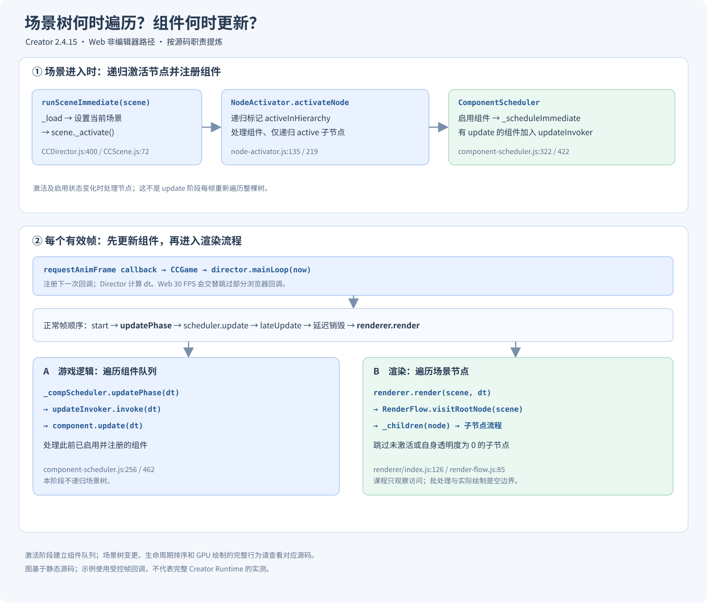

# 第 01 课：场景激活、逐帧更新与场景树遍历

> 场景激活时递归节点并注册组件；每帧先更新组件队列，再为渲染遍历场景树。

**本课问题：** 场景里的组件如何进入每帧 `update(dt)`？引擎又在哪里遍历场景树？

以 Creator **2.4.15 Web 非编辑器运行时**为依据。源码结论来自本地静态阅读；示例以受控帧回调和空渲染边界演示流程，不是完整 Creator Runtime。



## 一条场景激活链，两条每帧路径

```text
场景进入：
  director.runSceneImmediate(scene)
    → scene._load() → 设置当前场景 → scene._activate()
      → NodeActivator.activateNode(scene, true)
        → 递归场景节点、激活组件 → ComponentScheduler 注册 update

每帧：
  CCGame._runMainLoop 的 callback → director.mainLoop(now)
    → startPhase → updatePhase → updateInvoker → 组件.update(dt)
    → scheduler.update → lateUpdatePhase → 延迟销毁
    → renderer.render(scene, dt)
      → RenderFlow.visitRootNode(scene) → _children(node) → 子节点
```

组件的 `update` 阶段遍历的是**已注册组件队列**，不是每帧递归场景树。渲染路径从当前场景根节点进入 `RenderFlow`，才递归处理子节点。节点激活时的递归与渲染时的递归用途不同。

## 1. 场景如何把组件交给调度器？

[CCDirector.js:400](../../engine/2.4.15engine/cocos2d/core/CCDirector.js#L400) 的 `runSceneImmediate` 初始化场景，处理常驻节点与旧场景、设置当前场景，再调用 `scene._activate()`；[CCScene.js:72](../../engine/2.4.15engine/cocos2d/core/CCScene.js#L72) 把场景交给 `NodeActivator`。

[NodeActivator](../../engine/2.4.15engine/cocos2d/core/node-activator.js#L135) 设置节点 `_activeInHierarchy`，处理组件，再递归自身 `_active` 为真的子节点。递归结束后依次执行 `__preload`、`onLoad` 和 `onEnable` 队列。组件启用后，[ComponentScheduler](../../engine/2.4.15engine/cocos2d/core/component-scheduler.js#L322) 将带 `update` 的组件加入 `updateInvoker`；帧更新中启用的组件会先进入延迟队列。

课程实现：[CCScene.ts](src/CCScene.ts)、[NodeActivator.ts](src/NodeActivator.ts)、[component-scheduler.ts](src/component-scheduler.ts)。

## 2. 每帧如何调用游戏逻辑？

[CCGame.js:373](../../engine/2.4.15engine/cocos2d/core/CCGame.js#L373) 注册浏览器帧回调；回调在 game 未暂停时先安排下一帧，再进入 Director。Web 30 FPS 分支会交替跳过部分浏览器回调。

[CCDirector.js:103](../../engine/2.4.15engine/cocos2d/core/CCDirector.js#L103) 计算 `dt`，在未暂停时依次执行 `start`、`update`、普通 Scheduler 和 `lateUpdate`，随后处理延迟销毁；渲染发生在更新阶段之后。`dt` 由帧时间差换算为秒，非正差值归零；Debug 下超过 1 秒时使用 `1/60`，见 [calculateDeltaTime](../../engine/2.4.15engine/cocos2d/core/CCDirector.js#L204)。

[component-scheduler.js:462](../../engine/2.4.15engine/cocos2d/core/component-scheduler.js#L462) 的 `updatePhase(dt)` 调用 `updateInvoker.invoke(dt)`，最终执行队列中各组件的 [`update(dt)`](../../engine/2.4.15engine/cocos2d/core/component-scheduler.js#L256)。

课程实现：[CCGame.ts](src/CCGame.ts)、[CCDirector.ts](src/CCDirector.ts)、[component-scheduler.ts](src/component-scheduler.ts)。

## 3. 每帧在哪里遍历场景树？

Director 调用 [renderer.render](../../engine/2.4.15engine/cocos2d/core/renderer/index.js#L126)，场景存在时进入 `RenderFlow.render` 和 [visitRootNode](../../engine/2.4.15engine/cocos2d/core/renderer/render-flow.js#L214)。渲染标记选择相应流程；当处理子节点时，[RenderFlow._children](../../engine/2.4.15engine/cocos2d/core/renderer/render-flow.js#L85) 遍历 `_children`，跳过未激活或自身透明度为 0 的子节点，再进入每个子节点的渲染流程。

课程的 [render-flow.ts](src/render-flow.ts) 保留入口、根节点访问、子节点递归及跳过条件；`visitRenderNode` 只记录流程访问，不表示节点实际产生了 draw call。

## 运行与核对

在本课目录运行：

```sh
deno run src/main.ts
deno test tests
```

`main.ts` 创建一个场景与 Player 节点，通过 `runSceneImmediate` 激活并注册组件，然后提供两个帧时间戳。每帧先输出 `Player.update(0.016)`，再输出渲染流程访问 `Scene` 与 `Player`。场景加载和浏览器帧回调由示例提供；没有真实绘制。

## 精简边界

- `runSceneImmediate` 保留加载、旧场景/常驻节点处理、切换、激活、恢复和事件的位置；场景初始化、旧场景清理、资源释放、常驻节点迁移和事件分发是空实现。
- 生命周期队列保留 `preload → onLoad → onEnable` 和 start/update/lateUpdate 阶段，以及更新阶段的延迟注册；任务池、执行优先级、完整的帧内增删、异常和失效组件处理没有完整实现。示例要求节点的组件列表均为有效组件。
- 场景渲染保留 `renderer.render → 根节点访问 → 子节点遍历`，不实现真实 RenderFlow 标记链、变换、Assembler、合批、Camera、GPU 提交或绘制。
- 音频、普通 Scheduler 的任务、帧事件、延迟销毁及 purge 等保留接口或调用位置，具体行为为空；节点事件也未实现。其他帧率、JSB 和编辑器分支不在本课范围。

测试使用受控依赖，检查场景激活注册、每帧更新与渲染访问顺序、未激活及透明节点、停用、30 FPS 分支和 Director 暂停。它们不是浏览器或完整引擎运行验证。
