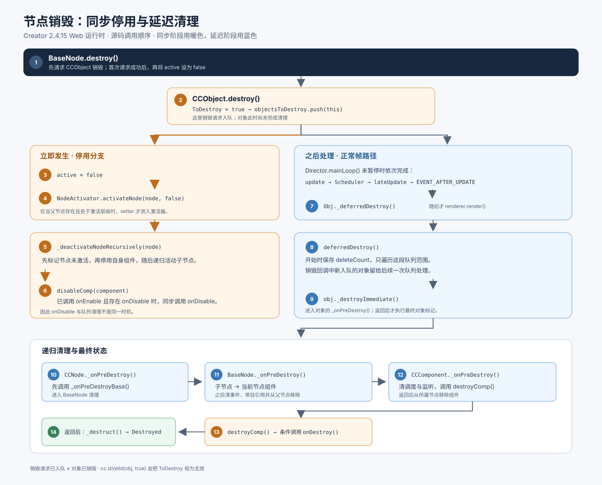

# 第 02 课：节点销毁，从 `destroy()` 到延迟清理

> `destroy()` 先标记并排队，再同步停用节点；真正的清理在延迟销毁队列处理时发生。

本课依据 Creator **2.4.15 Web 运行时**源码。`src/` 按上游文件收录原码片段，标出全链路步骤号；它们不是示例程序或独立实现。README 解释调用顺序并链接到对应源码。

帧回调进入 `Director.mainLoop()` 的部分见[第 01 课](../s01_game_startup/README.md)。本课从引擎提供的 `destroy()` 入口开始；具体由哪段项目逻辑调用它，取决于项目代码。



源码摘录按上游文件分组：

- [base-node.js：步骤 1、3、11](src/base-node.js)
- [CCObject.js：步骤 2、8、9、14 与状态判断](src/CCObject.js)
- [node-activator.js：步骤 4、5、13](src/node-activator.js)
- [component-scheduler.js：步骤 6](src/component-scheduler.js)
- [CCDirector.js：步骤 7](src/CCDirector.js)
- [CCNode.js：步骤 10](src/CCNode.js)
- [CCComponent.js：步骤 12](src/CCComponent.js)

## 调用顺序

```text
1  BaseNode.destroy()
2    → CCObject.destroy()：设置 ToDestroy，加入 objectsToDestroy
3    → active = false
4      → NodeActivator.activateNode(node, false)
5        → _deactivateNodeRecursively(node)
6          → ComponentScheduler.disableComp(component) → 符合条件时立即 onDisable()
7  Director.mainLoop：update / lateUpdate / EVENT_AFTER_UPDATE 之后调用 _deferredDestroy()
8    → deferredDestroy()：只处理本轮开始时队列中的对象
9      → _destroyImmediate()
10       → CCNode._onPreDestroy()
11         → BaseNode._onPreDestroy()：先递归销毁子节点，再销毁自身组件
12           → CCComponent._onPreDestroy()
13             → NodeActivator.destroyComp() → 符合条件时调用 onDestroy()
14       → 回到 _destroyImmediate()：执行 _destruct()，最后设置 Destroyed
```

步骤 9、10、11、12、13 是嵌套调用：对象销毁流程会在进入子方法处暂停，子方法返回后再继续。步骤 14 标出步骤 9 在 `_onPreDestroy()` 返回后的收尾。

## 同步停用节点

### 1. 节点先请求销毁，再同步停用

`BaseNode.destroy()` 先调用父类对象销毁方法。只有首次请求成功，才把节点的 `active` 设为 `false`。

[base-node.js:1059](../../engine/2.4.15engine/cocos2d/core/utils/base-node.js#L1059)

源码摘录：[src/base-node.js](src/base-node.js)

### 2. `CCObject.destroy()` 设置标记并加入队列

重复请求会被 `Destroyed` 或 `ToDestroy` 拦截。首次请求设置 `ToDestroy` 并压入 `objectsToDestroy`；Web 运行时等待引擎调用延迟销毁队列。

[CCObject.js:305](../../engine/2.4.15engine/cocos2d/core/platform/CCObject.js#L305)

源码摘录：[src/CCObject.js](src/CCObject.js)

这里保留了编辑器分支，避免把 Web 运行时行为误当成所有运行模式下唯一的队列触发方式。

### 3. `active = false` 进入节点激活器

只有节点有父节点且父节点在层级中激活时，`active` setter 才会通知 `NodeActivator`。

[base-node.js:257](../../engine/2.4.15engine/cocos2d/core/utils/base-node.js#L257)

源码摘录：[src/base-node.js](src/base-node.js)

### 4. `activateNode(node, false)` 选择停用路径

[node-activator.js:219](../../engine/2.4.15engine/cocos2d/core/node-activator.js#L219)

源码摘录：[src/node-activator.js](src/node-activator.js)

该方法在停用递归后，还会清理此前排队的激活回调，并发出层级激活状态变化事件。

### 5. 递归停用节点及其活动子节点

节点先从层级中标记为未激活，再处理自身组件，之后递归仍处于激活状态的子节点。

[node-activator.js:178](../../engine/2.4.15engine/cocos2d/core/node-activator.js#L178)

源码摘录：[src/node-activator.js](src/node-activator.js)

### 6. 停用时同步调用符合条件的 `onDisable()`

Web 运行时的 `disableComp()` 检查 `IsOnEnableCalled`。因此 `onDisable()` 是停用过程的一部分，不需要等到 `_deferredDestroy()`。

[component-scheduler.js:413](../../engine/2.4.15engine/cocos2d/core/component-scheduler.js#L413)

源码摘录：[src/component-scheduler.js](src/component-scheduler.js)

## 帧更新后，渲染前处理销毁队列

### 7. Director 在更新阶段之后调用 `_deferredDestroy()`

正常帧路径先执行组件 `update`、Scheduler、组件 `lateUpdate` 和 `EVENT_AFTER_UPDATE`，然后处理延迟销毁，最后进入渲染。这个调用位于 `!this._paused` 分支中。

[CCDirector.js:114](../../engine/2.4.15engine/cocos2d/core/CCDirector.js#L114)

源码摘录：[src/CCDirector.js](src/CCDirector.js)

场景切换的 `runSceneImmediate()` 也会显式调用 `_deferredDestroy()`；因此不能把“下一帧”当作所有场景下唯一的处理时机。[CCDirector.js:447](../../engine/2.4.15engine/cocos2d/core/CCDirector.js#L447)

### 8. `deferredDestroy()` 固定本轮处理数量

队列长度在循环前保存到 `deleteCount`。如果某个销毁回调中又请求销毁其他对象，新对象留在队列中，等待后续一次 `_deferredDestroy()` 调用。

[CCObject.js:196](../../engine/2.4.15engine/cocos2d/core/platform/CCObject.js#L196)

源码摘录：[src/CCObject.js](src/CCObject.js)

“后续一次调用”不等于必然“下一帧”：Director 的场景切换路径和编辑器分支也可能触发队列处理。

## 队列处理：对象、子节点与组件

### 9. `_destroyImmediate()` 包住销毁回调与最终标记

它先调用对象自己的 `_onPreDestroy()`。该调用返回后，在运行时执行 `_destruct()`，最后写入 `Destroyed`。

[CCObject.js:490](../../engine/2.4.15engine/cocos2d/core/platform/CCObject.js#L490)

源码摘录：[src/CCObject.js](src/CCObject.js)

### 10. `CCNode._onPreDestroy()` 先进入基类清理

方法先调用 `_onPreDestroyBase()`；该调用返回后，继续清理节点专属状态。下方保留完整方法；基类递归内容见第 11 步。

[CCNode.js:1667](../../engine/2.4.15engine/cocos2d/core/CCNode.js#L1667)

源码摘录：[src/CCNode.js](src/CCNode.js)

`_onPreDestroyBase` 指向 `BaseNode` 的 `_onPreDestroy`；Creator 编辑器会再包一层撤销/重做处理。[base-node.js:1273](../../engine/2.4.15engine/cocos2d/core/utils/base-node.js#L1273)

### 11. `BaseNode._onPreDestroy()` 先递归子节点，再销毁当前节点组件

子节点通过 `_destroyImmediate()` 递归清理；当前节点的组件随后逐个 `_destroyImmediate()`。之后清除事件订阅、常驻节点引用，并在不是由父节点递归销毁时从父节点 `children` 中移除。

[base-node.js:1207](../../engine/2.4.15engine/cocos2d/core/utils/base-node.js#L1207)

源码摘录：[src/base-node.js](src/base-node.js)

这段顺序意味着：父节点销毁时，会先完整处理子节点，再进入父节点自己的组件列表。

### 12. 组件销毁时清理调度、监听并请求 `onDestroy`

[CCComponent.js:503](../../engine/2.4.15engine/cocos2d/core/components/CCComponent.js#L503)

源码摘录：[src/CCComponent.js](src/CCComponent.js)

### 13. `destroyComp()` 决定是否调用 `onDestroy()`

Web 运行时只有组件定义了 `onDestroy`，且此前已经调用过 `onLoad`（`IsOnLoadCalled`）时，才执行 `onDestroy()`。所以“调用了节点 `destroy()`”不代表任意组件都一定收到 `onDestroy()`。

[node-activator.js:339](../../engine/2.4.15engine/cocos2d/core/node-activator.js#L339)

源码摘录：[src/node-activator.js](src/node-activator.js)

完成基类子树/组件清理（其中可能调用 `onDestroy`）后，`CCNode._onPreDestroy()` 执行节点专属清理，再返回 `_destroyImmediate()`。

### 14. `_destroyImmediate()` 收尾并设置 `Destroyed`

`_destruct()` 返回后，对象才获得最终的 `Destroyed` 标记。

[CCObject.js:504](../../engine/2.4.15engine/cocos2d/core/platform/CCObject.js#L504)

源码摘录：[src/CCObject.js](src/CCObject.js)

节点清理还包含重排监听和编辑器撤销处理；这些不改变本课的 Web 运行时主链。

## 销毁状态：`cc.isValid`

这不是销毁调用链的一步，而是读取对象状态的辅助入口。默认模式只把 `Destroyed` 判为无效；严格模式还把 `ToDestroy` 判为无效。

[CCObject.js:561](../../engine/2.4.15engine/cocos2d/core/platform/CCObject.js#L561)

源码摘录：[src/CCObject.js](src/CCObject.js)

| 对象阶段 | `cc.isValid(obj)` | `cc.isValid(obj, true)` |
| --- | --- | --- |
| 尚未请求销毁 | `true` | `true` |
| 已设置 `ToDestroy`，尚未执行 `_destroyImmediate()` | `true` | `false` |
| 已设置 `Destroyed` | `false` | `false` |

## 本课范围与证据

- 依据：仓库 `engine/2.4.15engine/` 的 Creator 2.4.15 Web 运行时静态源码；源码片段链接到对应文件和行号。
- 重点：节点 `destroy()`、立即停用、帧内延迟队列、子节点和组件清理、`onDisable`/`onDestroy` 的触发条件。
- 不覆盖：单独调用 `Component.destroy()` 的差异、资源自动释放细节、编辑器撤销/重做流程、JSB 原生代理的实际释放效果。
- 本课没有独立示例或运行时验证；不把静态源码阅读描述成编辑器、浏览器或原生运行结果。
