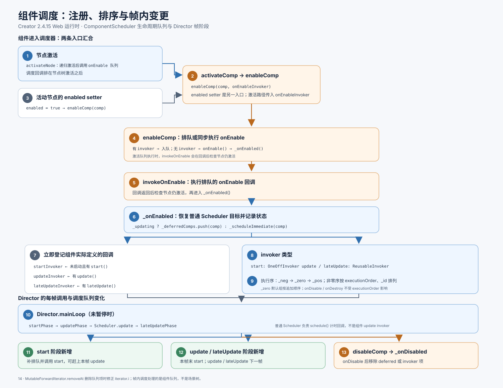

# 第 03 课：组件调度，注册、排序与帧内变更

> 组件何时进入 `start`、`update`、`lateUpdate` 队列？如果本帧中途启用或停用组件，调度器如何处理？

本课依据 Creator **2.4.15 Web 运行时**源码。`src/` 按引擎文件收录源码片段，并以 1–14 标记整条调用链；这些摘录不是示例程序或独立实现。帧循环外层见[第 01 课](../s01_game_startup/README.md)。



## 源码摘录

- [node-activator.js：步骤 1、2](src/node-activator.js)
- [CCComponent.js：步骤 3、9](src/CCComponent.js)
- [component-scheduler.js：步骤 4–8、11–13](src/component-scheduler.js)
- [CCDirector.js：步骤 10](src/CCDirector.js)
- [CCClass.js：步骤 9 的 `executionOrder` 语义](src/CCClass.js)
- [mutable-forward-iterator.js：步骤 14](src/mutable-forward-iterator.js)

## 整条调用链

```text
1  NodeActivator.activateNode(true)：准备 onEnable 队列，递归激活节点后调用队列
2    → activateComp：启用中的组件进入 ComponentScheduler.enableComp
3  Component.enabled setter：活动节点上的 enabled 变化也可直接进入 enableComp / disableComp
4  enableComp：有 onEnableInvoker 时先入队；没有时同步调用 onEnable
5    → invokeOnEnable：执行排队回调；节点仍激活时进入 _onEnabled
6  _onEnabled：帧内放入 _deferredComps，帧外直接登记回调
7    → _scheduleImmediate：只登记组件实际定义的 start / update / lateUpdate
8  startInvoker 为 OneOffInvoker；updateInvoker 和 lateUpdateInvoker 为 ReusableInvoker
9    → 按 executionOrder 分组和排序；零序组保留默认追加顺序
10 Director.mainLoop：startPhase → updatePhase → Scheduler.update → lateUpdatePhase
11 startPhase：启动已登记组件，并处理 start 回调中新增的组件
12 update / lateUpdate 期间新增的组件：本帧末补调 start，更新回调下一帧运行
13 disableComp：调用符合条件的 onDisable，并撤销待处理或已登记的队列项
14 MutableForwardIterator.removeAt：删除队列项时修正正在遍历的索引
```

步骤 2 与步骤 3 是两个进入调度器的路径；它们汇合到 `enableComp()`。步骤 4–5 是场景激活时延迟调用 `onEnable` 的路径；活动节点上直接修改 `enabled` 时，`enableComp()` 没有传入 `onEnableInvoker`，因此在 setter 调用栈里执行 `onEnable`。

## 注册与三个生命周期队列

`NodeActivator` 激活节点树时先收集 `onEnable` 回调，再在场景激活任务末尾执行；`activateComp()` 只在组件启用且节点仍处于激活层级时调用 `enableComp()`。活动节点上修改 `Component.enabled` 是另一条入口。两条路径的分叉和汇合分别见步骤 1–5。

`_onEnabled()` 在记录 `IsOnEnableCalled` 后检查 `_updating`：若调度器尚未进入本帧阶段，就调用 `_scheduleImmediate()`；若帧内已经开始调度，则把组件留在 `_deferredComps`。`_scheduleImmediate()` 仅登记组件实际定义的回调；`start` 已经调用过的组件不会再次加入 `startInvoker`。

## 队列类型与执行顺序

`startInvoker` 使用 `OneOffInvoker`，组件的 `start()` 调用后从该批队列清空；组件级 `IsStartCalled` 标记防止重复启动。`updateInvoker` 与 `lateUpdateInvoker` 使用可重复调用的 `ReusableInvoker`。

`LifeCycleInvoker` 把组件分到 `_neg`、`_zero`、`_pos` 三组。负序回调先执行，零序默认组其次，正序组最后。`OneOffInvoker` 在调用时排序负序和正序组；`ReusableInvoker` 在新增非零序组件时用 `sortedIndex()` 按 `_executionOrder` 和 `_id` 插入，零序组则追加。

`executionOrder` 默认值为 0。Creator 的类注册选项文档说明它影响 `onLoad`、`onEnable`、`start`、`update`、`lateUpdate` 的顺序，不影响 `onDisable` 和 `onDestroy`；相同规则与队列实现分别见 [CCClass.js](../../engine/2.4.15engine/cocos2d/core/platform/CCClass.js#L879) 和 `src/` 摘录。

## 帧阶段与本帧新增组件

第 01 课已经给出 Director 的帧主循环。本课只追踪它与组件调度器的接口：`startPhase()`、`updatePhase(dt)`、普通 Scheduler 的 `update(dt)`、`lateUpdatePhase(dt)`。中间的普通 Scheduler 负责 `schedule()` 一类计时回调，不是组件的 `update()` invoker。

`startPhase()` 将 `_updating` 设为 `true`，先调用当前队列里的 `start()`，再处理这些回调中启用的组件。它把当时的 `_deferredComps` 登记到各自 invoker，并在进入 `updatePhase()` 前补调这些组件的 `start()`，所以这批组件可以赶上本帧的 `update()` 与 `lateUpdate()`。若补调的新组件的 `start()` 又启用了其他组件，那些新组件属于下一批 deferred 项，不保证赶上本帧 `update()`；源码会在后续的 `_startForNewComps()` 调用中处理它们。

`lateUpdatePhase()` 先运行本帧已有的 lateUpdate 队列，再把 `_updating` 设为 `false`，处理 update/lateUpdate 阶段中新启用的组件。新组件的 `start()` 会在这里立即执行，但它的 `update()` 和 `lateUpdate()` 从下一帧开始。该时机由 `_startForNewComps()` 的实际调用位置决定，不应概括成所有新增组件都“下一帧才开始”。

## 停用与队列变更

Web 运行时的 `disableComp()` 在 `IsOnEnableCalled` 标记存在时先调用 `onDisable()`，然后进入 `_onDisabled()`。`_onDisabled()` 会暂停普通 Scheduler 上以组件为目标的计时任务；如果组件还在 `_deferredComps` 中，就直接取消待处理项，否则从 start/update/lateUpdate invoker 移除对应回调。

invoker 使用 `MutableForwardIterator` 遍历。移除当前项或它之前的项时，`removeAt()` 同步调整 `iterator.i`，避免数组改变后跳过下一个组件。这个索引修正属于调度队列遍历本身，不是业务组件的生命周期回调。

## 本课边界

- 依据：Creator 2.4.15 Web 运行时静态源码；所有源码摘录均标出上游路径、行号和全链路序号。
- 核心范围：组件如何登记回调、三类队列如何排序、帧内新增和停用如何影响队列。
- `createInvokeImpl()` 的 JIT 生成、异常慢路径和一般 Scheduler 的计时器内部实现不在主链中；源码入口仍可从 [component-scheduler.js](../../engine/2.4.15engine/cocos2d/core/component-scheduler.js#L194) 查看。
- 本课没有示例程序或运行时验证；结论来自 2.4.15 Web 源码静态阅读。
