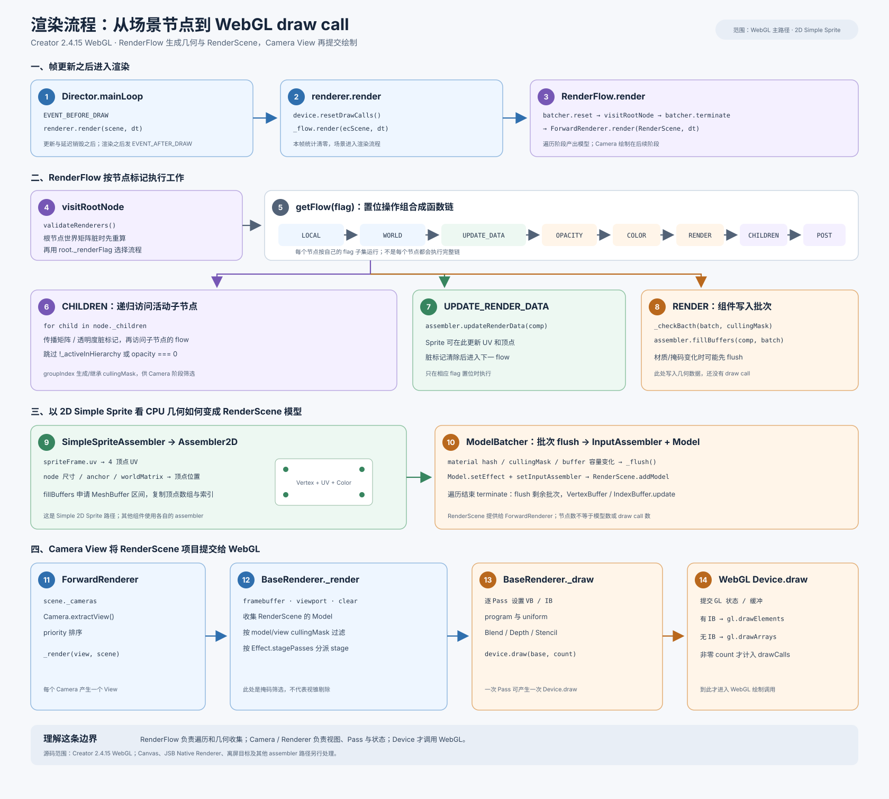

# 第 04 课：渲染流程，从场景节点到 WebGL draw call

> 场景树遍历如何变成顶点/索引缓冲、Camera 的绘制项，最后到达 WebGL？

本课依据 Creator **2.4.15 WebGL 运行时**源码。第 01 课已经指出 `renderer.render(scene, dt)` 会遍历场景树；本课继续追踪它怎样生成几何数据、建立批次、按 Camera 组织绘制，直到 `gl.drawElements()` / `gl.drawArrays()`。`src/` 是上游源码摘录，按整条调用链编号，不是示例程序或独立实现。



## 源码摘录

- [CCDirector.js：步骤 1](src/CCDirector.js)
- [renderer-index.js：初始化接线、步骤 2](src/renderer-index.js)
- [render-flow.js：步骤 3–8](src/render-flow.js)
- [CCRenderComponent.js：步骤 8、9](src/CCRenderComponent.js)
- [assembler.js、sprite-assemblers.js、assembler-2d.js：步骤 9](src/assembler.js)、[Sprite assembler](src/sprite-assemblers.js)、[2D 缓冲写入](src/assembler-2d.js)
- [model-batcher.js、mesh-buffer.js：步骤 10](src/model-batcher.js)、[MeshBuffer](src/mesh-buffer.js)
- [forward-renderer.js：步骤 11、13](src/forward-renderer.js)
- [base-renderer.js：步骤 12、13](src/base-renderer.js)
- [Device.js：步骤 14](src/Device.js)

## 完整调用链

```text
1  Director.mainLoop：update / lateUpdate / 延迟销毁之后发出 EVENT_BEFORE_DRAW
     → renderer.render(scene, dt) → EVENT_AFTER_DRAW
2  renderer.render：重置 drawCalls → RenderFlow.render(scene, dt)
3  RenderFlow.render：重置 ModelBatcher → visitRootNode → terminate → ForwardRenderer.render
4  visitRootNode：校验 RenderComponent；需要时更新根节点世界矩阵，再按 _renderFlag 分派
5  getFlow(_renderFlag)：把置位的操作标记串成流程，执行顺序为
     LOCAL_TRANSFORM → WORLD_TRANSFORM → UPDATE_RENDER_DATA → OPACITY → COLOR
     → RENDER → CHILDREN → POST_RENDER（每个节点只执行其标记要求的操作）
6  CHILDREN：遍历子节点；跳过层级未激活或透明度为 0 的节点；传递 group/culling mask
7  UPDATE_RENDER_DATA：调用 renderComponent._assembler.updateRenderData(component)
8  RENDER：_checkBacth 检查材质/掩码边界 → assembler.fillBuffers(component, ModelBatcher)
9  默认 2D Simple Sprite：更新 UV、四个顶点，并把顶点/索引写入 MeshBuffer 的 CPU 数组
10 ModelBatcher：批次边界时生成 InputAssembler / Model 并加入 RenderScene；遍历结束后 flush、上传缓冲
11 ForwardRenderer：从 RenderScene 的 Camera 提取 View，按 priority 排序
12 BaseRenderer._render：设置 framebuffer / viewport / clear；按 camera cullingMask 过滤 Model，再分派 stage
13 ForwardRenderer stage → BaseRenderer._draw：为每个 Pass 设置 buffer、program、uniform 和绘制状态，调用 Device.draw
14 WebGL Device.draw：提交状态与缓冲绑定，调用 gl.drawElements 或 gl.drawArrays，并累加 drawCalls
```

步骤 1 的渲染调用位于 Director 更新阶段之后；这条 Web 路径中，`_paused` 会跳过游戏更新，但 Render 区段仍在暂停判断之外。步骤 3 之后有清楚的边界：`RenderFlow` 遍历场景树并产出 `RenderScene` 中的模型；真正的 Camera 绘制由 `ForwardRenderer` 接手。

## 节点标记如何组成 RenderFlow

`_renderFlag` 是按位组合的操作集合。`getFlow()` 从标记生成并缓存一个串接函数链；因此变换、渲染数据更新、颜色更新、绘制、子节点遍历和后处理会按固定顺序运行，但某个节点只执行它当前置位的部分。渲染遍历发生在 `RenderFlow._children()`：它递归的是子节点树；组件 `update()` 则由第 03 课的组件队列调度，两种遍历用途不同。

子节点遍历时会继承父节点带来的矩阵/透明度脏标记，并根据 `groupIndex` 生成或继承 `cullingMask`。这里跳过层级未激活节点和透明度为 0 的节点；Camera 的 mask 过滤则在后面的 `BaseRenderer._render()` 执行。不要把这两处过滤概括成同一个可见性判断。

## Sprite 几何如何进入批次

本课用默认的 **2D Simple Sprite** 追踪一条具体 assembler 路径。渲染组件初始化时，`Assembler.init()` 根据组件类型选择 assembler；每帧 RenderFlow 先按需调用 `updateRenderData()`，之后 `fillBuffers()` 把顶点和索引复制到 `MeshBuffer`。Sliced、Tiled、Filled、Mesh、Label、Mask、Graphics、Spine 和 3D 组件有自己的 assembler，本课不把 Simple Sprite 的四顶点算法推广到它们。

`CCRenderComponent._checkBacth()` 在材质哈希或 culling mask 变化时 flush 当前批次；缓冲容量耗尽、切换 MeshBuffer 也可能触发 flush。`ModelBatcher._flush()` 把已累计的索引范围封装为 `InputAssembler` 和 `Model`，并加入 `RenderScene`。`terminate()` 处理最后一批，再调用 VertexBuffer / IndexBuffer 的 `update()` 上传本轮 CPU 数据。因此一个 Sprite 节点不等于一个 Model，也不等于一个 draw call。

## Camera 到 WebGL

`ForwardRenderer` 为 `RenderScene` 中每个 Camera 提取 View，并按 Camera priority 排序。`BaseRenderer._render()` 设置目标 framebuffer、viewport 和清除参数，再按 `model._cullingMask & view._cullingMask` 筛选模型，并根据 Effect 的 `stagePasses` 组织绘制阶段。这个源码片段展示的是层/相机掩码筛选；本课不据此声称引擎在此处完成了几何视锥剔除。

绘制阶段为每个 Pass 设置顶点/索引缓冲、Shader program、uniform、Blend、Depth、Stencil 等状态，然后调用 `Device.draw()`。WebGL Device 先提交发生变化的状态；存在索引缓冲时走 `gl.drawElements()`，否则走 `gl.drawArrays()`。WebGL draw call 计数在非零绘制数量的分支中递增。

## 本课范围与证据

- 依据：仓库 `engine/2.4.15engine/` 的 Creator 2.4.15 WebGL 运行时静态源码；`src/` 中每段均标出上游文件、行号和调用链步骤。
- 具体几何路径：默认 2D Simple Sprite；主链同时追踪通用 `RenderFlow`、`ModelBatcher`、Camera View、ForwardRenderer、BaseRenderer 和 WebGL Device。
- 不覆盖 Canvas renderer、JSB Native Renderer、离屏 RenderTexture、阴影、多种 assembler 的内部算法及资源/Shader 构建过程；这些路径不能由本课的 Simple Sprite 源码代替。
- 本课没有 demo 或运行时验证；结论来自 Creator 2.4.15 WebGL 静态源码阅读。
