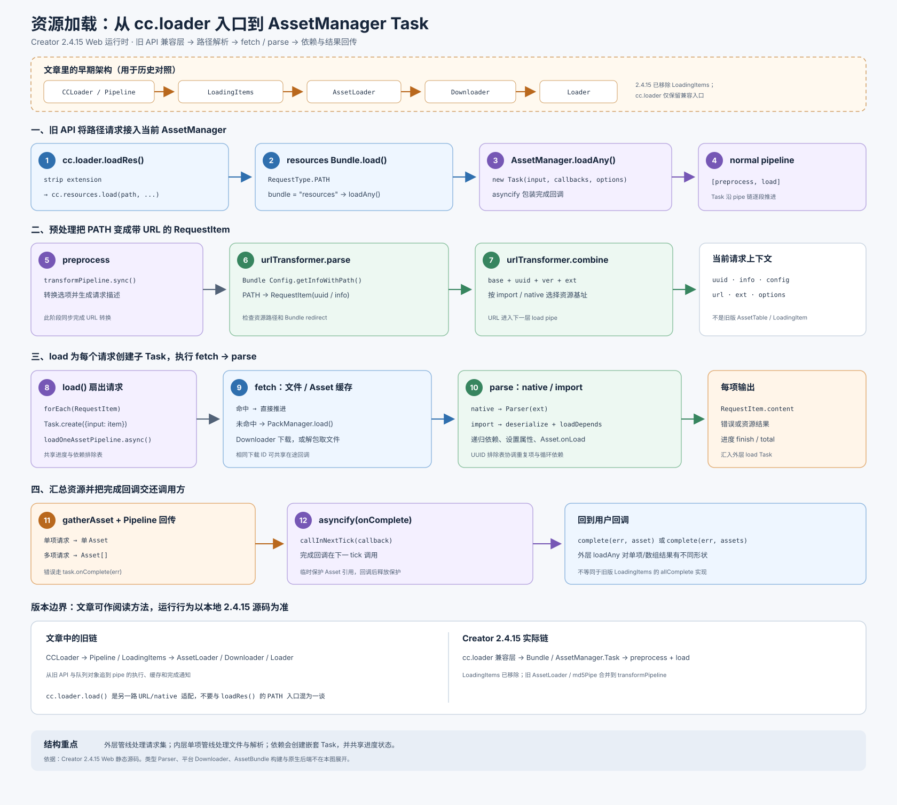

# 第 05 课：资源加载管线，从 `cc.loader` 到 AssetManager Task

> 调用 `cc.loader.loadRes()` 后，路径怎样变成请求项，经过下载、解析和依赖装配，再回到完成回调？

本课参照[《Cocos Creator 资源加载流程剖析（一）》](https://www.cnblogs.com/ybgame/p/10576884.html)的源码阅读方式：从 API 入口追到队列/任务，再跟踪管线阶段与结果回传。但该文讨论的是较早期 `CCLoader` / `LoadingItems` 架构；本课严格依据仓库 **Creator 2.4.15 Web 运行时**，沿实际存在的 `cc.loader` 兼容层和 `AssetManager.Task` 管线分析。`src/` 是上游源码摘录，不是示例程序或独立实现。



## 源码摘录

- [asset-manager/index.js：初始化加载两个模块](src/asset-manager-index.js)
- [cc-loader.js：步骤 1、兼容旁路和版本边界](src/cc-loader.js)
- [Bundle.js：步骤 2](src/Bundle.js)
- [CCAssetManager.js：步骤 2、3 与管线初始化](src/CCAssetManager.js)
- [shared.js、pipeline.js：步骤 4、11](src/shared.js)、[Pipeline](src/pipeline.js)
- [preprocess.js：步骤 5](src/preprocess.js)
- [urlTransformer.js：步骤 6、7](src/urlTransformer.js)
- [load.js：步骤 8–10](src/load.js)
- [pack-manager.js、downloader.js：步骤 9](src/pack-manager.js)、[Downloader](src/downloader.js)
- [parser.js：步骤 10](src/parser.js)
- [utilities.js：步骤 11、12](src/utilities.js)

## 完整调用链

```text
1  cc.loader.loadRes(path, type, progress, complete)
     → 去掉可选扩展名 → cc.resources.load(path, type, progress, complete)
2  Bundle.load：标记 RequestType.PATH 和 bundle="resources"
     → cc.assetManager.loadAny(path, options, progress, complete)
3  AssetManager.loadAny：规范化参数、创建 Task(input / callbacks / options)
4  normal pipeline.async(task)：外层管线为 [preprocess, load]
5  preprocess：分离选项，运行 transformPipeline.sync(subTask)
6  urlTransformer.parse：PATH + Bundle Config → RequestItem(uuid / info / type)
7  urlTransformer.combine：Bundle base + import/native base + uuid + version + ext → URL
8  load：遍历 RequestItem，为每项创建子 Task，进入 loadOneAssetPipeline
9  fetch：文件或 Asset 缓存命中则跳过；否则 PackManager/Downloader 取回或解包文件
10 parse：解析 native 文件或反序列化 import 资源；递归加载依赖、设置引用与 onLoad、缓存 Asset
11 汇总：进度/错误通过 Task 回传；全部完成后 gatherAsset 形成单项或数组结果
12 Pipeline 把结果交给 asyncify(onComplete)，通过 callInNextTick 调用用户完成回调
```

第 01 步只是旧 API 入口：2.4.15 的 `loadRes()` 不再通过旧版 `AssetTable` 找 UUID，而是交给 `cc.resources` 这个 Bundle。步骤 4 的 `normal pipeline` 负责请求预处理和资源加载；其中 `preprocess` 又同步运行独立的 `transformPipeline`，而 `load` 会为每个 RequestItem 再开 `[fetch, parse]` 子管线。三个层级不要合并成文章中的一条 `[AssetLoader, Downloader, Loader]`。

## 从路径到请求项

`cc.resources` 是名称为 `resources` 的 Bundle。`Bundle.load()` 将路径请求标记为 `RequestType.PATH`，把类型、Bundle 名称和是否返回数组放进选项，再调用 `cc.assetManager.loadAny()`。随后 `urlTransformer.parse()` 用 Bundle 的路径表查出 UUID 与资源信息；若路由到依赖 Bundle，则检查目标 Bundle 是否已经加载。`combine()` 再根据资源属于 import 还是 native，选用对应 base，并拼接 UUID、版本号和扩展名。

因此 2.4.15 的路径解析依据是已加载 Bundle 的 `Config`，不是文章旧流程中的 `CCLoader._getResUuid()` / `AssetTable`。没有对应资源路径或 UUID 的场景会在请求转换阶段失败，而不是等到下载器才发现。

## Task、下载、解析和依赖

AssetManager 的普通管线由 `[preprocess, load]` 构成。`Pipeline.async()` 按顺序调用 pipe；每个 pipe 完成时，`_flow()` 把 `task.output` 移到下一 pipe 的 `task.input`。`load()` 再为请求集合创建单项子 Task，执行 `loadOneAssetPipeline` 的 `fetch` 与 `parse` 两步。

`fetch` 检查 RequestItem 已带文件或普通 Asset 缓存；需要文件时调用 `PackManager.load()`。未打入包的资源转给 Downloader，打包资源下载后解包，并把请求项对应的数据交回。Downloader 自己还检查文件缓存和相同 ID 的在途请求。这里的这些缓存与请求状态承接了旧文章中队列协调的部分职责，但数据结构和生命周期不是 `LoadingItems`。

`parse` 对 native 请求调用类型 Parser；对 import 请求解析序列化数据，再由 `loadDepends()` 取依赖并建立子 Task。依赖完成后，代码设置资源引用属性、调用资产 `onLoad()`，并按缓存选项保存 Asset。重复 UUID 与循环依赖由当前 load 任务的 `__exclude__` 记录及回调列表协调。这个 `onLoad()` 是 Asset 的加载回调，不是场景组件生命周期中的 `Component.onLoad()`。

## 结果回传与旧版文章的边界

所有子项完成后，`gatherAsset()` 根据请求形态返回单个资源或数组；外层 Pipeline 再把结果传给 `loadAny()` 的完成回调。`loadAny()` 用 `asyncify()` 包装回调，在 `callInNextTick()` 中调用，并在回调前后保护资源引用。进度则由共享 `task.progress.finish / total` 随子项和依赖更新。

2.4.15 源码明确标记 `cc.loader` 已弃用、`cc.LoadingItems` 已移除并指向 `AssetManager.Task`。旧 `cc.loader.load()` 仍有兼容适配：直接 URL 会变成 native 请求并转交 `loadAny()`；它与 `loadRes()` 经 `cc.resources.load()` 的 PATH 路径不同。旧 `AssetLoader` 和 `md5Pipe` 也被标记为合并进 `transformPipeline`。

## 本课范围与证据

- 依据：Creator 2.4.15 Web 运行时 `engine/2.4.15engine/cocos2d/core/asset-manager/` 静态源码；每段摘录标出上游文件、行号和主链步骤。
- 主线：`cc.loader.loadRes()` → `cc.resources` Bundle → `AssetManager.Task` → URL 转换 → 单项 fetch/parse → 依赖与回调。
- 不展开：各资源类型 Parser/Downloader 的具体 Web API、AssetBundle 构建产物、原生 JSB 下载后端、自动释放和完整引用计数策略。
- 课程没有 demo 或运行时验证。引用文章用于阅读组织和历史对照；行为结论以本地 2.4.15 源码为准。
