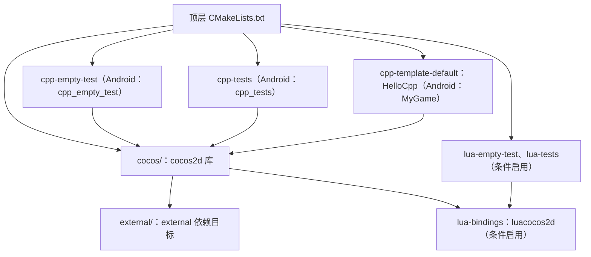

# 第 30 课（ENG02）：工程结构、构建目标与依赖

**目标：** 从本地 CMake 文件读出 Cocos2d-x 4.0 的主要构建目标，理解源码目录如何进入目标，以及内部库、平台库、预编译依赖和子模块各自处于什么位置。

## 本课问题

- 顶层 CMake 如何把引擎、测试工程和 C++ 模板接入同一构建树？
- `cocos2d`、`external`、`luacocos2d` 和示例程序分别是什么目标？
- CMake 写出了哪些依赖声明？它们能否证明当前机器已经具备可构建条件？

## 源码树与构建树

本课继续观察仓库里的 `engine/cocos2d-x-4/`，不修改引擎源码，也不执行 CMake 配置或编译。

- 顶层 [`CMakeLists.txt`](../../engine/cocos2d-x-4/CMakeLists.txt) 创建 `Cocos2d-x` 工程，纳入 `cocos/`、测试工程和默认 C++ 模板。
- [`CocosBuildSet.cmake`](../../engine/cocos2d-x-4/cmake/Modules/CocosBuildSet.cmake) 把 `ENGINE_BINARY_PATH` 指向顶层二进制目录下的 `engine/`，并加载通用构建设置。
- [`PreventInSourceBuilds.cmake`](../../engine/cocos2d-x-4/cmake/Modules/PreventInSourceBuilds.cmake) 拒绝把源码目录直接当作构建目录。`cocos2d` 和 `external` 的归档/库输出目录还由各自 CMake 文件设置到构建目录下的 `lib/`。
- [`CocosConfigDefine.cmake`](../../engine/cocos2d-x-4/cmake/Modules/CocosConfigDefine.cmake) 声明 C 代码使用 C99、C++ 代码使用 C++11。根工程声明的 CMake 最低版本为 3.6；这些声明不等于已经检查本机编译器、平台 SDK 和依赖。

## 顶层目标关系

阅读 [`engine/cocos2d-x-4/CMakeLists.txt`](../../engine/cocos2d-x-4/CMakeLists.txt) 后，可以得到下面这张静态目标图：

逐层核对源码：

1. 顶层工程通过 `add_subdirectory(cocos ...)` 加入引擎；[`cocos/CMakeLists.txt`](../../engine/cocos2d-x-4/cocos/CMakeLists.txt) 收集 2D、3D、平台、渲染、物理、音频等模块文件，并用 `add_library(cocos2d ...)` 建立核心库目标。
2. 同一文件把 [`external/CMakeLists.txt`](../../engine/cocos2d-x-4/external/CMakeLists.txt) 加入构建，并把 `external` 链接到 `cocos2d`。目标 `external` 再按选项加入 Box2D、Chipmunk、FreeType、Recast、Bullet、PNG、GLFW 等子目标。
3. `BUILD_EDITOR_COCOSTUDIO`、`BUILD_EDITOR_SPINE` 和 `BUILD_EXTENSIONS` 在 `cocos/CMakeLists.txt` 中默认开启。它们收集的源码会并入 `cocos2d` 的源文件列表；不要仅凭 `extensions/` 目录存在，就推断它会形成一个单独的库目标。
4. 顶层文件将 `cpp-empty-test`、`cpp-tests` 和 `templates/cpp-template-default` 分别加入。测试和模板的 CMake 文件把程序目标链接到 `cocos2d`。Android 分支会把相应目标定义为共享库，其他分支才走可执行程序，因此目标类型与入口源文件要结合平台条件阅读。
5. [`cocos/scripting/lua-bindings/CMakeLists.txt`](../../engine/cocos2d-x-4/cocos/scripting/lua-bindings/CMakeLists.txt) 创建 `luacocos2d` 并链接 `cocos2d`。虽然 [`CocosBuildSet.cmake`](../../engine/cocos2d-x-4/cmake/Modules/CocosBuildSet.cmake) 中 `BUILD_LUA_LIBS` 的选项初始值是 `OFF`，顶层 CMake 在加入 `cocos/` 前显式设为 `ON`，所以 Lua 绑定和 Lua 测试接线会进入这个顶层构建。

## 依赖如何分类

| 依赖边界 | 本地证据 | 阅读时要区分 |
| --- | --- | --- |
| 引擎内置第三方源码 | [`external/CMakeLists.txt`](../../engine/cocos2d-x-4/external/CMakeLists.txt) 中的 `BUILD_EXT_*` 选项和 `add_subdirectory` | 子目录被选入目标不代表已编译或链接成功 |
| 平台系统库/SDK | [`CocosConfigDepend.cmake`](../../engine/cocos2d-x-4/cmake/Modules/CocosConfigDepend.cmake) 按 Windows、Linux、Android、Apple 分支声明系统库、框架或 `find_package` | 依赖会随目标平台变化；不能把某个平台的清单当成所有平台的清单 |
| 预编译依赖包 | 顶层 [`README.md`](../../engine/cocos2d-x-4/README.md) 说明 `download-deps.py` 和后续子模块步骤；[`external/version.json`](../../engine/cocos2d-x-4/external/version.json) 与 [`external/config.json`](../../engine/cocos2d-x-4/external/config.json) 保存依赖包相关版本元数据 | 两个文件分别记录 `metal-support-9` 与 `metal-support-22` 标记；仅凭元数据无法确认某目标平台所需的 payload 已准备好或版本匹配 |
| 工具和测试资源子模块 | [`.gitmodules`](../../engine/cocos2d-x-4/.gitmodules) 列出 `cocos2d-console`、`bindings-generator` 和 `ccs-res` 路径 | 子模块清单是依赖线索，不等于当前目录已经初始化或工具能够运行 |

[`CocosConfigDepend.cmake`](../../engine/cocos2d-x-4/cmake/Modules/CocosConfigDepend.cmake) 还表明，系统库链接由平台条件控制。例如 Linux 分支查找 GTK3、OpenGL、CURL、SQLite3 等，Apple 分支查找系统框架；这只是源码声明，不能代替当前主机的 SDK/库检查。

开始真实构建前，要先选定平台和架构，再核对工具链、SDK、依赖 payload 与子模块。按照[项目构建专题 Skill](../../plugins/cocos2d-x-4/skills/cocos2d-x-4-project-build/SKILL.md)的边界，本课不下载依赖、不初始化子模块、不安装工具、不改全局环境。

## 动手练习

1. 从顶层 CMake 追到 `cocos2d`、`external`、`cpp-tests` 和 `HelloCpp`，在纸上画出 `add_subdirectory`、`add_library` 与 `target_link_libraries` 之间的关系，并标出哪些是库、哪些是程序目标。
2. 对照 `CocosBuildSet.cmake`、顶层 `CMakeLists.txt` 和 `cocos/CMakeLists.txt`，说明 `BUILD_LUA_LIBS` 的默认值为何不等于本顶层工程的最终取值。
3. 按表格把一个平台依赖、一个内置第三方库、一个预编译包元数据和一个 `.gitmodules` 条目分类；写出每类证据尚不能证明什么。
4. 从 `cpp-tests/CMakeLists.txt` 找出 Android 与桌面目标定义的差别，并说明为何不能从目标名直接推断最终产物类型。

## 简化说明

- Mermaid 图是从当前快照的 CMake 接线归纳出来的静态视图。实际生成的目标图和源文件列表会随平台、构建选项和 CMake 版本而变化。
- CMake 中声明了目标、依赖或工具要求，不表示本课已配置、编译、测试或运行它们；本课没有这些构建/运行证据。
- 版本元数据出现不同标记时，只记录观察到的内容；不能据此单独判定依赖损坏或兼容。

## 参考资料

- [仓库 Cocos2d-x 4.0 与 Creator 2.4.15 对照研究计划](../../docs/cocos2d-x-creator2x-source-study-plan.md)
- [本地 Cocos2d-x 顶层 CMake](../../engine/cocos2d-x-4/CMakeLists.txt)
- [本地 Cocos2d-x README](../../engine/cocos2d-x-4/README.md)
- [Cocos2d-x 工程配置与构建专题 Skill](../../plugins/cocos2d-x-4/skills/cocos2d-x-4-project-build/SKILL.md)
