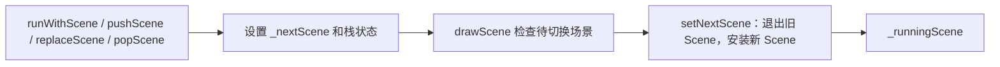

# 第 33 课（ENG05）：Director 与场景切换

**目标：** 从本地 `CCDirector` 的场景栈和待切换指针出发，比较启动、压栈、替换、弹栈和退出的行为，并追踪切换在帧流程中的落点。

## 本课代码快照

src/main.cpp 用独立的 Director 和 Scene 模型演示 run、push、drawScene 检查待切换状态以及 pop 返回栈顶场景。共享指针只是演示栈持有对象，不等同于 Cocos2d-x 的 Vector/Ref 所有权实现。

源码： [src/main.cpp](src/main.cpp)；课程结构参考 [Creator 第 3 课](../../learn_3.8cocoscreator/s03_director_loop/README.md)。

在本课目录编译并运行：

~~~sh
c++ -std=c++17 -Wall -Wextra -Wpedantic -Werror src/main.cpp -o /tmp/learn-cpp-s33
/tmp/learn-cpp-s33
~~~

预期观察：push B 后、下一次 drawScene 前 running 仍为 A；切换点才出现 A.onExit 与 B.onEnter。对照本地 CCDirector.cpp 核验真实清理规则。

本次已用 Apple Clang 21 按 C++17 严格警告选项编译并运行该教学示例；这验证的是独立课程代码，不是 Cocos2d-x 引擎运行。

## 本课范围

观察对象是本地 Cocos2d-x 4.0 的 `cocos/base/CCDirector.h` 与 `CCDirector.cpp`。本课解释 Director 如何选出当前 Scene、何时执行切换以及不同 API 对旧 Scene 的清理策略；不展开 Node 子节点生命周期，也不验证运行时画面或具体转场效果。

结论来自静态源码；本课没有构建或运行 Cocos2d-x 工程。课程模型的输出仅演示排队切换，真实 Scene 回调时序、转场效果和对象析构时点仍需目标工程验证。

## Director 维护的场景状态

[`CCDirector.h`](../../engine/cocos2d-x-4/cocos/base/CCDirector.h) 中，Director 保存三类关键状态：

- `_scenesStack`：场景管理栈，记录可恢复的场景顺序；其 `cocos2d::Vector<Scene*>` 在 `pushBack()` 时 retain 元素、`popBack()` 时 release 元素。
- `_runningScene`：当前正在运行的 Scene；公开的 `getRunningScene()` 返回它。
- `_nextScene`：弱引用，记录下一次切换准备安装的 Scene；注释指出它会在后续切换点成为 running Scene。

可以把流程概括为：

场景 API 会更新栈或 `_nextScene`；当前 running Scene 的切换由 `setNextScene()` 执行，而不是在每个 API 调用点立即完成。弹栈到指定层级时，被移除的非运行 Scene 也可能在 API 调用期间同步收到清理回调。

## 五种管理操作

| API | 栈与待切换状态 | 旧 Scene 的清理策略 | 用途 |
| --- | --- | --- | --- |
| `runWithScene(scene)` | 要求当前没有 running Scene；内部调用 `pushScene(scene)` 并启动动画 | 首个 Scene，没有旧 Scene 要退出 | 启动 Director |
| `pushScene(scene)` | 将 Scene 压入 `_scenesStack`，设为 `_nextScene` | `_sendCleanupToScene = false`，旧 Scene 退出但保留以便返回 | 临时进入新场景，如暂停菜单 |
| `replaceScene(scene)` | 替换栈顶 Scene，设为 `_nextScene` | `_sendCleanupToScene = true`，旧 Scene 退出并收到 `cleanup()` | 用新场景替换当前场景 |
| `popScene()` | 弹出栈顶；栈非空时以新的栈顶作为 `_nextScene` | 返回的旧栈顶 Scene 收到清理；若栈空则调用 `end()` | 从临时场景返回，或退出 |
| `popToRootScene()` / `popToSceneStackLevel(level)` | 弹出到指定栈层级，最终栈顶成为 `_nextScene`；level 为 0 时调用 `end()` | 被弹出的 Scene 会退出并清理 | 回到根场景或指定场景层级 |

`replaceScene()` 在还没有 running Scene 时会退回 `runWithScene()`。如果已经有一项待切换 Scene，替换路径会先处理那项待切换对象，再更新栈顶和 `_nextScene`。

## 切换何时生效

在 [`Director::drawScene()`](../../engine/cocos2d-x-4/cocos/base/CCDirector.cpp) 中，Director 先计算时间、处理事件并更新 Scheduler，然后清理渲染器并派发 `EVENT_BEFORE_DRAW`；检查到 `_nextScene` 后才调用 `setNextScene()`，随后再对当前 Scene 执行物理/导航更新、遍历和渲染。

`setNextScene()` 的普通场景路径大致是：

1. 当前 Scene 收到 `onExitTransitionDidStart()` 和 `onExit()`。
2. 若 `_sendCleanupToScene` 为 `true`，当前 Scene 再收到 `cleanup()`。
3. Director 释放原 `_runningScene`，把 `_nextScene` 安装为 `_runningScene` 并清空 `_nextScene`。
4. 新 Scene 收到 `onEnter()` 和 `onEnterTransitionDidFinish()`。

`pushScene()` 把 cleanup 标志设为 `false`，所以被压在栈中的旧 Scene 不会走这次 `cleanup()`；`replaceScene()` 和弹栈恢复路径会把标志设为 `true`。`TransitionScene` 有额外分支，转场对象会影响普通 Scene 回调的调用顺序，本课不推演具体转场类。

注意：`cleanup()` 是 Scene 的清理回调，不等于 C++ 析构已经发生。Director 对运行 Scene 的 `retain/release`、场景栈中的引用以及其他持有者，都会影响对象何时销毁；对象回收细节留到 ENG09。

## 退出请求不是立即销毁

`Director::end()` 只设置 `_purgeDirectorInNextLoop`。后续进入 `Director::mainLoop()` 时，Director 才调用 `purgeDirector()` 并结束当前运行。模板的[关闭菜单回调](../../engine/cocos2d-x-4/templates/cpp-template-default/Classes/HelloWorldScene.cpp)调用 `end()`，可以用来对照这条路径。不要把调用 `end()`、Scene 收到 `cleanup()` 和对象析构当成同一个事件。

## 手工推演

假设有场景 A、B、C：

1. `runWithScene(A)` 后，栈中记录 A；帧流程遇到待切换状态后，A 成为 `_runningScene`。
2. `pushScene(B)` 后，栈为 `[A, B]`；切换时 A 退出但不清理，B 进入。
3. `popScene()` 后，B 从栈移除，A 成为 `_nextScene`；切回 A 时，B 收到退出和清理，A 再次进入。
4. 对当前栈顶调用 `replaceScene(C)`，C 替换栈顶；旧栈顶退出并清理。
5. 如果从只剩根场景的状态再 `popScene()`，栈变空后 Director 请求 `end()`。

这张表是根据方法写入的状态和 `setNextScene()` 条件进行的静态推演，不是运行日志。

## 动手练习

1. 在 `CCDirector.cpp` 找到五种 API，逐个记录它们改变 `_scenesStack`、`_nextScene` 和 `_sendCleanupToScene` 的代码。
2. 在 `drawScene()` 找出 `setNextScene()` 相对 Scheduler 更新和 Scene 渲染的位置。
3. 用 A、B 两个 Scene 推演 `pushScene(B)` 再 `popScene()`：分别记录 running Scene、栈顶和清理标志。
4. 查 `end()` 与 `mainLoop()`，说明退出请求从设置标志到 Director 清理之间经过什么边界。

## 简化说明

- 以普通 Scene 为主；`TransitionScene` 的动画和回调时序需单独追踪。
- 源码中的 retain/release 只说明 Director 参与对象所有权；本课不完整追踪 Scene 引用计数和析构。
- 当前 running Scene 的切换会在 Director 的待切换检查点处理；部分 API 还会同步清理待切换对象或已弹出的栈项。是否显示新画面、转场是否流畅，需要在指定平台运行验证。

## 参考资料

- [本地 Director 头文件](../../engine/cocos2d-x-4/cocos/base/CCDirector.h)
- [本地 Director 实现](../../engine/cocos2d-x-4/cocos/base/CCDirector.cpp)
- [场景栈使用的 Vector 容器](../../engine/cocos2d-x-4/cocos/base/CCVector.h)
- [本地 Cocos2d-x 4.0 与 Creator 2.4.15 对照研究计划](../../docs/cocos2d-x-creator2x-source-study-plan.md)
- [Cocos2d-x 启动与帧循环专题 Skill](../../plugins/cocos2d-x-4/skills/cocos2d-x-4-startup-frame/SKILL.md)
