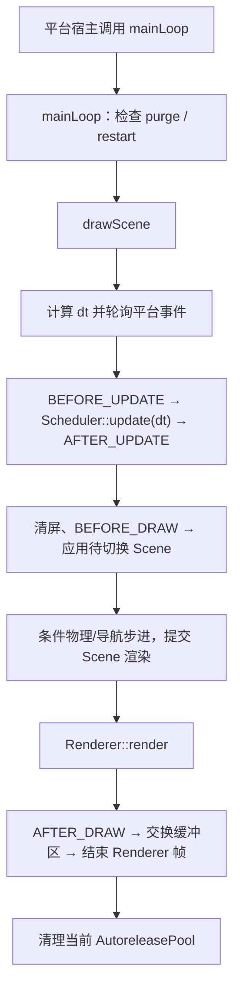

# 第 34 课（ENG06）：帧循环与 Scheduler

**目标：** 从平台调用 `Director::mainLoop()` 开始，读出一帧的更新和渲染顺序，并区分逐帧更新、间隔定时器、暂停与时间缩放。

## 本课范围

观察对象是本地 Cocos2d-x 4.0 的 `CCDirector` 和 `Scheduler`。第 31 课已经定位平台入口；本课集中看平台如何进入 Director、Director 如何调用 Scheduler，以及 Scheduler 如何组织回调。本课是静态源码分析，没有构建或运行平台工程。

## 谁驱动 Director 的每一帧

Director 不创建一个跨平台通用的原生主循环；平台宿主负责反复调用 Director：

| 平台路径 | 本地调用入口 |
| --- | --- |
| macOS、Linux、Windows desktop | 平台 `Application::run()` 的窗口循环调用 `director->mainLoop()` |
| iOS | `CCDirectorCaller` 调用 `director->mainLoop(dt)`，把帧间隔传入 Director |
| Android | Java GL Renderer 进入 JNI `nativeRender()`，再调用 `Director::mainLoop()` |

可对照[第 31 课](../s31_cocos2d_platform_entry/README.md)和[本地启动/帧循环追踪](../../docs/cocos2d-x/01-startup-and-frame.md)。各宿主使用自己的事件循环或 GL 回调；帧率和线程时序不能跨平台互推。

## `mainLoop()` 到一帧完成

[`Director::mainLoop()`](../../engine/cocos2d-x-4/cocos/base/CCDirector.cpp) 先检查待处理的 purge/restart 标志；没有这些请求且 Director 有效时，才进入 `drawScene()`。一帧主体可按下面顺序阅读：



静态源码的关键顺序是：

1. `drawScene()` 开始 Renderer 帧并计算 `_deltaTime`；有 GLView 时轮询平台事件。
2. Director 未暂停时，依次派发 `EVENT_BEFORE_UPDATE`、调用 `_scheduler->update(_deltaTime)`、派发 `EVENT_AFTER_UPDATE`。
3. Renderer 清屏并派发 `EVENT_BEFORE_DRAW`；有待切换 Scene 时调用 `setNextScene()`。
4. 当前 Scene 根据编译开关执行物理/导航步进，再由 GLView 提交 Scene 的渲染内容。
5. 更新统计信息，执行 Renderer 渲染，派发 `EVENT_AFTER_DRAW`，交换缓冲区并结束 Renderer 帧。
6. `drawScene()` 返回后，正常的 `mainLoop()` 路径清理当前 AutoreleasePool。

因此，Scheduler 的普通更新发生在 Scene 提交渲染之前；场景切换检查位于 Scheduler 更新之后、Scene 提交之前。宿主决定何时再次调用主循环，Director 再根据调用方式计算或接收 `dt`。

## Scheduler 如何安排回调

[`Scheduler::update(dt)`](../../engine/cocos2d-x-4/cocos/base/CCScheduler.cpp) 先按 `_timeScale` 缩放 `dt`，然后处理更新回调和 Timer：

1. **逐帧更新：** 按负优先级、零优先级、正优先级列表调用；数值越小越早。目标被暂停或条目已标记删除时会跳过。
2. **自定义 Timer：** 在逐帧更新列表之后处理。Timer 累加缩放后的 `dt`，达到 delay/interval 后触发；如果某次 `dt` 跨过多个 interval，Timer 可能在同一次 Scheduler 更新里补触发多次。

启用脚本绑定时，Scheduler 还会处理脚本回调；其后会执行排入 Cocos 线程的函数队列。`Director::init()` 创建 Scheduler 和 ActionManager，并以 `PRIORITY_SYSTEM` 注册 ActionManager 的逐帧更新，所以 Actions 也由 Scheduler 驱动；Action 的内部推进留到 ENG12。Scheduler 头文件说明系统优先级保留给引擎，用户更新应使用 `PRIORITY_NON_SYSTEM_MIN` 或更高的数值。

例如，假设当前类实现了 `update(float)`，下面两种注册方式的参数含义不同：

```cpp
auto scheduler = Director::getInstance()->getScheduler();

// 每次 Scheduler::update 都调用，参数是缩放后的帧 dt。
scheduler->scheduleUpdate(this, Scheduler::PRIORITY_NON_SYSTEM_MIN, false);

// interval=1 秒，delay=0.25 秒，repeat=2 表示首触发后再重复 2 次。
// Timer 回调参数是首次 delay 或 interval，不是每帧实际经过的时间。
scheduler->schedule(
    [this](float timerInterval) { ++_tickCount; },
    this, 1.0f, 2, 0.25f, false, "pulse");
```

`scheduleUpdate()` 用于逐帧 `update`；间隔为 0 的 Timer 也能每帧触发一次，但 Scheduler 头文件建议这种需求改用 `scheduleUpdate()`。自定义 Timer 以 `target + key` 标识；同一 target/key 再次注册会复用 Timer 并重置计时参数。对 `ccSchedulerFunc` 重载而言，这不会替换已有 Timer 保存的回调。`target` 是调度分组、暂停和取消用的指针，不代表 Scheduler 接管目标对象的生命周期。

## 暂停与时间缩放不是一回事

| 操作 | 源码影响 | 结果 |
| --- | --- | --- |
| `Director::pause()` | 设置 Director `_paused`，并把动画间隔设为 `1/4` 秒以减少忙等 | `drawScene()` 仍会轮询事件并继续渲染，但跳过 update 事件和 `Scheduler::update()` |
| `Scheduler::pauseTarget(target)` | 标记该 target 的更新项和 Timer 为 paused | 其他 target 继续运行；该 target 恢复后继续收到调度 |
| `Scheduler::setTimeScale(scale)` | 统一缩放传给 scheduled update、Timer 和 Action 的 `dt` | 低于 1 变慢，高于 1 变快；不会停止 Scheduler 调用 |

`Director::resume()` 恢复动画间隔并把下一次 delta time 设为 0，避免暂停期间的空档变成一次很大的更新。注意，带编译开关的物理/导航步进位于 `_paused` 判断之外；不要把 Director 暂停误解为帧循环内所有逻辑都必然停止。上述是本地源码所示的控制方式，不代表实际设备达到某个目标帧率。

## 动手练习

1. 在 `drawScene()` 标出 `calculateDeltaTime()`、Scheduler 更新、Scene 切换、Scene 提交与缓冲区交换的先后关系。
2. 比较 `scheduleUpdate()` 和间隔 Timer 的目标、优先级、时间参数与取消方式。
3. 手算 `interval=1.0`、`delay=0.25`、`repeat=2` 的总触发次数，并说明 Timer 回调参数代表什么。
4. 对比 Director pause、单个 target pause 和 `setTimeScale(0.5f)` 分别会影响哪些更新。
5. 对照 macOS、iOS、Android 的 `mainLoop` 调用点，标记哪一侧向 Director 传入了 dt。

## 简化说明

- 本课只按当前本地源码读取一般路径；脚本、物理、导航和转场会受平台与编译开关影响。
- 源码不能证明目标平台的帧率、Timer 实际触发间隔、线程调度或渲染画面；这些需要在指定工程和平台运行观察。
- 调度回调的目标生命周期必须由调用方保证；对象释放前要按使用的 API 取消或暂停相关回调。

## 参考资料

- [本地 Director 实现](../../engine/cocos2d-x-4/cocos/base/CCDirector.cpp)
- [本地 Director 头文件](../../engine/cocos2d-x-4/cocos/base/CCDirector.h)
- [本地 Scheduler 实现](../../engine/cocos2d-x-4/cocos/base/CCScheduler.cpp)
- [本地 Scheduler 头文件](../../engine/cocos2d-x-4/cocos/base/CCScheduler.h)
- [iOS DirectorCaller](../../engine/cocos2d-x-4/cocos/platform/ios/CCDirectorCaller-ios.mm)
- [Android Renderer JNI](../../engine/cocos2d-x-4/cocos/platform/android/jni/Java_org_cocos2dx_lib_Cocos2dxRenderer.cpp)
- [Cocos2d-x 启动与帧循环专题 Skill](../../plugins/cocos2d-x-4/skills/cocos2d-x-4-startup-frame/SKILL.md)
- [仓库 Cocos2d-x 4.0 与 Creator 2.4.15 对照研究计划](../../docs/cocos2d-x-creator2x-source-study-plan.md)
