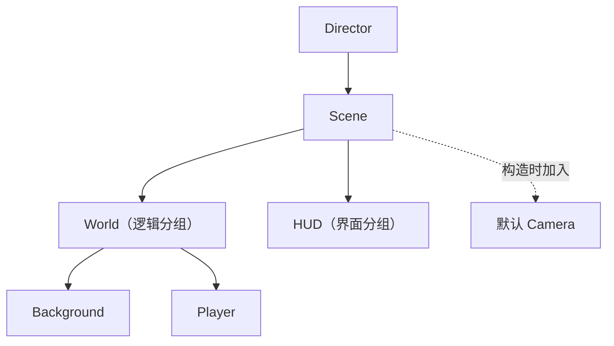

# 第 35 课（ENG07）：Scene、Node 与场景树

**目标：** 创建简单的父子节点层级，理解 `Scene` 与 `Node` 的关系，并按本地源码解释节点树如何搜索和遍历。

## 本课范围

本课依据仓库中的 Cocos2d-x 4.0 源码做静态分析，聚焦 `Scene`/`Node` 树、子节点访问、局部 Z 顺序和访问流程。坐标变换留到 ENG08，引用计数与 AutoreleasePool 留到 ENG09，Component 留到 ENG10。本课未构建或运行示例工程。

## Scene 是 Node 树的根

本地 [`Scene`](../../engine/cocos2d-x-4/cocos/2d/CCScene.h) 是 `Node` 的派生类；Director 的 running Scene 因而可以像其他 Node 一样拥有子节点。常见结构是一个 Scene 作根，下面放逻辑分组、游戏对象和 UI 分组：



`Scene` 构造函数会创建并加入默认 Camera。因此查询 `Scene::getChildrenCount()` 时，数量可能包含引擎创建的 Camera，不只是游戏代码添加的节点。

## 创建父子节点

```cpp
auto scene = Scene::create();
auto world = Node::create();
auto player = Node::create();
auto hud = Node::create();

scene->addChild(world, 0, "world");
world->addChild(player, 1, "player");
scene->addChild(hud, 2, "hud");

Director::getInstance()->runWithScene(scene);
```

`addChild(child, localZOrder, name)` 把 child 放进父节点的 `_children`，设置名称和 parent 指针。该 child 必须尚未有 parent；要换父节点，应先从旧 parent 移除，再加到新 parent。一个 Node 通过 `_parent` 指向一个直接父节点，而 `getChildren()` 返回的也只是直接子节点。

这段示例用空 `Node` 作为结构分组；它们建立树关系，但自身没有 Sprite 等可见内容。`Node::create()`/`Scene::create()` 返回 autorelease 对象；加入父节点时，内部 `Vector<Node*>` 会 retain 子节点。具体对象何时最终析构由引用关系决定，完整规则留到 ENG09。

## 查询直接子节点与递归后代

- `getParent()` 返回直接父节点。
- `getChildren()` 和 `getChildrenCount()` 只看直接孩子，不递归。
- `getChildByName("world")` 在当前节点的直接孩子中查找。
- `enumerateChildren("//player", callback)` 使用 `//` 递归搜索后代；回调返回 `true` 可提前结束遍历。

例如，`scene->getChildByName("player")` 不会越过 `world` 找到 `player`；应从 `world` 查找，或用 Scene 的递归枚举接口。节点名称是搜索标识，不是场景文件中的持久化 ID。

## Node::visit 的访问和绘制顺序

[`Node::visit()`](../../engine/cocos2d-x-4/cocos/2d/CCNode.cpp) 会递归访问当前节点和子节点。简化后的顺序是：

1. 当前节点不可见时立即返回，当前节点及其整棵子树都不会继续访问。
2. 处理当前节点的父级变换信息；具体坐标计算留到 ENG08。
3. 若子节点顺序已变脏，先按 `localZOrder` 排序；相同 Z 值按到达顺序排列。
4. 先访问 `localZOrder < 0` 的子节点。
5. 当前节点通过相机可见性检查后执行自己的 `draw()`。
6. 再访问剩余子节点，即 `localZOrder >= 0` 的节点。

父节点的局部 Z 顺序只比较它自己的兄弟节点，不是把全场景节点摊平成一个全局排序。普通 `addChild` 会标记顺序需要重排；`visit()` 在遍历前调用 `sortAllChildren()`，避免每次插入都立即排序。

例如，若一个父节点有 Z 值为 `-1`、`0`、`2` 的三个孩子，遍历顺序为：负 Z 孩子 → 父节点自己的 draw → Z 为 0 的孩子 → Z 为 2 的孩子。若中间的父节点不可见，早退会跳过它的后代。

## 从树中移除不等于对象已析构

`removeChild(child)` 的默认参数为 `cleanup = true`。当父节点正在运行时，child 会先收到退出回调；之后按 cleanup 参数执行清理，清空 parent 指针，并从父节点的 `Vector` 移除。Vector 的 erase 会 release 父节点持有的那一份引用。

所以要区分三件事：child 是否仍在树中、`cleanup()` 是否停止其关联行为、C++ 对象是否已析构。移除只会断开父子关系并释放父节点的持有；如果还有其他引用，对象仍可存活。若传 `cleanup = false`，也不能假设 Actions 和调度回调已停止。Node 生命周期与完整释放路径见[对象生命周期源码地图](../../docs/cocos2d-x/02-objects-and-lifecycle.md)。

运行中的父节点添加 child 时，`addChild` 会立即调用 child 的 `onEnter()`；若父节点的转场已完成，也会调用 `onEnterTransitionDidFinish()`。这表示树的改动可能带来同步生命周期回调，但不等于本课已经验证这些回调的运行时顺序。

## 动手练习

1. 画出 `Scene → World → Player` 和 `Scene → HUD`，标注每个节点的直接 parent 与直接 children。
2. 对比 `scene->getChildByName("player")` 与 `scene->enumerateChildren("//player", ...)` 的搜索范围。
3. 给同一 parent 的三个 child 设置 `localZOrder` 为 `-1`、`0`、`2`，写出 `visit()` 的遍历顺序。
4. 将 World 设为不可见，说明哪些后代不会进入 `visit()`。
5. 对照 `removeChild(child, true)` 与 `removeChild(child, false)`，分别说明树关系、清理调用和对象销毁能得出什么结论。

## 简化说明

- 本课只追踪默认 `Node::visit()` 路径；Camera、Renderer、自定义 Node 的 `draw()` 和渲染队列排序会影响最终画面。
- Scene 默认 Camera 会作为 Scene 的子节点参与树结构；练习里未把其渲染行为展开。
- 结论来自当前本地源码，不代表示例工程已构建运行，也不能单凭代码顺序断言设备上的最终像素或对象析构时点。

## 参考资料

- [本地 Node 头文件](../../engine/cocos2d-x-4/cocos/2d/CCNode.h)
- [本地 Node 实现](../../engine/cocos2d-x-4/cocos/2d/CCNode.cpp)
- [本地 Scene 头文件](../../engine/cocos2d-x-4/cocos/2d/CCScene.h)
- [本地 Scene 实现](../../engine/cocos2d-x-4/cocos/2d/CCScene.cpp)
- [引用 Node 的 Vector 容器](../../engine/cocos2d-x-4/cocos/base/CCVector.h)
- [Cocos2d-x Scene/Node/Component 生命周期源码地图](../../docs/cocos2d-x/02-objects-and-lifecycle.md)
- [Scene/Node 生命周期专题 Skill](../../plugins/cocos2d-x-4/skills/cocos2d-x-4-scene-node-lifecycle/SKILL.md)
- [本地 Cocos2d-x 4.0 与 Creator 2.4.15 研究计划](../../docs/cocos2d-x-creator2x-source-study-plan.md)
