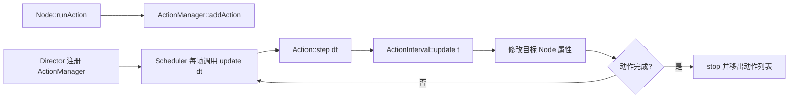

# 第 40 课（ENG12）：Action 与动作管理

**目标：** 从 `Node::runAction()` 追踪一个动作如何进入 `ActionManager`、被 `Scheduler` 逐帧推进、修改 Node 状态，并在完成、暂停或停止时清理。

## 本课代码快照

src/main.cpp 提供独立的 MoveBy、FadeTo、Call、Sequence、Spawn 和 ActionManager 小模型。ActionManager 用 deltaTime 推进时间线并修改 NodeState；它用于观察动作组合，不链接 Cocos2d-x。

源码： [src/main.cpp](src/main.cpp)；课程结构参考 [Creator 第 33 课](../../learn_3.8cocoscreator/s33_action_composition/README.md)。

在本课目录编译并运行：

~~~sh
c++ -std=c++17 -Wall -Wextra -Wpedantic -Werror src/main.cpp -o /tmp/learn-cpp-s40
/tmp/learn-cpp-s40
~~~

预期观察：前一秒先移动，之后移动与淡出并行，最后只触发一次 sequence complete。对照本地 ActionManager 和各 Action 的真实更新实现。

本次已用 Apple Clang 21 按 C++17 严格警告选项编译并运行该教学示例；这验证的是独立课程代码，不是 Cocos2d-x 引擎运行。

## 本课范围与证据

本课根据仓库中的 Cocos2d-x 4.0 源码说明原生 C++ 动作路径，并用 `MoveBy`、`MoveTo`、`DelayTime` 和 `Sequence` 组成一个小例子。独立模型已运行；Cocos2d-x 工程仍未构建或运行，脚本绑定可能在回调处增加额外逻辑。

## 一帧中的动作路径



`Director` 创建 `ActionManager` 并将它按 `Scheduler::PRIORITY_SYSTEM` 注册为每帧更新目标。`Node::runAction()` 把动作和目标 Node 交给该 Node 的 ActionManager；Manager 在每帧调用动作的 `step(dt)`。时间动作把已用时间换算为 `[0, 1]` 的进度 `t`，再由具体动作的 `update(t)` 更新目标属性。

## Action 的常见类别

| 类别 | 例子 | 作用 |
| --- | --- | --- |
| 有时长动作 | `MoveBy`、`MoveTo`、`FadeTo`、`RotateBy` | 在一段时间内按进度改变 Node 属性 |
| 瞬时动作 | `Show`、`Hide`、`Place`、`CallFunc` | 在动作序列的某个时点立刻执行 |
| 组合动作 | `Sequence`、`Spawn`、`Repeat`、`RepeatForever` | 顺序执行、并行执行或重复其他动作 |
| 缓动动作 | `EaseIn`、`EaseBounce` 等 | 包装时间动作，改变进度曲线 |

`MoveBy` 从开始时目标的位置出发，应用相对位移；`MoveTo` 使用指定的绝对终点。源码中 `MoveTo::startWithTarget()` 会根据目标当前坐标计算内部位移，所以在目标位置变化后启动时仍会朝指定坐标移动。

## 组合动作示例

```cpp
constexpr int kIntroActionTag = 4001;

auto intro = Sequence::create(
    MoveBy::create(0.6f, Vec2(120.0f, 0.0f)),
    DelayTime::create(0.2f),
    MoveTo::create(0.6f, Vec2(320.0f, 180.0f)),
    nullptr);

// 标签应设在交给 Node/ActionManager 的顶层动作上。
intro->setTag(kIntroActionTag);
this->runAction(intro);
```

这段序列先把 Node 向右移动 120 个坐标单位，再等待 0.2 秒，最后移动到父节点坐标系中的 `(320, 180)`。`nullptr` 是变长 `Sequence::create()` 参数列表的结束标记。组合动作作为一个顶层 Action 交给 Manager；其子动作由组合对象按阶段推进。

需要提前取消时：

```cpp
this->stopActionByTag(kIntroActionTag);
```

标签要设在 `intro` 这个顶层 `Sequence` 上，因为 ActionManager 管理的是传给 `runAction()` 的对象。`stopAllActions()` 会移除该 Node 的全部动作；`pause()` / `resume()` 会暂停或恢复该 Node 的动作目标。

## ActionManager 如何持有对象

| 源码位置 | 关键行为 |
| --- | --- |
| `Node::runAction()` | 把动作交给 `_actionManager`；Node 尚未运行时以暂停状态加入 |
| `ActionManager::addAction()` | 为 Node 建立目标记录，设置动作 target，并把动作加入其动作数组 |
| `ccArrayAppendObject()` | 对加入数组的 Action 调用 `retain()` |
| `ActionManager::update()` | 对未暂停目标的动作调用 `step(dt)`；完成时调用 `stop()` 并移除动作 |
| 移除目标记录 | 该目标的动作列表清空后释放 Manager 对 Node 的持有 |

`::create()` 创建的动作通常进入 autorelease 池；加入 Manager 后，动作数组会持有它。Action 对象包含自己的目标和运行进度，不要把同一个 Action 实例同时交给多个 Node；需要相同效果时分别创建，或用 `clone()`。

ActionManager 也会在目标记录建立时 `retain()` Node。因而一个持续运行的 `RepeatForever` 可能让目标保持存活，直到动作被停止或目标清理动作。不要把“从父节点移除”本身当成“动作已移除”的证据。

## 完成、暂停与清理

- `ActionInterval::step(dt)` 第一次执行时将 elapsed 置零并以 `t = 0` 更新；之后才累计传入的 `dt`。进度被限制在 `[0, 1]`，elapsed 达到 duration 后，Manager 在更新循环中停止并移除动作。
- `Node::onExit()` 的原生路径调用 `pause()`，ActionManager 因而暂停该 Node 的目标记录；`onEnter()` 调用 `resume()` 后恢复。
- `Node::cleanup()` 调用 `stopAllActions()`。因此带 cleanup 的场景清理路径会移除动作；若以不清理的方式移出父节点，Node 退出时动作会暂停并保留，之后可随 Node 再次进入而恢复。
- `Node` 析构路径也调用 `stopAllActions()`。由于 ActionManager 持有仍有动作的 Node，持续动作可能延后析构；无限重复动作应在合适的生命周期边界显式停止。

帧循环和 Scheduler 的一般调度规则见[第 34 课](../s34_cocos2d_frame_loop_scheduler/README.md)；Node 的进入、退出与对象持有关系见[第 35 课](../s35_cocos2d_scene_node_tree/README.md)和[第 37 课](../s37_cocos2d_ref_autorelease_pool/README.md)。

## 动手练习

1. 从 `Node::runAction()` 追踪到 `ActionManager::addAction()`，标出 Action 和 Node 分别在哪一步被 retain。
2. 从 `Director` 构造函数追踪到 `Scheduler::scheduleUpdate()`，确认 ActionManager 的更新优先级。
3. 对比 `MoveBy` 和 `MoveTo` 的 `startWithTarget()` / `update()`，用两个不同初始坐标推演终点。
4. 根据 `ActionInterval::step()` 推演 1 秒动作的第一次、第二次和最后一次更新中 `t` 的变化。
5. 给 `RepeatForever` 设置顶层 tag，分别推演 `pause()`、`stopActionByTag()` 和 `cleanup()` 的效果及 Node 持有关系。

## 简化说明

- 源码证据限定仓库中的 Cocos2d-x 4.0 快照；未验证目标平台帧率、实际渲染效果或脚本绑定的动作回调。
- 示例只包含同一 Node 上顺序修改位置的动作；并行修改同一属性、物理系统驱动及自定义 Action 需要进一步分析具体实现。
- 官方文档用于说明公开动作 API；实际持有、逐帧调用和清理结论以本地源码为准。

## 参考资料

- [本地 Cocos2d-x 版本记录](../../engine/cocos2d-x-4/CHANGELOG)
- [Node 的动作接口和生命周期实现](../../engine/cocos2d-x-4/cocos/2d/CCNode.cpp)
- [Action 接口](../../engine/cocos2d-x-4/cocos/2d/CCAction.h)
- [ActionInterval、MoveBy / MoveTo 与组合动作接口](../../engine/cocos2d-x-4/cocos/2d/CCActionInterval.h)
- [ActionManager 接口](../../engine/cocos2d-x-4/cocos/2d/CCActionManager.h)
- [ActionInterval、MoveBy / MoveTo 和组合动作实现](../../engine/cocos2d-x-4/cocos/2d/CCActionInterval.cpp)
- [ActionManager 实现](../../engine/cocos2d-x-4/cocos/2d/CCActionManager.cpp)
- [动作数组 retain / release 实现](../../engine/cocos2d-x-4/cocos/base/ccCArray.cpp)
- [Director 创建并注册 ActionManager](../../engine/cocos2d-x-4/cocos/base/CCDirector.cpp)
- [Scheduler 系统优先级](../../engine/cocos2d-x-4/cocos/base/CCScheduler.h)
- [第 34 课：帧循环与 Scheduler](../s34_cocos2d_frame_loop_scheduler/README.md)
- [第 35 课：Scene、Node 与场景树](../s35_cocos2d_scene_node_tree/README.md)
- [第 37 课：Ref、引用计数与 AutoreleasePool](../s37_cocos2d_ref_autorelease_pool/README.md)
- [Cocos2d-x v4：Action 入门与 By/To 差异](https://docs.cocos2d-x.org/cocos2d-x/v4/en/actions/getting_started.html)
- [Cocos2d-x v4：基本动作与组合示例](https://docs.cocos2d-x.org/cocos2d-x/v4/en/actions/basic.html)
- [Cocos2d-x v4：Action API 参考](https://docs.cocos2d-x.org/api-ref/cplusplus/v4x/dd/d0d/group__actions.html)
