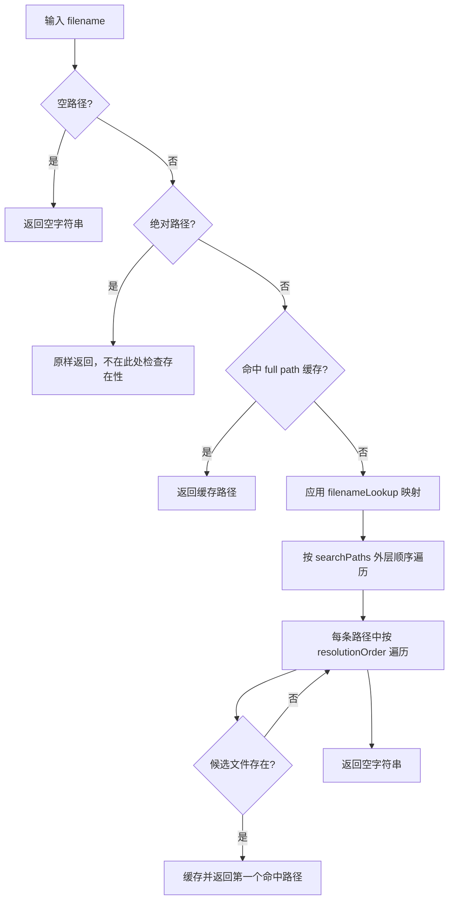

# 第 41 课（ENG13）：FileUtils 与资源路径解析

**目标：** 跟踪一个相对文件名如何经过文件名映射、搜索路径和分辨率目录，解析成实际路径；区分资源读取目录与可写目录。

## 本课范围与证据

本课依据仓库中的 Cocos2d-x 4.0 `FileUtils` 源码，聚焦文件寻址，不展开 `TextureCache` 或 SpriteFrame 缓存。结论是静态源码分析，没有构建或运行工程；不同平台的默认资源根目录、绝对路径判断和可写目录由对应平台实现决定。

## 相对文件名的解析流程



本地 `FileUtils::fullPathForFilename()` 按以下顺序工作：

1. 空字符串直接返回空字符串。
2. 按当前平台实现判断绝对路径；绝对路径直接原样返回。这一步不验证文件存在，也不会继续应用文件名映射。
3. 相对路径先查 `_fullPathCache`，缓存命中就直接返回。
4. 用 `filenameLookup` 字典把逻辑文件名映射为实际文件名；没有映射时沿用原名。
5. 外层遍历 search path，内层遍历 resolution order，生成候选路径并检查文件。第一个命中的完整路径会缓存并返回。
6. 所有候选均未命中时返回空字符串；失败结果不会写入 full path 缓存。

例如配置两条搜索路径 `themeA/`、`themeB/`，分辨率目录顺序为 `resources-hd/`、空目录，查询 `ui/button.png` 时，通用实现的候选顺序是：

```text
themeA/ui/resources-hd/button.png
themeA/ui/button.png
themeB/ui/resources-hd/button.png
themeB/ui/button.png
```

搜索路径顺序优先于分辨率顺序。文件名中的子目录位于分辨率目录之前；具体拼接可在本地 `getPathForFilename()` 看到。Apple、Windows 等平台会覆写部分路径判断或路径拼接，因此仍要按目标平台复核。

## 搜索路径与分辨率配置

| API | 本地实现行为 |
| --- | --- |
| `setSearchPaths(paths)` | 保存原始输入；相对项前面会加 default resource root，末尾补 `/`；必要时把 default root 追加为搜索路径；清理文件和目录解析缓存 |
| `addSearchPath(path, front)` | 将路径插入头部或尾部；相对路径前加 default resource root；当前实现没有清理已存在的 full path 缓存 |
| `setSearchResolutionsOrder(order)` | 按给定顺序替换分辨率目录，末尾缺少空目录时补空目录；清理解析缓存 |
| `addSearchResolutionsOrder(order, front)` | 将分辨率目录插入头部或尾部；当前实现没有清理已存在的 full path 缓存 |
| `getSearchPaths()` | 返回含 default root 前缀的内部搜索路径数组 |
| `getOriginalSearchPaths()` | 返回 `setSearchPaths()` / `addSearchPath()` 收到的原始路径数组 |

配置已经解析过某个文件名后，再调用 `addSearchPath(..., true)` 或 `addSearchResolutionsOrder(..., true)`，旧的成功结果可能仍由缓存返回。源码提供 `purgeCachedEntries()` 清理解析缓存；`setSearchPaths()`、`setSearchResolutionsOrder()` 和 `setFilenameLookupDictionary()` 也会清理它。排查“加了优先路径仍解析到旧文件”时，先检查缓存，再检查路径顺序。

## 找到路径不等于文件存在

本地实现对绝对路径直接返回输入字符串。因此，对绝对路径来说，`!fullPathForFilename(path).empty()` 并不能证明文件存在；用 `isFileExist(path)` 检查。相对路径只有在候选文件实际命中时才会由 `fullPathForFilename()` 返回非空路径。

还要注意本地头文件注释与实现的差异：`CCFileUtils.h` 的 API 注释写着查找失败时返回输入的 filename，但当前 `CCFileUtils.cpp` 的通用实现返回空字符串。官方 v4 API 参考也保留了类似旧注释；本课关于通用实现的失败行为以本地 `.cpp` 为准，平台覆写仍需单独检查。

```cpp
auto fileUtils = FileUtils::getInstance();
const std::string logicalName = "config/settings.json";
const std::string fullPath = fileUtils->fullPathForFilename(logicalName);

if (fullPath.empty())
{
    CCLOG("resource not found: %s", logicalName.c_str());
}
else
{
    CCLOG("resolved resource: %s", fullPath.c_str());
}
```

若输入可能是绝对路径，还要单独调用 `isFileExist(fullPath)` 验证文件。对相对路径，`isFileExist(logicalName)` 会执行搜索并返回存在性结果。

## 资源路径与可写路径分工

`FileUtils` 的 search paths 用于解析资源名。`getWritablePath()` 则返回平台实现提供的可读写目录，常用于保存配置、进度或临时数据；它不是自动参与每次资源查找的规则。需要从可写目录按相对名字读取文件时，要显式把该目录加入 search paths，或直接使用完整路径。

平台源码分别实现 `getWritablePath()`。不要把 macOS、Windows、Android 或 iOS 的实际目录写死为跨平台常量；应在目标平台查询该 API 返回值。Cocos2d-x 官方文件系统指南也把资源读取与文件/目录操作分别列出。

## 动手练习

1. 根据 `fullPathForFilename()` 的循环顺序，手算两条 search path、两个分辨率目录下一个文件名的候选顺序。
2. 读取 `setSearchPaths()` 与 `addSearchPath()`，比较相对路径的 root 前缀、头尾插入和缓存清理行为。
3. 对同一个资源先查询一次，再把新目录用 `addSearchPath(newPath, true)` 插到头部；推演缓存清理前后可能返回的路径。
4. 对比 `fullPathForFilename()`、`isFileExist()` 和 `getWritablePath()`，分别说明它们能证明什么、不能证明什么。
5. 对照 `CCFileUtils.h` 的注释与 `CCFileUtils.cpp` 的失败分支，记录应以哪一处作为当前快照行为证据。

## 简化说明

- 结论限定本地 Cocos2d-x 4.0 通用 `FileUtils` 实现；平台子类可覆盖路径判断、拼接、文件存在性和可写目录行为。
- 本课不验证 APK/Bundle 打包后的平台文件系统访问，也不读取或修改任何项目资源。
- `cpp-tests` 中存在 search path 与 resolution directory 示例入口，但本课未运行这些测试。

## 参考资料

- [本地 FileUtils 接口与注释](../../engine/cocos2d-x-4/cocos/platform/CCFileUtils.h)
- [本地 FileUtils 路径解析实现](../../engine/cocos2d-x-4/cocos/platform/CCFileUtils.cpp)
- [FileUtils 平台可写路径实现目录](../../engine/cocos2d-x-4/cocos/platform/)
- [FileUtils search path 与 resolution 用例](../../engine/cocos2d-x-4/tests/cpp-tests/Classes/FileUtilsTest/FileUtilsTest.cpp)
- [资源寻址、缓存与释放源码地图](../../docs/cocos2d-x/03-assets-loading-and-release.md)
- [资源加载专题 Skill](../../plugins/cocos2d-x-4/skills/cocos2d-x-4-assets-loading/SKILL.md)
- [Cocos2d-x v4 FileUtils API 参考](https://docs.cocos2d-x.org/api-ref/cplusplus/v4x/dc/d69/classcocos2d_1_1_file_utils.html)
- [Cocos2d-x v4 文件系统指南](https://docs.cocos2d-x.org/cocos2d-x/v4/en/advanced_topics/filesystem.html)
- [第 29 课：Cocos2d-x 源码版本与目录地图](../s29_cocos2d_source_version_map/README.md)
