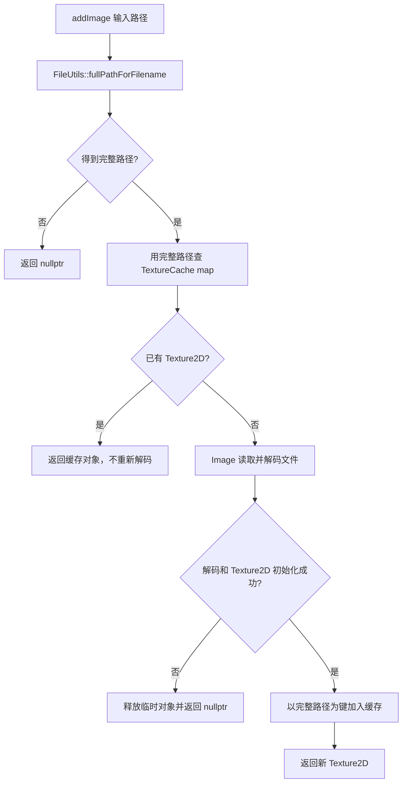

# 第 42 课（ENG14）：TextureCache 与纹理复用

**目标：** 跟踪图片路径如何成为 `TextureCache` 的键，重复加载何时返回同一 `Texture2D`，以及缓存引用与 Sprite 引用如何共同决定对象能否释放。

## 本课范围与证据

本课根据仓库中的 Cocos2d-x 4.0 `TextureCache`、`Director` 和 `Sprite` 源码，分析同步单图加载与纹理复用。结论是静态源码分析；没有运行指针比较、引用计数探针或平台显存观察。图集帧与纹理的关系留到下一课。

## 从文件路径到缓存命中



本地 `TextureCache::addImage(path)` 先调用 `FileUtils::fullPathForFilename(path)`，再用返回的完整路径字符串查询 `_textures`。因此：

- 两个输入只有解析到**相同的完整路径字符串**时，才命中同一个 map 键并复用 `Texture2D`。
- 相同图像内容若位于不同路径，默认会形成不同缓存项；缓存按路径键查找，不按文件内容计算哈希。
- FileUtils 找不到相对路径时，或图片解码/纹理初始化失败时，同步 `addImage()` 返回 `nullptr`。
- 改动 FileUtils 搜索路径会影响随后解析出的纹理键；缓存与路径解析的交接见[第 41 课](../s41_cocos2d_fileutils_path_resolution/README.md)。

## 同步请求的复用示例

```cpp
auto* cache = Director::getInstance()->getTextureCache();
const std::string path = "Images/HelloWorld.png"; // 换成工程内存在的图片

Texture2D* first = cache->addImage(path);
Texture2D* second = cache->addImage(path);

if (first != nullptr && second != nullptr)
{
    CCASSERT(first == second, "same resolved path should reuse its texture");
    CCLOG("cached path: %s", cache->getTextureFilePath(first).c_str());
}
```

该代码展示可用于运行时观察的指针比较，但本课没有执行它。若 `first` 是空指针，先排查 FileUtils 解析结果和图像解码；不能把加载失败时的两个空指针相等当成缓存命中。

## 谁持有 Texture2D

| 操作 | 本地引用关系 |
| --- | --- |
| 首次同步 `addImage()` 成功 | 新 `Texture2D` 的初始引用由 TextureCache map 持有；本地代码注明插入时无需再 retain |
| 再次用同一键调用 `addImage()` | 返回 map 中同一个指针，不会再解码，也不会为调用者额外 retain |
| Sprite 使用纹理 | `Sprite::setTexture()` retain 新纹理，并在替换时 release 旧纹理 |
| TextureCache 移除纹理键 | map 释放它持有的引用；若 Sprite 或其他对象仍持有引用，Texture2D 继续存活 |

从 `Director::getInstance()->getTextureCache()` 获取缓存。Cocos2d-x 4.x 已移除 `TextureCache::getInstance()` 等旧入口；这一版本通过 `Director` 访问。`addImage()` 返回的裸指针不是一份独立所有权，若后续还要使用它，必须保证缓存项或其他持有者仍然有效。`Ref` 引用计数背景见[第 37 课](../s37_cocos2d_ref_autorelease_pool/README.md)。

## 清理 API 的差别

| API | 本地行为 | 仍有 Sprite/其他持有者时 |
| --- | --- | --- |
| `removeUnusedTextures()` | 只移除引用计数恰为 1 的缓存项 | 引用计数大于 1 时保留 |
| `removeTextureForKey(key)` | 先按 key 查找；未命中时用 FileUtils 解析 key，再移除对应 map 项并 release 缓存引用 | 对象可以继续存活，但纹理键已不在缓存中 |
| `removeTexture(texture)` | 按对象指针找到并移除一个缓存项，release 缓存引用 | 其他持有者仍可继续使用对象 |
| `removeAllTextures()` | 清空整张 map，并逐项 release 缓存引用 | 活跃 Sprite 仍可持有对象；之后同路径加载可能创建另一份 Texture2D |

例如，某纹理由缓存和 Sprite 各持有一份引用时，引用计数至少为 2，`removeUnusedTextures()` 不会清掉它。调用 `removeTextureForKey()` 会移除缓存自己的引用；Sprite 仍持有旧纹理时，再次 `addImage()` 会因缓存键已不存在而创建新的纹理对象。此时同一源文件可能同时对应仍在使用的旧对象和缓存中的新对象。

缓存 map 项消失只说明缓存不再持有该键，不等于 GPU 资源已立即销毁。对象销毁取决于最后一份引用释放；显存回收还需要目标平台运行时证据。本课没有验证这两项。

## 异步入口提示

`addImageAsync()` 也用解析后的完整路径检查缓存。若纹理已缓存，回调会在当前调用路径直接执行；若路径为空或文件不存在，也会直接回调 `nullptr`。只有未缓存且文件可读的请求才会进入加载队列。因此不能假设每次 async 回调都晚于调用返回；回调持有者提前销毁时，还要按生命周期使用 `unbindImageAsync()`。

## 动手练习

1. 从 `TextureCache::addImage()` 标出 FileUtils、缓存 map、Image 解码和 Texture2D 插入的先后顺序。
2. 解释相同路径的两次 `addImage()` 为什么返回同一个指针；再推演同一图像的两份不同完整路径会发生什么。
3. 对“缓存单独持有”“缓存加一个 Sprite 持有”“调用 `removeTextureForKey()` 后 Sprite 仍持有”分别写出引用计数变化。
4. 比较 `removeUnusedTextures()` 与 `removeAllTextures()`，说明哪种方法可能清掉仍在使用的缓存键，以及为何不一定销毁纹理对象。
5. 查看 `TextureCacheTest.cpp` 的异步加载用例，区分源码测试入口与本课实际运行证据。

## 简化说明

- 结论限于本地 Cocos2d-x 4.0 同步单图 `addImage(path)` 与 TextureCache 的引用管理；用户自定义 `addImage(Image*, key)`、异步去重、设备上下文重建等不展开。
- 本课没有执行 `cpp-tests`，也没有测量 CPU/GPU 内存或销毁时机。
- `removeUnusedTextures()` 的判断以本地 `getReferenceCount() == 1` 实现为准；仍需按目标平台和实际持有关系核验。

## 参考资料

- [本地 TextureCache 接口](../../engine/cocos2d-x-4/cocos/renderer/CCTextureCache.h)
- [本地 TextureCache 加载、缓存和清理实现](../../engine/cocos2d-x-4/cocos/renderer/CCTextureCache.cpp)
- [Director 创建和访问 TextureCache](../../engine/cocos2d-x-4/cocos/base/CCDirector.cpp)
- [Sprite 对 Texture2D 的 retain/release](../../engine/cocos2d-x-4/cocos/2d/CCSprite.cpp)
- [Ref 引用计数接口](../../engine/cocos2d-x-4/cocos/base/CCRef.h)
- [TextureCache 测试入口](../../engine/cocos2d-x-4/tests/cpp-tests/Classes/TextureCacheTest/TextureCacheTest.cpp)
- [Texture2D 测试中的移除与清理入口](../../engine/cocos2d-x-4/tests/cpp-tests/Classes/Texture2dTest/Texture2dTest.cpp)
- [资源寻址、缓存与释放源码地图](../../docs/cocos2d-x/03-assets-loading-and-release.md)
- [资源加载专题 Skill](../../plugins/cocos2d-x-4/skills/cocos2d-x-4-assets-loading/SKILL.md)
- [Cocos2d-x v4 TextureCache API 参考](https://docs.cocos2d-x.org/api-ref/cplusplus/V4.0/de/d33/classcocos2d_1_1_texture_cache.html)
- [Cocos2d-x v4 API 变更：TextureCache 由 Director 访问](https://docs.cocos2d-x.org/cocos2d-x/v4/en/apichange/api_change_v4.html)
- [第 37 课：Ref、引用计数与 AutoreleasePool](../s37_cocos2d_ref_autorelease_pool/README.md)
- [第 41 课：FileUtils 与资源路径解析](../s41_cocos2d_fileutils_path_resolution/README.md)
