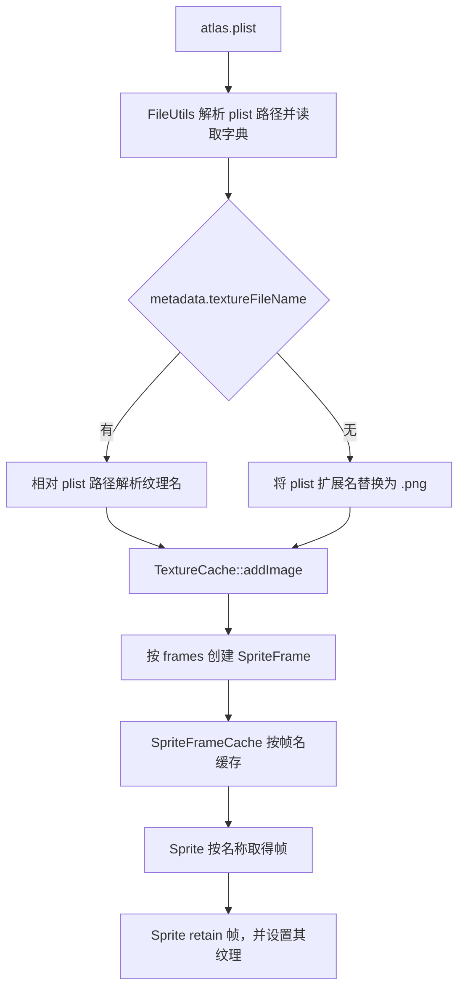

# 第 43 课（ENG15）：SpriteFrameCache 与精灵帧

## 本课代码快照

src/main.cpp 是独立 C++17 教学模型，模拟两个 SpriteFrame 共用图集纹理，以及清空帧缓存后 Sprite 继续持有帧和纹理的关系。它不读取真实 plist，也不链接 Cocos2d-x。

~~~sh
c++ -std=c++17 -Wall -Wextra -Wpedantic -Werror src/main.cpp -o /tmp/learn-cpp-s43
/tmp/learn-cpp-s43
~~~

预期观察：清空帧缓存后，Sprite 持有的帧仍然存活；Sprite 释放后，最后一份纹理引用才消失。课程结构参考 [Creator 第 13 课](../../learn_3.8cocoscreator/s13_sprite_frame_texture/README.md)。

本课模型已按上述命令编译并运行；这只验证课程示例，不代表已构建或运行 Cocos2d-x 工程。

**目标：** 从 atlas plist 追踪 SpriteFrame 的创建、按名称查找、Sprite 使用时的 retain，以及帧缓存和纹理缓存分层清理。

## 本课范围与证据

本课依据仓库中的 Cocos2d-x 4.0 `SpriteFrameCache`、`SpriteFrame`、`Sprite` 和 `TextureCache` 实现。课程只做静态源码分析，没有运行图集加载或清理；缓存机制和生命周期结论不代表目标平台的显存回收时机。

## SpriteFrame 表示什么

SpriteFrame 不是单独的图片像素。它把一张 `Texture2D` 与帧矩形、旋转标记、裁剪偏移、原始尺寸等信息组合起来；plist 也可为多边形帧提供顶点数据。多个 SpriteFrame 因而可以共用同一张图集纹理。



默认 `addSpriteFramesWithFile(plist)` 会先用 FileUtils 解析并读取 plist。若 `metadata.textureFileName` 非空，本地实现会相对 plist 路径构造纹理路径；若为空，就把 plist 文件名扩展名改为 `.png`。随后经 `TextureCache::addImage()` 取得纹理，再为每个 frame 字典创建 SpriteFrame。具体解析了哪些坐标字段取决于 plist 的格式版本。

## 加载并按帧名创建 Sprite

```cpp
auto* frameCache = SpriteFrameCache::getInstance();
frameCache->addSpriteFramesWithFile("animations/grossini.plist");

SpriteFrame* frame = frameCache->getSpriteFrameByName("grossini_dance_01.png");
if (frame != nullptr)
{
    auto* sprite = Sprite::createWithSpriteFrame(frame);
    // sprite 可加入场景；Sprite 内部会保留 frame 和所用纹理。
}
```

也可以用 `Sprite::createWithSpriteFrameName(name)` 一步查找并创建 Sprite。`getSpriteFrameByName()` 返回的是缓存中的裸指针；若要把它保存到 Sprite 之外并跨越缓存移除继续使用，需要自行管理引用。Sprite 的 `setSpriteFrame()` 会 retain 帧。

## 两层缓存和引用关系

| 对象 | 缓存/使用关系 |
| --- | --- |
| `SpriteFrameCache` | 以帧名为键保存 SpriteFrame；`Map::insert()` retain 新帧 |
| `SpriteFrame` | 自己 retain 所用的 `Texture2D`，并保存矩形、旋转、偏移等帧数据 |
| `Sprite` | `setSpriteFrame()` retain SpriteFrame；设置纹理时也 retain Texture2D |
| `TextureCache` | 由 `Director` 持有；负责按完整纹理路径复用 Texture2D |

因此，帧表移除一个 SpriteFrame，并不保证 SpriteFrame 对象立刻销毁：已创建的 Sprite 可能仍然持有它。SpriteFrame 对象存活时会继续持有 Texture2D；TextureCache 又有自己的纹理引用。帧缓存和纹理缓存必须分别判断与清理，不能把移除 plist 帧当成纹理已释放。

## 移除帧与清理纹理

- `removeSpriteFrameByName(name)` 移除一个帧名对应的缓存项。
- `removeSpriteFramesFromFile(plist)` 读取该 plist，再按其中的帧名移除缓存项；它不会移除 TextureCache 的纹理项。
- `removeUnusedSpriteFrames()` 只移除引用计数恰为 1 的帧，即 SpriteFrameCache 是唯一持有者的帧。
- `removeSpriteFrames()` 清空整个帧缓存；仍被 Sprite 或其他代码持有的 SpriteFrame 继续存活。
- 等帧和 Sprite 不再持有纹理后，再用 TextureCache 的 `removeUnusedTextures()` 清理仅剩缓存引用的纹理。该过程不等于已观测到 GPU 显存立即回收。

### 帧名需要全局唯一

默认 plist 批量加载在发现某个帧名已经存在时会跳过该帧，不替换现有对象；因此多个图集中重名时，后加载的 plist 不一定能提供预期帧。当前 `removeSpriteFramesFromFile()` 也按 plist 列出的帧名从全局缓存删除，没有逐帧校验缓存条目是否来自该 plist；若两个 plist 有相同帧名，移除其中一个可能把另一个先加载的同名帧一并移除。给不同图集使用全局唯一帧名更安全。

直接调用 `addSpriteFrame(frame, name)` 是另一个入口：它通过 `Map::insert()` 写入，已有同名项会被替换。不要把这个入口的替换行为套用到 plist 批量加载。

## 动手练习

1. 沿 `addSpriteFramesWithFile(plist)` 追踪 plist 解析、纹理路径生成、TextureCache 加载和帧表插入。
2. 对比 metadata 存在 `textureFileName` 与缺失两种路径，画出对应的纹理解析方式。
3. 写出缓存、一个 Sprite、SpriteFrame 到 Texture2D 的引用关系；分别推演移除 plist、Sprite 释放、移除未使用帧和移除未使用纹理之后哪些对象仍存活。
4. 比较 plist 批量加载对重名帧的跳过逻辑与 `addSpriteFrame()` 的同名替换逻辑。
5. 检查 `SpriteTest.cpp` 中加载和移除多份 atlas 的用例入口；注明这些源码入口没有在本课中运行。

## 简化说明

- 本课针对普通 plist atlas 路径；格式 3 的 alias、polygon frame 和自定义 `addSpriteFramesWithFile` 重载需要按具体数据继续检查。
- 文件移除按 plist 内列出的名称工作；重名帧会使跨 plist 的归属难以隔离。
- 课程没有构建工程、运行测试或检查 GPU 资源回收。

## 参考资料

- [本地 SpriteFrameCache 接口](../../engine/cocos2d-x-4/cocos/2d/CCSpriteFrameCache.h)
- [本地 SpriteFrameCache 解析、索引和清理实现](../../engine/cocos2d-x-4/cocos/2d/CCSpriteFrameCache.cpp)
- [SpriteFrame 保存 Texture2D 的引用](../../engine/cocos2d-x-4/cocos/2d/CCSpriteFrame.cpp)
- [Sprite 使用 SpriteFrame 并设置纹理](../../engine/cocos2d-x-4/cocos/2d/CCSprite.cpp)
- [Ref 容器 Map 的 retain/release 与同名插入行为](../../engine/cocos2d-x-4/cocos/base/CCMap.h)
- [TextureCache 纹理清理实现](../../engine/cocos2d-x-4/cocos/renderer/CCTextureCache.cpp)
- [SpriteTest 图集加载与移除入口](../../engine/cocos2d-x-4/tests/cpp-tests/Classes/SpriteTest/SpriteTest.cpp)
- [资源寻址、缓存与释放源码地图](../../docs/cocos2d-x/03-assets-loading-and-release.md)
- [资源加载专题 Skill](../../plugins/cocos2d-x-4/skills/cocos2d-x-4-assets-loading/SKILL.md)
- [Cocos2d-x v4 SpriteFrameCache API 参考](https://docs.cocos2d-x.org/api-ref/cplusplus/v4x/d7/d76/classcocos2d_1_1_sprite_frame_cache.html)
- [Cocos2d-x v4 Sprite sheets 指南](https://docs.cocos2d-x.org/cocos2d-x/v4/en/sprites/spritesheets.html)
- [Cocos2d-x v4 SpriteFrameCache 指南](https://docs.cocos2d-x.org/cocos2d-x/v4/en/sprites/spriteframe_cache.html)
- [第 37 课：Ref、引用计数与 AutoreleasePool](../s37_cocos2d_ref_autorelease_pool/README.md)
- [第 41 课：FileUtils 与资源路径解析](../s41_cocos2d_fileutils_path_resolution/README.md)
- [第 42 课：TextureCache 与纹理复用](../s42_cocos2d_texture_cache/README.md)
