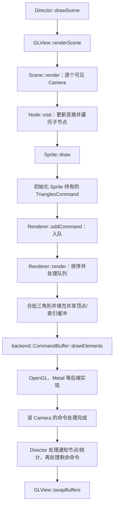

# 第 44 课（ENG16）：Sprite 到渲染器的调用路径

## 本课代码快照

src/main.cpp 是独立 C++17 教学模型，模拟 Sprite 提交绘制命令，并按相邻命令的纹理、program 和 blend 状态统计简化批次。它不调用图形 API，不测 GPU draw call，也不链接 Cocos2d-x。

~~~sh
c++ -std=c++17 -Wall -Wextra -Wpedantic -Werror src/main.cpp -o /tmp/learn-cpp-s44
/tmp/learn-cpp-s44
~~~

预期观察：四个节点产生四条命令；中间纹理状态改变后，简化模型分成三个相邻兼容组。兼容组不是实际 draw call 数。课程结构参考 [Creator 第 10 课](../../learn_3.8cocoscreator/s10_render_entry/README.md)。

本课模型已按上述命令编译并运行；这只验证课程示例，不代表已构建或运行 Cocos2d-x 工程。

**目标：** 从一帧开始，追踪场景遍历怎样调用 `Sprite::draw()`，怎样把三角形命令交给 Renderer，再怎样通过图形后端发出绘制请求。

## 本课范围与证据

结论依据仓库中的 Cocos2d-x 4.0 C++ 快照，属于静态源码追踪；本课没有构建或运行示例，也没有观测实际 draw call、帧时间或 GPU 行为。官方 v4 的 Sprite 教程也以 `TrianglesCommand` 说明 Sprite 绘制路径；具体流程以下面本地快照为准。

## 一帧怎样进入 Sprite



简化图中将主场景 Camera 画成一条路径。实际 `Scene::render()` 会遍历可见 Camera，并在每个 Camera 遍历后调用 Renderer；返回 `Director::drawScene()` 后还会访问通知节点、统计信息，并再次处理 Renderer 队列。因此不能把一次 `Sprite::draw()` 等同于当场调用一次图形 API。

## 从场景树到绘制命令

`Director::drawScene()` 先更新调度器、清屏，再经 `GLView::renderScene()` 进入 `Scene::render()`。Scene 设置当前 Camera 并调用 `Node::visit()`。可见 Node 根据父变换和自身变换得到模型视图矩阵；遍历时按本地 Z 顺序先访问负 Z 子节点，再绘制自身，最后访问其余子节点。Sprite 作为 Node 子类，在自己的绘制步骤中覆盖 `draw()`。

```cpp
// 放在一个 Layer 的初始化逻辑中；图片路径需替换成工程内存在的图片。
auto* sprite = Sprite::create("Images/grossini.png");
if (sprite == nullptr)
    return false;

sprite->setPosition(Vec2(160, 120));
this->addChild(sprite);
return true;
```

Sprite 的 `draw()` 在没有可用 `Texture2D` 或 backend texture 时直接返回。否则它把当前纹理、混合函数、几何数据、全局 Z 顺序、变换和 flags 写入自身持有的 `_trianglesCommand`，再调用 `renderer->addCommand()`。这一步是提交命令；并没有在 `Sprite::draw()` 内直接调用 `glDrawElements()`。

## Renderer 怎样处理命令

`Renderer::addCommand()` 把命令指针放进当前 render queue。默认全局 Z 为 0 的 2D 命令按入队顺序处理；负数和正数全局 Z 命令会按全局 Z 稳定排序。Node 的本地 Z 顺序影响遍历和入队顺序；`setGlobalZOrder()` 则参与 Renderer 的队列顺序。

对 `TRIANGLES_COMMAND`，Renderer 先把命令放入待处理列表，而不是立即绘制。触发 flush 时，`drawBatchedTriangles()` 将命令顶点按各自模型视图变换写入共享顶点缓冲，并拼接索引。连续且可合批命令的 material ID 相同，才会进入同一个 batch；本地 `TrianglesCommand` 的 material ID 由 backend texture、program type 和 blend factors 生成。自定义 program 可跳过合批，缓冲区容量或其他命令类型也可能造成 flush。

Renderer 为 batch 设置顶点缓冲、索引缓冲和 program state，再调用 `backend::CommandBuffer::drawElements()`。OpenGL 后端的实现会落到 `glDrawElements()`；Metal 后端则使用 Metal 的 indexed draw 接口。上层 Sprite/Renderer 代码不应假定当前一定使用某个图形 API。

## 一张 Sprite 不一定对应一次 draw call

- 一张 Sprite 通常会提交一个三角形命令；命令中使用的几何可随 Sprite 的渲染模式变化。
- 两个相邻命令只有在可合批且 material ID 匹配时，才可能被合成一个 batch。
- 因而相同纹理、默认 program、相同 blend，并且在同一处理序列中相邻，是观察合批的简化条件；仅仅“同一张图”不能保证一个 draw call。
- 混合不同纹理/材质、插入需要独立处理的命令、跨 queue 边界或触发缓冲区上限，都可能分开绘制。

Sprite 所持命令和渲染数据由 Sprite/Node 保持；`Renderer::clean()` 在处理后清空队列指针，不接管 Sprite 的生命周期。不要把 render queue 中的命令指针保存到后续帧使用。

## 动手观察

1. 在最小场景中加入两个 `Sprite::create("Images/grossini.png")`，设置不同位置，并保持默认全局 Z、program 和 blend。
2. 注册 `Director::EVENT_AFTER_DRAW` 监听器，在回调中读取 `Director::getInstance()->getRenderer()->getDrawnBatches()`；先记录一个 Sprite，再记录两个相邻 Sprite 的结果。
3. 在源码中逐步跟踪 `Node::visit()`、`Sprite::draw()`、`Renderer::addCommand()`、`Renderer::drawBatchedTriangles()`。解释观察到的 batch 数为什么不能简单按 Sprite 个数推算。
4. 再让两个 Sprite 使用不同纹理，比较结果；记录这只是当前场景、当前后端与配置下的观察，不据此推导跨平台性能。

源码里存在用于检查 Sprite/Renderer 行为的 cpp-tests 入口，但本课没有运行它们。以上步骤是可执行的观察方案，不是本课的运行结果。

## 简化说明

- 主路径以普通 Sprite、默认 2D 相机和 `TrianglesCommand` 为例；多相机、RenderTexture、SpriteBatchNode、裁剪节点、3D 队列、自定义渲染命令会插入额外步骤或队列边界。
- 课程追踪到 backend 命令接口和本地 OpenGL/Metal 实现，不声称已经验证特定设备上的最终绘制或帧性能。
- 本课未执行构建、测试或运行时采样。

## 参考资料

- [Director 帧绘制顺序](../../engine/cocos2d-x-4/cocos/base/CCDirector.cpp)
- [GLView 到 Scene 的入口](../../engine/cocos2d-x-4/cocos/platform/CCGLView.cpp)
- [Scene 按 Camera 遍历并处理命令](../../engine/cocos2d-x-4/cocos/2d/CCScene.cpp)
- [Node 变换与场景树访问](../../engine/cocos2d-x-4/cocos/2d/CCNode.cpp)
- [Sprite 构造 TrianglesCommand](../../engine/cocos2d-x-4/cocos/2d/CCSprite.cpp)
- [Sprite 持有的 TrianglesCommand](../../engine/cocos2d-x-4/cocos/2d/CCSprite.h)
- [TrianglesCommand 的纹理和材质 ID](../../engine/cocos2d-x-4/cocos/renderer/CCTrianglesCommand.cpp)
- [Renderer 队列、合批和 backend 调用](../../engine/cocos2d-x-4/cocos/renderer/CCRenderer.cpp)
- [Render queue 与 command buffer 接口](../../engine/cocos2d-x-4/cocos/renderer/CCRenderer.h)
- [抽象 backend command buffer](../../engine/cocos2d-x-4/cocos/renderer/backend/CommandBuffer.h)
- [OpenGL indexed draw 实现](../../engine/cocos2d-x-4/cocos/renderer/backend/opengl/CommandBufferGL.cpp)
- [Metal indexed draw 实现](../../engine/cocos2d-x-4/cocos/renderer/backend/metal/CommandBufferMTL.mm)
- [Sprite 测试入口](../../engine/cocos2d-x-4/tests/cpp-tests/Classes/SpriteTest/SpriteTest.cpp)
- [Cocos2d-x v4 Sprite 与 TriangleCommand 官方教程](https://docs.cocos2d-x.org/cocos2d-x/v4/en/upgradeGuide/spriteTutorial.html)
- [第 35 课：Scene、Node 与场景树](../s35_cocos2d_scene_node_tree/README.md)
- [第 36 课：变换与坐标关系](../s36_cocos2d_node_transforms_coordinates/README.md)
- [第 42 课：TextureCache 与纹理复用](../s42_cocos2d_texture_cache/README.md)
- [第 43 课：SpriteFrameCache 与精灵帧](../s43_cocos2d_sprite_frame_cache/README.md)
