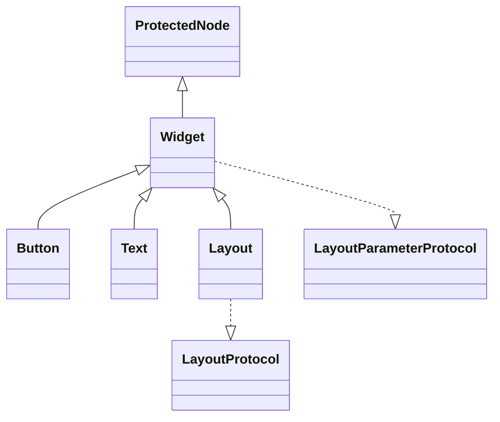

# 第 45 课（ENG17）：UI 组件与布局

**目标：** 用 `ui::Layout`、`ui::Text` 和 `ui::Button` 组一个小界面，追踪子控件如何排布，以及按钮触摸如何成为 click 回调。

## 本课范围与证据

本课依据仓库中的 Cocos2d-x 4.0 `cocos/ui/` 源码和 `cpp-tests` 示例做静态分析；没有构建或运行界面。仓库已有的输入事件 Skill 验证过独立鼠标监听示例，但不能据此说本课的 `ui::Button` 触摸与布局已运行验收。

## Cocos2d-x UI 对象是什么

`ui::Widget` 继承 `ProtectedNode`，并实现 `LayoutParameterProtocol`；`ui::Button`、`ui::Text` 和 `ui::Layout` 都是 Widget 子类。`Layout` 另外实现 `LayoutProtocol`，负责组织子控件。它们是场景树中的 C++ 对象，不是挂到普通 Node 上的 Creator `Component`。



`Layout::Type` 在本地 v4 源码中有 `ABSOLUTE`、`VERTICAL`、`HORIZONTAL`、`RELATIVE` 四种。默认是 `ABSOLUTE`：子控件按自己的 position 放置。垂直、水平或相对布局会由相应的 `LayoutManager` 计算 Widget 子节点的位置；普通 `Node` 子节点不会被线性 manager 当作 Widget 排列。

## 创建纵向菜单

以下示例使用仓库 `cpp-tests/Resources/Images` 中的按钮贴图和 `Resources/fonts` 中的字体；放到其他工程时，要换成该工程自己的资源路径。

```cpp
#include "ui/CocosGUI.h"
using namespace cocos2d;

// 在 Layer::init() 成功之后创建
auto* panel = ui::Layout::create();
panel->setContentSize(Size(360, 220));
panel->setPosition(Vec2(40, 80));
panel->setLayoutType(ui::Layout::Type::VERTICAL);
panel->setBackGroundColorType(ui::Layout::BackGroundColorType::SOLID);
panel->setBackGroundColor(Color3B(42, 54, 72));
this->addChild(panel);

auto* title = ui::Text::create("Menu", "fonts/Marker Felt.ttf", 24);
auto* titleParam = ui::LinearLayoutParameter::create();
titleParam->setGravity(ui::LinearLayoutParameter::LinearGravity::CENTER_HORIZONTAL);
titleParam->setMargin(ui::Margin(0, 12, 0, 6));
title->setLayoutParameter(titleParam);
panel->addChild(title);

auto* start = ui::Button::create(
    "Images/btn-play-normal.png",
    "Images/btn-play-selected.png");
start->setTitleText("Start");
auto* startParam = ui::LinearLayoutParameter::create();
startParam->setGravity(ui::LinearLayoutParameter::LinearGravity::CENTER_HORIZONTAL);
startParam->setMargin(ui::Margin(0, 8, 0, 10));
start->setLayoutParameter(startParam);
panel->addChild(start);

start->addClickEventListener([](Ref*) {
    CCLOG("Start clicked");
});

// 若要在首帧遍历前读取子控件 position，可显式执行一次布局。
panel->forceDoLayout();
```

## Layout 怎样计算位置

`Layout::addChild()` 会为 Widget 子节点补上当前布局类型需要的参数；垂直/水平布局补 `LinearLayoutParameter`，相对布局补 `RelativeLayoutParameter`。也可以像示例一样自行创建参数并设置 margin。

布局类型、容器尺寸、子节点增删等操作会把布局标记为 dirty。`Layout::visit()` 在遍历子节点前调用 `doLayout()`；若没有 dirty 标记就跳过重算。垂直 manager 从容器顶部开始，按已经排序的子节点顺序，用子节点的包围尺寸、anchor、margin 和 gravity 算出 position，再把下一个子节点放到当前控件下方。想在这一帧立即检查位置，可以调用 `forceDoLayout()`。

因此，容器的 `contentSize` 是布局计算输入；它不会因为 `Layout` 是一个“面板”就自动等于屏幕大小。线性布局的间隔可通过控件的 `Margin` 表达。不要把 Creator 2.4 `Layout` 的 `spacingX/spacingY` 属性套到 Cocos2d-x 4.0 C++ `ui::Layout` 上。

## Button 点击从哪里来

`Button` 构造时启用触摸。`Widget::setTouchEnabled(true)` 创建 `EventListenerTouchOneByOne`，把它以 scene-graph priority 注册到当前 Widget，并默认设置为 swallow touches。触摸开始时，Widget 会检查自身和祖先的可见/启用状态，再用当前 Camera 和本地变换做 hit test；若位于启用裁剪的 Layout 下，还要通过裁剪区域检查。

按下命中后 Widget 进入 highlighted 状态。移动时它会重新 hit test 并更新高亮；抬起时仍高亮才走 `releaseUpEvent()`，触发 `addClickEventListener()` 保存的回调。移出按钮后再抬起会走 cancel 路径，不触发 click。

Widget 向父 Widget 传播 UI touch callback 与 EventDispatcher 的 `swallowTouches` 是两件事。本地 Widget 默认 `_propagateTouchEvents` 为 true，而触摸 listener 默认 swallow 为 true；排查父容器回调或同屏其他监听器收不到事件时，需要分别检查这两层设置。

触摸 listener 由 Widget 管理，Widget 析构时会从 EventDispatcher 移除它并释放 listener。`removeFromParent()` 只说明脱离父节点，不足以证明 Widget 已析构；所有权和清理边界可对照[第 39 课](../s39_cocos2d_event_dispatcher_input/README.md)。

## 动手观察

1. 在 `cpp-tests` 中找到 `UILayoutTest_Layout_Linear_Vertical`，对照本课 `VERTICAL` 菜单跟踪 layout parameter、manager 和子控件 position。
2. 运行一个最小菜单时，记录每个 Widget 的 `getPosition()`；调整容器高度、子控件顺序或 top/bottom margin，再观察布局结果。`forceDoLayout()` 可用于布局完成后立即读取 position。
3. 点击按钮中途保持手指/鼠标在按钮内再抬起，记录 click；按下后移出再抬起，确认两条路径的回调差异。
4. 分别检查 Widget 的 `_propagateTouchEvents` 和 listener 的 `isSwallowTouches()`，解释 UI 父级 touch 回调与普通 EventDispatcher listener 的传播差异。

这些是后续运行观察步骤，不是本课已运行的结果。`cpp-tests` 中有 UI 示例入口，但本课没有执行它们；不同平台的字体、触摸输入和显示尺寸还要在目标环境单独验证。

## 简化说明

- 本课聚焦 `Layout` 绝对/线性布局和 `Button` 点击，不展开 RelativeLayoutParameter 规则、百分比尺寸、LayoutComponent、焦点导航、滚动容器或 Cocos Studio 序列化。
- `Button` 图片和字体路径取自 `cpp-tests` 资源目录，不保证在空白模板工程里可直接加载。
- 仓库目前没有独立的 Cocos2d-x UI/布局 Skill；按钮输入部分参考现有 input-events Skill。没有构建、运行或目标设备验收。

## 参考资料

- [Widget 类型、尺寸、命中检测和触摸回调](../../engine/cocos2d-x-4/cocos/ui/UIWidget.h)
- [Widget 触摸监听器、命中检测和 click 回调实现](../../engine/cocos2d-x-4/cocos/ui/UIWidget.cpp)
- [Layout 类型、容器与布局接口](../../engine/cocos2d-x-4/cocos/ui/UILayout.h)
- [Layout dirty 标记、子节点参数和遍历时布局](../../engine/cocos2d-x-4/cocos/ui/UILayout.cpp)
- [垂直/水平布局 manager](../../engine/cocos2d-x-4/cocos/ui/UILayoutManager.cpp)
- [Margin 与 LinearLayoutParameter](../../engine/cocos2d-x-4/cocos/ui/UILayoutParameter.h)
- [Button 资源、标题与内部渲染节点](../../engine/cocos2d-x-4/cocos/ui/UIButton.cpp)
- [cpp-tests UI 纵向布局入口](../../engine/cocos2d-x-4/tests/cpp-tests/Classes/UITest/CocoStudioGUITest/UILayoutTest/UILayoutTest.cpp)
- [cpp-tests Button 与点击回调入口](../../engine/cocos2d-x-4/tests/cpp-tests/Classes/UITest/CocoStudioGUITest/UIButtonTest/UIButtonTest.cpp)
- [示例普通状态按钮贴图](../../engine/cocos2d-x-4/tests/cpp-tests/Resources/Images/btn-play-normal.png)
- [示例按下状态按钮贴图](../../engine/cocos2d-x-4/tests/cpp-tests/Resources/Images/btn-play-selected.png)
- [示例字体](../../engine/cocos2d-x-4/tests/cpp-tests/Resources/fonts/Marker%20Felt.ttf)
- [输入事件专题 Skill](../../plugins/cocos2d-x-4/skills/cocos2d-x-4-input-events/SKILL.md)
- [Cocos2d-x v4 Button 指南](https://docs.cocos2d-x.org/cocos2d-x/v4/en/ui_components/buttons.html)
- [Cocos2d-x v4 Layout API](https://docs.cocos2d-x.org/api-ref/cplusplus/V4.0/d2/db7/classcocos2d_1_1ui_1_1_layout.html)
- [Cocos2d-x v4 Widget API](https://docs.cocos2d-x.org/api-ref/cplusplus/V4.0/d8/d62/classcocos2d_1_1ui_1_1_widget.html)
- [第 35 课：Scene、Node 与场景树](../s35_cocos2d_scene_node_tree/README.md)
- [第 36 课：变换与坐标关系](../s36_cocos2d_node_transforms_coordinates/README.md)
- [第 39 课：事件分发与输入监听](../s39_cocos2d_event_dispatcher_input/README.md)
- [第 44 课：Sprite 到渲染器的调用路径](../s44_cocos2d_sprite_renderer_path/README.md)
