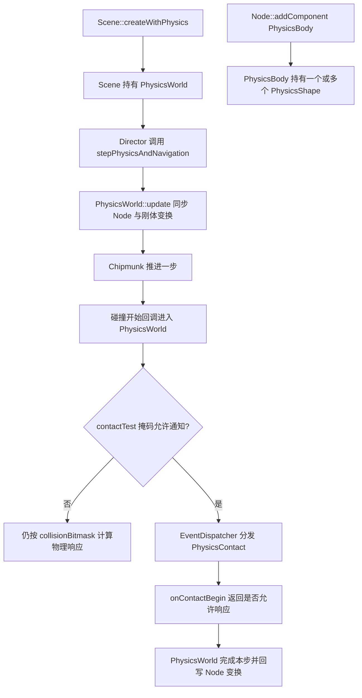

# 第 47 课（ENG19）：物理组件与碰撞回调

**目标：** 创建一个启用物理世界的场景，把静态地面和动态圆形刚体接到 Node 上，并追踪碰撞响应与碰撞通知各自经过的源码路径。

## 本课范围与证据

本课按仓库中的 Cocos2d-x 4.0 C++ 快照追踪 2D `PhysicsWorld`、`PhysicsBody` 和 contact listener；未构建或运行示例。这里的物理世界在本地源码中通过 Chipmunk `cpSpace`/`cpHastySpace` 执行。它与 `Physics3DWorld`/Bullet 路径不同，不能把两者 API 或行为混为一谈。

`Scene::createWithPhysics()` / `initWithPhysics()` 受 `CC_USE_PHYSICS` 编译配置控制。若目标工程没有启用这项配置，物理 API 可能不可用。官方 v4 手册用于了解公开概念，本课涉及的掩码判断以本地 `CCPhysicsWorld.cpp` 的实际条件为准。

## 从场景更新到碰撞回调



`Scene::initWithPhysics()` 创建并持有 `PhysicsWorld`。默认自动步进打开；Director 在运行场景的绘制前调用 `stepPhysicsAndNavigation(deltaTime)`，Scene 再将时间交给 `PhysicsWorld::update()`。更新过程中先把场景树变换同步给物理体，推进物理世界，再把刚体结果同步回 Node。手动调用 `step()` 前要先关闭自动步进。

`PhysicsBody` 是 Node 的组件，形状由 `PhysicsShape` 提供。`PhysicsBody::createCircle()`、`createBox()` 会创建带形状的刚体；`createEdgeSegment()`、`createEdgeBox()` 等边界刚体在本地实现中会设为非动态，适合做固定地面或墙。Node 的组件关系负责把可视节点和物理体关联起来。

## 一个地面和落球

下面的函数返回一个可作为运行场景使用的 `Scene`。圆形使用 `DrawNode` 画在刚体原点，不依赖外部贴图；若要直接编译运行，还需放入启用了 2D physics 的 Cocos2d-x 工程。

```cpp
#include "cocos2d.h"

using namespace cocos2d;

Scene* createPhysicsDemo()
{
    auto* scene = Scene::createWithPhysics();
    if (scene == nullptr)
        return nullptr;

    auto* world = scene->getPhysicsWorld();
    world->setGravity(Vec2(0.0f, -400.0f));

    const Size visibleSize = Director::getInstance()->getVisibleSize();
    const Vec2 visibleOrigin = Director::getInstance()->getVisibleOrigin();

    auto* ground = Node::create();
    ground->setPosition(Vec2(visibleOrigin.x, visibleOrigin.y + 40.0f));
    auto* groundBody = PhysicsBody::createEdgeSegment(
        Vec2::ZERO, Vec2(visibleSize.width, 0.0f));
    groundBody->setTag(1);
    groundBody->setContactTestBitmask(0xFFFFFFFF);
    ground->addComponent(groundBody);
    scene->addChild(ground);

    constexpr float radius = 24.0f;
    auto* ball = DrawNode::create();
    ball->drawDot(Vec2::ZERO, radius, Color4F::RED);
    ball->setPosition(Vec2(visibleOrigin.x + visibleSize.width * 0.5f,
                           visibleOrigin.y + visibleSize.height * 0.75f));
    auto* ballBody = PhysicsBody::createCircle(radius);
    ballBody->setDynamic(true);
    ballBody->setTag(2);
    ballBody->setContactTestBitmask(0xFFFFFFFF);
    ball->addComponent(ballBody);
    scene->addChild(ball);

    auto* listener = EventListenerPhysicsContact::create();
    listener->onContactBegin = [](PhysicsContact& contact) {
        auto* bodyA = contact.getShapeA()->getBody();
        auto* bodyB = contact.getShapeB()->getBody();
        CCLOG("Contact begin: body %d with body %d",
              bodyA->getTag(), bodyB->getTag());
        return true; // 保留本次接触的物理响应
    };
    listener->onContactSeparate = [](PhysicsContact& contact) {
        CCLOG("Contact separated");
    };

    Director::getInstance()->getEventDispatcher()
        ->addEventListenerWithSceneGraphPriority(listener, scene);
    return scene;
}
```

地面边刚体会固定在 Node 的位置；圆形刚体默认受重力影响，这里显式设为动态。示例把两个刚体的 contact-test 掩码都设为全 1，目的是确保当前本地源码会分发 contact 通知；这不是所有玩法都应采用的过滤策略。

## 碰撞响应和通知是两种判断

本地 `PhysicsShape` 默认 category 和 collision 掩码为全 1，contact-test 掩码为 `0`。因此两个默认刚体可以发生物理碰撞，但默认不会发出 contact listener 通知。

| 字段 | 作用 | 本地 v4 默认值 |
| --- | --- | --- |
| `categoryBitmask` | 标记刚体所属类别 | `0xFFFFFFFF` |
| `collisionBitmask` | 决定物理碰撞响应能否发生 | `0xFFFFFFFF` |
| `contactTestBitmask` | 决定游戏是否收到 contact 通知 | `0x00000000` |

当前本地 `PhysicsWorld::collisionBeginCallback()` 对普通 group 的判断分别检查两边的 category 与对方的 collision 掩码；要有碰撞响应，两个交叉按位与都需非零。contact 通知也有独立检查：源码在任一交叉按位与为零时关闭通知，因此本地实现要求两个方向都匹配。`CCPhysicsBody.h` 的文字注释把通知条件描述成“任一比较非零”，与 `CCPhysicsWorld.cpp` 的实际门控条件不完全一致；本课示例用双方全 1 掩码避开这一边界，并建议在目标构建上核验。

即使掩码允许通知，`EventListenerPhysicsContact` 也必须注册到 `EventDispatcher`。`onContactBegin` 返回 `true` 让物理解算继续；返回 `false` 会拒绝这次接触的响应。不要把它与 `contactTestBitmask` 混为一层：一个决定是否产生通知，一个决定回调是否接受接触响应。

## 四类 contact 回调

| 回调 | 时机 | 返回值 / 用途 |
| --- | --- | --- |
| `onContactBegin` | 两个形状刚开始接触 | `true` 接受响应，`false` 忽略这次接触 |
| `onContactPreSolve` | 两个形状本步仍接触、响应前 | `false` 可跳过本步响应，也可改摩擦、弹性或表面速度 |
| `onContactPostSolve` | 本步碰撞响应之后 | 读取求解信息，适合做碰撞结果观察 |
| `onContactSeparate` | 两个形状分离 | 处理离开接触状态 |

普通 `EventListenerPhysicsContact` 会收到通过掩码的各类接触；若只关心指定刚体、形状或 group，可以使用 `EventListenerPhysicsContactWithBodies`、`...WithShapes` 或 `...WithGroup`。listener 以 Scene graph priority 注册到 Scene 后，会随 Scene 的事件目标生命周期管理。

## 动手观察

1. 在 `cpp-tests` 的 `PhysicsContactTest` 中追踪 World 重力、静态边界、多个类别的 body 和 contact listener；对照本课单球示例缩小到一个接触对。
2. 将球和地面的 `contactTestBitmask` 都改成 `0`：观察源码里物理响应掩码仍允许碰撞，但通知门控关闭。再只给一侧设全 1，比较本地实现的双向条件。
3. 保留 contact 通知，把一侧 `collisionBitmask` 设为 `0`：区分“收到事件”和“发生物理响应”。
4. 分别让 `onContactBegin` 返回 `true` 和 `false`，再观察 `onContactSeparate`，记录运行平台、Cocos2d-x 构建配置和回调结果。
5. 打开 `PhysicsWorld::DEBUGDRAW_ALL`，对比绘制形状与 Node 的可视标记，检查碰撞体尺寸、位置和可视对象是否对齐。

这些步骤是待运行的观察方案。`PhysicsTest.cpp` 有对应示例和测试入口，但本课没有构建、运行或做目标平台验收。

## 简化说明

- 本课聚焦 2D 刚体、边界形状和 contact 通知；不展开关节、射线/区域查询、复杂碰撞组、连续碰撞或 3D Bullet。
- 示例采用 Chipmunk 后端的 Cocos2d-x 4.0 本地源码结论；目标平台的构建开关、步进时序和实际碰撞结果仍需运行验证。
- 仓库目前没有独立的 Cocos2d-x 物理专题 Skill；Creator 的 2D/3D physics Skills 面向另一套运行时，本课没有套用。

## 参考资料

- [Scene 创建 PhysicsWorld 与自动步进](../../engine/cocos2d-x-4/cocos/2d/CCScene.cpp)
- [Director 帧循环中的物理步进调用](../../engine/cocos2d-x-4/cocos/base/CCDirector.cpp)
- [Scene 的 PhysicsWorld 接口](../../engine/cocos2d-x-4/cocos/2d/CCScene.h)
- [PhysicsWorld 碰撞筛选、步进与刚体同步](../../engine/cocos2d-x-4/cocos/physics/CCPhysicsWorld.cpp)
- [PhysicsWorld 公共配置与调试接口](../../engine/cocos2d-x-4/cocos/physics/CCPhysicsWorld.h)
- [PhysicsBody 创建、形状和 bitmask](../../engine/cocos2d-x-4/cocos/physics/CCPhysicsBody.cpp)
- [PhysicsBody 的类别、碰撞和通知掩码接口](../../engine/cocos2d-x-4/cocos/physics/CCPhysicsBody.h)
- [PhysicsShape 默认掩码和形状数据](../../engine/cocos2d-x-4/cocos/physics/CCPhysicsShape.cpp)
- [PhysicsContact 与各类碰撞 listener](../../engine/cocos2d-x-4/cocos/physics/CCPhysicsContact.h)
- [Contact 事件分发与回调返回值](../../engine/cocos2d-x-4/cocos/physics/CCPhysicsContact.cpp)
- [Node 附加 PhysicsBody 组件的接口](../../engine/cocos2d-x-4/cocos/2d/CCNode.h)
- [cpp-tests PhysicsContactTest 示例](../../engine/cocos2d-x-4/tests/cpp-tests/Classes/PhysicsTest/PhysicsTest.cpp)
- [Cocos2d-x v4 物理概念与 PhysicsWorld](https://docs.cocos2d-x.org/cocos2d-x/v4/en/physics/concepts.html)
- [Cocos2d-x v4 碰撞检测与 contact 回调](https://docs.cocos2d-x.org/cocos2d-x/v4/en/physics/collisions.html)
- [PhysicsBody v4 C++ API](https://docs.cocos2d-x.org/api-ref/cplusplus/v4x/d7/d7b/classcocos2d_1_1_physics_body.html)
- [第 35 课：Scene、Node 与场景树](../s35_cocos2d_scene_node_tree/README.md)
- [第 36 课：变换与坐标关系](../s36_cocos2d_node_transforms_coordinates/README.md)
- [第 38 课：Component 与组件生命周期](../s38_cocos2d_component_lifecycle/README.md)
