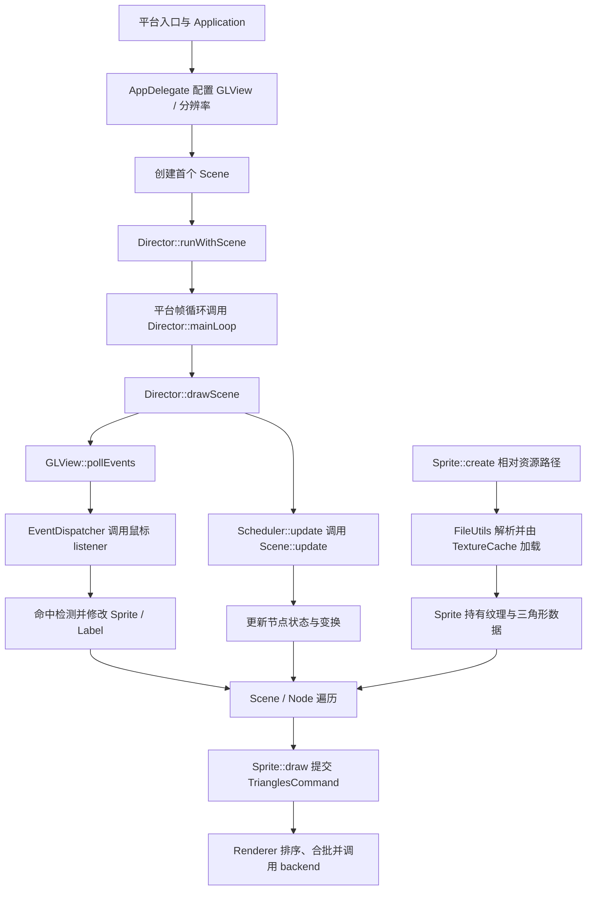

# 第 48 课（ENG20）：综合练习：启动、交互、资源与渲染

**目标：** 以 Cocos2d-x 4.0 默认 C++ 模板为起点，串起 AppDelegate 启动首个场景、Scheduler 更新节点、鼠标输入改变状态、FileUtils/TextureCache 载入图片，以及 Sprite 命令进入 Renderer 的完整路径。

## 本课范围与证据

本课是前 19 个引擎主题的综合练习，不新增一套项目结构。示例依据仓库的 `cpp-template-default` 和当前 Cocos2d-x 4.0 源码做静态整理；没有构建或运行本课改动，也不据此声称某个平台已验收。

启动顺序与平台消息循环会因目标平台而异。本课用默认 C++ 模板讲共同的 `AppDelegate → Director → Scene` 接线，并用模板中的桌面 `EventListenerMouse` 示例讲交互。移动端触摸输入请按[第 39 课](../s39_cocos2d_event_dispatcher_input/README.md)的 listener 路径另行验证。

## 一条完整的运行路径



默认模板的 `AppDelegate::applicationDidFinishLaunching()` 先取得 `Director`，创建并设置 `GLView`，配置设计分辨率与内容缩放，再创建首个 Scene 并调用 `runWithScene()`。实际平台入口如何启动 `Application`、如何驱动帧循环，应沿目标平台模板继续追踪；不要假设桌面、Android 和 iOS 共用同一个 `main()`。

在本地 `Director::drawScene()` 中，会先轮询 GLView 事件，再更新 Scheduler，随后进入场景绘制。Sprite 的 `update()` 修改位置或旋转后，Node 遍历会带着当前变换进入 `Sprite::draw()`；事件回调更新的位置和 Label 文本也会在接下来的绘制中体现。

## 启动首个场景

在默认模板 `AppDelegate::applicationDidFinishLaunching()` 中，GLView 和设计分辨率已经配置完成后，核心接线是：

```cpp
auto director = Director::getInstance();
auto scene = CapstoneScene::createScene();
if (scene == nullptr)
    return false;

director->runWithScene(scene); // 仅用于启动首个 Scene
```

`runWithScene()` 是 Director 启动时进入第一个场景的入口；已有运行场景时切换场景应使用对应的场景栈/替换接口，不要重复把 `runWithScene()` 当作任意切场景 API。GLView、分辨率策略、资源搜索路径和平台启动器保持模板原有配置，本课不重写它们。

## 创建 Sprite、更新场景并响应鼠标

下面的紧凑示例是一个独立 Scene 类，可放在新建的 `CapstoneScene.h/.cpp` 中；若直接改模板 `HelloWorldScene.h/.cpp`，请将类名和现有声明合并，避免重复定义。`HelloWorld.png` 和 `fonts/Marker Felt.ttf` 是默认 C++ 模板的资源；换工程时要确认它们被放入目标包并可由 FileUtils 搜索到。

```cpp
#include "cocos2d.h"

using namespace cocos2d;

class CapstoneScene : public cocos2d::Scene
{
public:
    static cocos2d::Scene* createScene() { return CapstoneScene::create(); }

    bool init() override
    {
        if (!Scene::init())
            return false;

        const auto size = Director::getInstance()->getVisibleSize();
        const auto origin = Director::getInstance()->getVisibleOrigin();

        _sprite = Sprite::create("HelloWorld.png");
        if (_sprite == nullptr)
            return false;
        _sprite->setPosition(Vec2(origin.x + size.width / 2.0f,
                                  origin.y + size.height / 2.0f));
        addChild(_sprite);

        _status = Label::createWithTTF("Clicks: 0", "fonts/Marker Felt.ttf", 24);
        if (_status == nullptr)
            return false;
        _status->setPosition(Vec2(origin.x + size.width / 2.0f,
                                  origin.y + size.height - 24.0f));
        addChild(_status, 1);

        auto listener = EventListenerMouse::create();
        listener->onMouseDown = [this](EventMouse* event) {
            if (event->getMouseButton() != EventMouse::MouseButton::BUTTON_LEFT)
                return;

            const Vec2 point = convertToNodeSpace(event->getLocation());
            if (!_sprite->getBoundingBox().containsPoint(point))
                return;

            ++_clickCount;
            _status->setString(StringUtils::format("Clicks: %d", _clickCount));
            _sprite->setPositionX(_sprite->getPositionX() + 20.0f);
        };
        _eventDispatcher->addEventListenerWithSceneGraphPriority(listener, _sprite);

        scheduleUpdate();
        return true;
    }

    void update(float dt) override
    {
        if (_sprite == nullptr)
            return;

        _rotation += 20.0f * dt;
        _sprite->setRotation(_rotation);
    }

    CREATE_FUNC(CapstoneScene);

private:
    cocos2d::Sprite* _sprite = nullptr; // 由 Scene 的子节点关系持有
    cocos2d::Label* _status = nullptr;  // 由 Scene 的子节点关系持有
    int _clickCount = 0;
    float _rotation = 0.0f;
};
```

这里的 `getBoundingBox()` 给出 Sprite 在父节点坐标中的边界；鼠标位置先通过 `convertToNodeSpace()` 转成 Scene 坐标，再做命中检查。鼠标 listener 绑定到 Sprite 的 scene-graph priority，使事件目标跟随节点运行状态；如果改用固定优先级，必须自己管理 listener 与回调捕获对象的生命周期。

`scheduleUpdate()` 把 Scene 的 `update(dt)` 注册到 Scheduler。`dt` 用于按时间推进旋转角度；不要把“每帧加固定角度”当成与帧率无关的运动。事件处理只修改游戏状态，绘制仍由后续 Scene/Node 遍历统一完成。

## 图片怎样进入屏幕

`Sprite::create("HelloWorld.png")` 进入 `Sprite::initWithFile()`，再调用 Director 持有的 `TextureCache::addImage()`。TextureCache 经 FileUtils 解析相对路径、读取并创建或复用纹理。找不到文件或图像解码失败时 Sprite 创建会失败，所以示例检查了空指针；资源存在不等于任何目标平台都能正确打包或读取。

之后 `Sprite::draw()` 把纹理、三角形、混合信息和变换写入 Sprite 持有的 `TrianglesCommand`，再将命令交给 Renderer。Renderer 后续排序、批处理并调用图形 backend；Sprite 提交一个命令不代表立即执行一次 GPU draw，也不能仅凭画面上的 Sprite 数量推断 draw call 数量。批处理条件见[第 44 课](../s44_cocos2d_sprite_renderer_path/README.md)。

## 逐段验证思路

1. 从 `AppDelegate.cpp` 追踪 GLView、设计分辨率、`createScene()` 和 `Director::runWithScene()`；再按目标平台入口查找谁驱动 `Director::mainLoop()`。
2. 启动默认模板后确认 `HelloWorld.png` 能载入。若 `_sprite` 为空，先检查资源包内容、FileUtils 搜索路径和实际文件名，不要先追 Renderer。
3. 在目标平台点击 Sprite 内部和外部：内部点击应更新 Label 并移动 Sprite，外部点击应无变化。记录 mouse listener 的事件位置、转换后的 Scene 坐标和命中结果。
4. 对照 `scheduleUpdate()` 与 `Director::drawScene()` 的 Scheduler 更新顺序，确认旋转使用 `dt`，并检查暂停或节点退出时更新是否还在执行。
5. 沿 `Sprite::initWithFile()`、`TextureCache::addImage()`、`Sprite::draw()`、`Renderer::addCommand()` 查看资源和命令路径；将观察到的命令、batch 和最终 draw call 分开记录。
6. 替换场景后检查 Sprite、scene-graph listener 和 Label 的所属关系。节点退出时监听器会随目标状态暂停；Node 的最终析构与父子所有权仍需分开判断。

以上是本课的目标平台练习步骤，不是当前已运行结果。本课没有构建、点击或测量渲染；仓库的历史 HelloCpp 桌面验证只证明其记录中对应的构建和交互切片，不替代本次综合练习的验收。

## 简化说明

- 核心例子采用默认 C++ 模板和桌面鼠标输入。移动平台应换成 `EventListenerTouchOneByOne` 并在目标设备上验证；平台 launcher 与事件注入细节不在此例中展开。
- 本课只加载一张普通 PNG，不展开 SpriteFrame atlas、异步资源、音频和物理；这些主题分别见前面的课程。
- 本课追踪到 Renderer/backend 接口，不声称在任意图形 API 或设备上观测了 draw call、GPU 时间或性能。

## 参考资料

- [默认模板 AppDelegate 启动接线](../../engine/cocos2d-x-4/templates/cpp-template-default/Classes/AppDelegate.cpp)
- [默认模板 Scene、Sprite、Label 与鼠标输入](../../engine/cocos2d-x-4/templates/cpp-template-default/Classes/HelloWorldScene.cpp)
- [默认模板 Scene 声明](../../engine/cocos2d-x-4/templates/cpp-template-default/Classes/HelloWorldScene.h)
- [默认模板 HelloWorld.png](../../engine/cocos2d-x-4/templates/cpp-template-default/Resources/HelloWorld.png)
- [默认模板 Marker Felt 字体](../../engine/cocos2d-x-4/templates/cpp-template-default/Resources/fonts/Marker%20Felt.ttf)
- [Director 帧循环、事件轮询、Scheduler 与绘制](../../engine/cocos2d-x-4/cocos/base/CCDirector.cpp)
- [Node 更新注册与场景树遍历](../../engine/cocos2d-x-4/cocos/2d/CCNode.cpp)
- [鼠标 listener 与事件分发](../../engine/cocos2d-x-4/cocos/base/CCEventListenerMouse.h)
- [FileUtils 资源路径解析](../../engine/cocos2d-x-4/cocos/platform/CCFileUtils.cpp)
- [Sprite::initWithFile 与 TextureCache 接线](../../engine/cocos2d-x-4/cocos/2d/CCSprite.cpp)
- [TextureCache 图片加载和缓存](../../engine/cocos2d-x-4/cocos/renderer/CCTextureCache.cpp)
- [Renderer 命令队列与批处理](../../engine/cocos2d-x-4/cocos/renderer/CCRenderer.cpp)
- [Cocos2d-x v4 Director 指南](https://docs.cocos2d-x.org/cocos2d-x/v4/en/basic_concepts/director.html)
- [Cocos2d-x v4 文件系统指南](https://docs.cocos2d-x.org/cocos2d-x/v4/en/advanced_topics/filesystem.html)
- [Cocos2d-x v4 事件注册指南](https://docs.cocos2d-x.org/cocos2d-x/v4/en/event_dispatcher/registering.html)
- [Cocos2d-x v4 Sprite 与 TriangleCommand](https://docs.cocos2d-x.org/cocos2d-x/v4/en/upgradeGuide/spriteTutorial.html)
- [第 33 课：Director 与场景切换](../s33_cocos2d_director_scene_switching/README.md)
- [第 34 课：帧循环与 Scheduler](../s34_cocos2d_frame_loop_scheduler/README.md)
- [第 39 课：事件分发与输入监听](../s39_cocos2d_event_dispatcher_input/README.md)
- [第 41 课：FileUtils 与资源路径解析](../s41_cocos2d_fileutils_path_resolution/README.md)
- [第 42 课：TextureCache 与纹理复用](../s42_cocos2d_texture_cache/README.md)
- [第 44 课：Sprite 到渲染器的调用路径](../s44_cocos2d_sprite_renderer_path/README.md)
