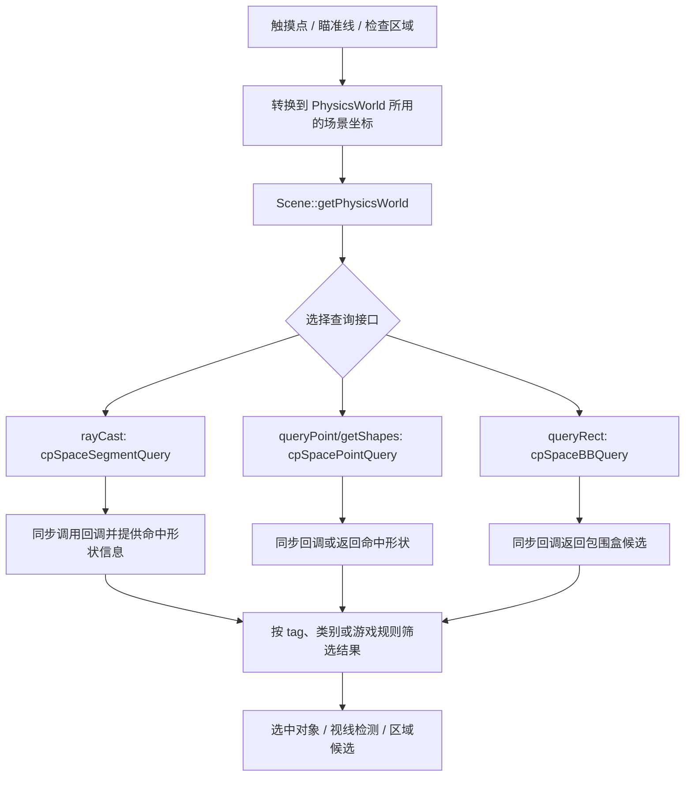

# 第 49 课（ENG21）：物理世界查询——射线、点与区域

**目标：** 按需询问 Cocos2d-x 2D `PhysicsWorld` 哪些形状位于一条线段、一个点或一个矩形附近，并区分空间查询结果与第 47 课的碰撞响应/接触通知。

## 本课范围与证据

本课依据仓库中的 Cocos2d-x 4.0 `CCPhysicsWorld` 接口、Chipmunk 调用和 `cpp-tests/PhysicsTest.cpp` 做静态分析；未构建或运行查询示例。范围仅限 2D `PhysicsWorld`，不涉及 3D/Bullet 查询。

仓库目前没有独立的 Cocos2d-x 物理查询 Skill。官方 v4 查询指南帮助确定公开用法；过滤细节、回调和待处理刚体处理以本地 `.cpp` 实现为准。

## 查询不是碰撞事件

第 47 课的 `onContactBegin` 来自物理模拟步中的接触；查询则由游戏代码在需要时主动调用，用来回答“从这里沿这条线能碰到哪些形状？”或“这个位置附近有哪些形状？”它不会替代接触事件，也不自动改变刚体速度或施加碰撞响应。



从屏幕输入发起查询时，先把触摸或鼠标位置转换到场景坐标，再交给 `PhysicsWorld`。坐标变换的依据见[第 36 课](../s36_cocos2d_node_transforms_coordinates/README.md)。

## 五种常用入口

| API | 返回或回调的内容 | 本地实现需要注意的边界 |
| --- | --- | --- |
| `rayCast(func, start, end, data)` | 线段穿过的形状；回调拿到 `PhysicsRayCastInfo` | `true` 继续枚举，`false` 结束；需要最近命中时收集后按 `fraction` 取最小值 |
| `queryPoint(func, point, data)` | 包含该点的形状 | 查询半径为 0；本地回调桥接不提供可靠的提前终止 |
| `getShapes(point)` | 所有包含该点的 `PhysicsShape*` | 直接返回 `Vector`；每个形状归其 PhysicsBody 管理 |
| `getShape(point)` | 点查询得到的最近形状，或 `nullptr` | 适合单对象点选；重叠对象的选择结果不等同于 UI 的前后层级 |
| `queryRect(func, rect, data)` | 包围盒与 Rect 重叠的形状候选 | 是包围盒筛选，不保证形状几何本身与矩形精确相交 |

本地 `rayCast()` 把起点、终点转成 Chipmunk 坐标后调用 `cpSpaceSegmentQuery()`，并填充 `PhysicsRayCastInfo` 的 shape、start、end、contact、normal 和 fraction。`cpp-tests` 的 `PhysicsDemoRayCast` 有 any、nearest、multiple 三种写法：最近命中模式遍历所有结果并比较 `fraction`，而不是假设第一个回调就是最近形状。

`queryRect()` 调用 `cpSpaceBBQuery()`；头文件也把 callback 条件写成 shape bounding box 与查询矩形重叠。它适合粗筛，再由游戏逻辑做精确判断。`queryPoint()` 的底层查询距离为 0；`getShapes()` 用同一类点查询返回全部命中，`getShape()` 使用 nearest 查询返回一个形状。

本地 `PhysicsQueryPointCallbackFunc` 与矩形查询共用 `bool` 函数类型，但 `queryPointFunc` 只把返回值写入 `continues`，没有像矩形/射线桥接那样在下一次回调前检查它。因此不要依赖 `queryPoint()` 的回调返回 `false` 来提前停止；只需一个目标时用 `getShape()`，否则收集结果后自行筛选。

查询 API 没有单独传入 Cocos `categoryBitmask`、`collisionBitmask` 或 `contactTestBitmask` 的参数。本地包装层使用 `CP_SHAPE_FILTER_ALL`；若玩法只考虑某一组 body，需在回调中按 body tag、类别或自己的对象状态过滤，不要把碰撞响应的 mask 自动当成查询过滤条件。

## 收集射线命中并找最近点

下面代码适合放在拥有 `PhysicsWorld*` 的查询函数里。起点和终点必须已经处于场景/物理世界使用的坐标空间。

```cpp
#include <algorithm>
#include <vector>
#include "cocos2d.h"

using namespace cocos2d;

struct RayHit
{
    float fraction;
    Vec2 point;
    int bodyTag;
};

void inspectRay(PhysicsWorld* world, const Vec2& start, const Vec2& end)
{
    if (world == nullptr)
        return;

    std::vector<RayHit> hits;
    world->rayCast(
        [&hits](PhysicsWorld&, const PhysicsRayCastInfo& info, void*) {
            auto* body = info.shape->getBody();
            hits.push_back({info.fraction, info.contact,
                            body != nullptr ? body->getTag() : -1});
            return true; // 继续收集线段上的其他命中
        },
        start, end, nullptr);

    if (hits.empty())
        return;

    const auto nearest = std::min_element(
        hits.begin(), hits.end(),
        [](const RayHit& a, const RayHit& b) {
            return a.fraction < b.fraction;
        });

    CCLOG("nearest body=%d fraction=%.3f at (%.1f, %.1f)",
          nearest->bodyTag, nearest->fraction,
          nearest->point.x, nearest->point.y);
}
```

`rayCast()` 会在调用期间同步执行查询回调，所以这个例子中的局部 `hits` 在函数返回前有效。`PhysicsShape*` 仍由所属 body 管理；如需跨帧保存结果，应复制需要的 tag/坐标，或明确管理被保存对象的生命周期。

如果只想让查询在某个条件成立时停止，可以在回调中返回 `false`。若需求是“最近命中”，先确认排序规则或像上例一样比较 `fraction`；不能把“提前终止”本身当作最近命中的保证。

## 矩形候选与点选

```cpp
void collectRectCandidates(PhysicsWorld* world, const Rect& area)
{
    if (world == nullptr)
        return;

    std::vector<int> bodyTags;
    world->queryRect(
        [](PhysicsWorld&, PhysicsShape& shape, void* data) {
            auto* tags = static_cast<std::vector<int>*>(data);
            auto* body = shape.getBody();
            if (body != nullptr)
                tags->push_back(body->getTag());
            return true; // 继续枚举矩形包围盒候选
        },
        area, &bodyTags);

    // bodyTags 是粗筛结果；按游戏自己的精确规则继续筛选。
}
```

当只需点选时，可以使用 `getShapes(point)` 得到全部重叠 shape，再根据 body tag 或对象状态选目标；`getShape(point)` 可直接取得一个最近 shape。`getShapes()`/`getShape()` 返回的是由 PhysicsWorld 管理对象持有的裸指针，不会因为查询而转移所有权。

## 查询更新与延迟刚体

本地 `rayCast()`、`queryRect()` 和 `queryPoint()` 在查询前会检查 PhysicsWorld 的延迟添加/移除 body 队列，必要时调用 `updateBodies()`。`getShapes()` 和 `getShape()` 则直接向 `cpSpace` 查询，没有这段队列刷新逻辑。若刚体正处于物理世界锁定期间的待处理变更中，不能假设这几种接口会观察到完全相同的状态；应避免在修改物理世界的回调里混用它们，并在目标运行环境验证所需时序。

这几种 API 是同步空间查询，不是监听器。它们不会触发 `onContactBegin` / `onContactSeparate`，也不会告诉你刚体在下一物理步是否会碰撞。需要边界或碰撞过滤时，结合[第 47 课](../s47_cocos2d_physics_contact_callbacks/README.md)理解 contact mask 与 collision mask。

## 动手观察

1. 查看 `PhysicsDemo::onTouchBegan()`：追踪屏幕触摸点、`getShapes(location)` 和从 shape 找回 PhysicsBody 的过程。
2. 查看 `PhysicsDemoRayCast` 的 any、nearest、multiple 三种模式；记录 callback 的 `return false`、遍历全部结果和最小 `fraction` 三种差异。
3. 用相同坐标调用 `getShapes()` 与 `getShape()`，比较重叠形状时的返回数量；再让点落在 shape 外，确认空结果。
4. 调整矩形区域，使其只覆盖某个多边形的包围盒角落，检查 `queryRect()` 为何仍可能返回该 shape 候选。
5. 对比 `queryRect()` 与 `getShapes()` 查询前如何处理延迟 body 队列；只记录源码条件，若要下运行结论需固定 Cocos2d-x 版本、平台和触发时机。

这些是后续观察步骤。`PhysicsTest.cpp` 有 raycast 和 point-picking 示例入口，但本课未运行测试、未测量查询性能，也未在目标平台验证回调顺序。

## 简化说明

- 只覆盖 Cocos2d-x 4.0 的 2D Chipmunk 查询封装，不展开碰撞检测算法、射线半径、连续碰撞、3D 查询或自定义 broadphase。
- `queryRect()` 返回包围盒候选；应用若需要几何精确结果，要实现额外筛选。
- 源码和官方文档不能替代目标项目运行观察；坐标转换、待处理刚体状态和查询性能需要结合平台与场景验证。

## 参考资料

- [PhysicsWorld 查询接口与回调数据类型](../../engine/cocos2d-x-4/cocos/physics/CCPhysicsWorld.h)
- [PhysicsWorld 查询实现与 Chipmunk 调用](../../engine/cocos2d-x-4/cocos/physics/CCPhysicsWorld.cpp)
- [PhysicsShape 与 body 所属关系](../../engine/cocos2d-x-4/cocos/physics/CCPhysicsShape.h)
- [cpp-tests 点选 shape 的入口](../../engine/cocos2d-x-4/tests/cpp-tests/Classes/PhysicsTest/PhysicsTest.cpp)
- [cpp-tests raycast 的 any/nearest/multiple 模式](../../engine/cocos2d-x-4/tests/cpp-tests/Classes/PhysicsTest/PhysicsTest.cpp)
- [Cocos2d-x v4 PhysicsWorld 查询指南](https://docs.cocos2d-x.org/cocos2d-x/v4/en/physics/queries.html)
- [PhysicsWorld v4 C++ API](https://docs.cocos2d-x.org/api-ref/cplusplus/v4x/d8/d63/classcocos2d_1_1_physics_world.html)
- [第 36 课：变换与坐标关系](../s36_cocos2d_node_transforms_coordinates/README.md)
- [第 47 课：物理组件与碰撞回调](../s47_cocos2d_physics_contact_callbacks/README.md)
