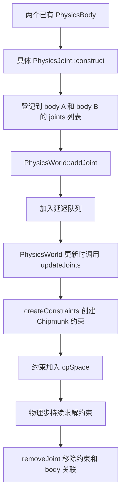

# 第 50 课（ENG22）：物理关节与刚体约束

**目标：** 把两个 PhysicsBody 连接成持续约束，读懂关节从构造、排队加入物理世界到移除的生命周期，并理解关节碰撞开关。

## 本课范围与证据

本课依据仓库中的 Cocos2d-x 4.0 `CCPhysicsJoint`、`CCPhysicsWorld`、`CCPhysicsBody` 和 `cpp-tests/PhysicsTest.cpp` 做静态分析；未构建或运行关节示例。物理接口受 `CC_USE_PHYSICS` 编译配置控制。范围限于 2D 物理关节，不展开约束求解器数学、3D 物理或性能调优。

研究计划中的物理与空间查询专题尚无独立 Cocos2d-x Skill，因此本课直接依照本地源码和官方 v4 资料核对。不要用 Creator 物理 Skill 的规则代替 Cocos2d-x C++ 接口。

## 接触与关节回答不同问题

接触描述两个形状当前是否相碰，并可触发接触回调；关节则把两个刚体持续连接起来，例如固定在一起、围绕支点转动、保持距离或通过弹簧连接。一个关节可连接两个不同的刚体，其中一个刚体可以是静态刚体。关节不负责代替接触回调，也不表示两个形状此刻正在接触。

官方 v4 手册列出固定、限制、销、距离、弹簧、槽、旋转弹簧、旋转限制、棘轮、齿轮和电机等关节类型。项目具体使用哪种类型，应按需要保持的几何或运动关系来选。

## 关节类型速览

| 类型 | 约束意图 |
| --- | --- |
| PhysicsJointFixed | 把两个刚体固定在一起 |
| PhysicsJointLimit | 限制两个锚点之间的距离范围 |
| PhysicsJointPin | 让两个刚体围绕一个锚点相对转动 |
| PhysicsJointDistance | 保持两个锚点间的固定距离 |
| PhysicsJointSpring | 用弹簧连接两个刚体 |
| PhysicsJointGroove | 一个刚体沿槽线连接另一个刚体上的锚点 |
| PhysicsJointRotarySpring / PhysicsJointRotaryLimit | 对旋转关系施加弹簧或角度限制 |
| PhysicsJointRatchet / PhysicsJointGear / PhysicsJointMotor | 约束棘轮步进、角速度比或相对角速度 |

类型之间不能只凭名字推断参数坐标和默认值。查看对应构造函数注释和 `createConstraints()`，确认它具体传入 Chipmunk 的哪个约束及其锚点形式。

## 本地调用时序

`PhysicsJoint::init()` 通过 `CCASSERT` 声明两个 body 必须非空且不是同一个对象，然后把关节指针记入两个 body 的 `_joints`。调用 `PhysicsWorld::addJoint()` 会设置关节的 world 指针并放进 `_delayAddJoints`；真正创建约束的工作在物理世界后续更新、空间未锁定时完成。因此，`addJoint()` 返回不代表 Chipmunk 约束已经在该语句中同步创建。

官方 v4x API 文档写明：若关节已加入另一个 PhysicsWorld，`addJoint()` 会先从旧世界移除再加入。但仓库这份 4.0 `CCPhysicsWorld.cpp` 的实现对 `joint->getWorld() == nullptr` 使用 `CCASSERT`，没有执行跨世界转移。课程代码按本地 4.0 源码处理：不要把同一个 joint 指针直接传给第二个 world；切换世界时应按当前源码的关节生命周期分别处理，并为目标世界创建合适的关节。

本地 PhysicsWorld 使用 Chipmunk 约束对象。以 `PhysicsJointPin` 为例，`createConstraints()` 调用 `cpPivotJointNew()` 或 `cpPivotJointNew2()`；以 `PhysicsJointDistance` 为例则调用 `cpPinJointNew()`。这说明 Cocos2d-x 的 Joint 是 API 层对象，而实际求解约束由物理后端承载。

## 从物理测试中抽出一个销关节

下面函数接收同一场景的物理世界、两个已有刚体和枢轴位置。它只展示关节的构造与加入，不负责创建节点或物理体。

~~~cpp
#include "cocos2d.h"

using namespace cocos2d;

PhysicsJointPin* connectAtPivot(PhysicsWorld* world,
                                PhysicsBody* bodyA,
                                PhysicsBody* bodyB,
                                const Vec2& pivot)
{
    if (world == nullptr || bodyA == nullptr || bodyB == nullptr || bodyA == bodyB)
        return nullptr;

    auto* joint = PhysicsJointPin::construct(bodyA, bodyB, pivot);
    if (joint == nullptr)
        return nullptr;

    joint->setCollisionEnable(false);
    world->addJoint(joint);
    return joint;
}
~~~

本地 `PhysicsTest.cpp` 也用两个 PhysicsBody 和共同枢轴构造 `PhysicsJointPin`，再传给当前场景的 PhysicsWorld。传给单点重载的 `pivot` 应与两个 body 所在场景使用的坐标约定一致；若改用双锚点重载，需分别检查 body A、body B 的锚点定义，不能直接把节点世界位置当作两个局部锚点。

`setCollisionEnable(false)` 表示连接的这两个 body 之间不处理碰撞。当前本地实现是在 `PhysicsWorld::collisionBeginCallback()` 中查找 body 之间的关节，若该关节禁用了碰撞，就拒绝该对 body 的本次接触处理。它不会关闭这两个 body 与其他刚体的碰撞。需要接触通知和响应的差异时，回看[第 47 课](../s47_cocos2d_physics_contact_callbacks/README.md)。

## 加入、移除与销毁

| 操作 | 本地实现行为 | 使用时的注意点 |
| --- | --- | --- |
| construct | 用 `new` 创建具体关节，并将其登记到两个 body | body 必须非空且不同；`PhysicsJoint` 不是 Node，也不继承 Ref |
| addJoint | 设置 world 指针并排队等待创建约束 | 物理更新处理队列后才将约束加入物理空间 |
| removeJoint(joint) | 默认 `destroy=true`；在未锁定时立即移除，锁定时延后处理 | 销毁可能立即或稍后发生；请求销毁后不要继续使用该指针 |
| removeJoint(joint, false) | 从物理空间/世界关系移除但不在本次操作中 delete | 调用方必须保留生命周期信息；不要假定它等同于可随时安全重加的暂停开关 |
| removeBody(body) | 遍历该 body 的 `_joints`，按 `destroy=true` 移除相关关节 | 移除任一端刚体会一并销毁连接关节，外部缓存的关节指针随之失效 |

`PhysicsWorld::doRemoveJoint()` 会移除约束、清除关节的 world 指针，并从两端 body 的 `_joints` 列表中删除它。若 `_destroyMark` 为真，就 `delete` 关节。物理空间锁定时，移除会进延迟队列，因此不能把“请求移除”和“此刻已析构”混为一谈；但从调用方角度应立即停止访问该指针。

关节使用普通裸指针接口，不要对它调用 Ref 的 `retain()` / `release()`。外部若保存关节指针，必须同时明确场景换出、刚体销毁或 `removeJoint()` 对它的影响。最常见的销毁路径是调用默认 `removeJoint(joint)`，或让关节一端的 PhysicsBody 从物理世界移除。

## 动手追踪

1. 从 `PhysicsJointPin::construct()` 跟到 `PhysicsJoint::init()`，记录在哪两处 body 列表中登记了同一个指针。
2. 从 `PhysicsWorld::addJoint()` 跟到 `updateJoints()`，再跟入 `PhysicsJoint::initJoint()` 与具体类型的 `createConstraints()`，标出加入 `_delayAddJoints` 和 `cpSpaceAddConstraint()` 的先后顺序。
3. 读取 `PhysicsJointDistance::createConstraints()`，确认其调用的 Chipmunk API；对比 `PhysicsJointSpring` 使用的约束构造函数。
4. 对比 `removeJoint(joint, true)` 与 `removeJoint(joint, false)`，继续跟踪 `doRemoveJoint()` 如何维护 `_world`、两个 body 的 `_joints` 和 `_destroyMark`。
5. 查看 `removeBody()` 如何遍历关节；再查看 `collisionBeginCallback()` 如何处理 `setCollisionEnable(false)`。
6. 查看 `PhysicsTest.cpp` 的 pin、fixed、distance、limit、spring 示例，说明哪种约束更适合铰链、绳索或弹性连接。

这些步骤是源码观察练习。`PhysicsTest.cpp` 中存在各类关节示例，但本课没有运行它们；本课结论是 Cocos2d-x 4.0 本地源码静态追踪结果，不是目标平台的运行验收。

## 简化说明

- 只研究 2D 关节的公开类型、world 接入和生命周期；没有推导 Chipmunk 的约束求解数学。
- 物理世界锁定期间的延迟操作会影响回调内增删的可见时机；示例用法不据此推断目标平台的精确帧时序。
- 双锚点、枢轴、距离、弹簧系数和角度的具体语义依关节类型而异；用到其他类型前逐项查 API 和本地 `createConstraints()`。
- 文档和源码说明不替代实际运行；本课没有构建、运行或测量物理关节。

## 参考资料

- [PhysicsJoint 抽象接口与各关节类型](../../engine/cocos2d-x-4/cocos/physics/CCPhysicsJoint.h)
- [PhysicsJoint 构造、后端约束和碰撞开关实现](../../engine/cocos2d-x-4/cocos/physics/CCPhysicsJoint.cpp)
- [PhysicsWorld 添加、延迟处理和移除关节](../../engine/cocos2d-x-4/cocos/physics/CCPhysicsWorld.cpp)
- [PhysicsBody 与关节关联及移除](../../engine/cocos2d-x-4/cocos/physics/CCPhysicsBody.cpp)
- [cpp-tests 物理关节示例](../../engine/cocos2d-x-4/tests/cpp-tests/Classes/PhysicsTest/PhysicsTest.cpp)
- [Cocos2d-x v4 Collision 与 Joint 手册](https://docs.cocos2d-x.org/cocos2d-x/v4/en/physics/collisions.html)
- [Cocos2d-x v4 PhysicsWorld C++ API](https://docs.cocos2d-x.org/api-ref/cplusplus/v4x/d8/d63/classcocos2d_1_1_physics_world.html)
- [第 47 课：物理组件与碰撞回调](../s47_cocos2d_physics_contact_callbacks/README.md)
- [第 49 课：物理世界查询](../s49_cocos2d_physics_world_queries/README.md)
