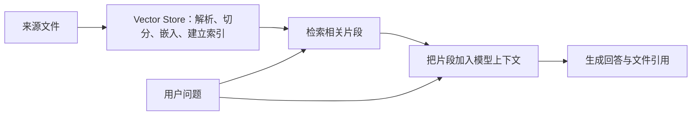

# 第 18 课：File Search、Vector Store 与 RAG

**目标：** 能说明文件如何进入 Vector Store 并被处理；能区分 Responses API 的托管 File Search 与直接 Retrieval API；能描述 RAG 的“检索—补充上下文—生成”流程及其覆盖边界。

## 本课问题

有一批需要反复查询的资料时，文件怎样变成可检索的知识库？检索到的片段又怎样参与模型回答？

## 前置知识

- [第 7 课](../s07_first_responses_request/README.md)：Responses API 请求结构。
- [第 14 课](../s14_file_inputs_pdf_file_search/README.md)：单次 `input_file` 与知识库检索的区别。
- [第 17 课](../s17_embeddings_vector_similarity/README.md)：Embedding 与向量相似度。

## 官方资料

- [File Search](https://developers.openai.com/api/docs/guides/tools-file-search)：查看 Responses API 内置 File Search、输出引用和搜索结果。
- [Retrieval](https://developers.openai.com/api/docs/guides/retrieval)：查看 Vector Store、语义搜索、文件处理和直接检索接口。
- [Create a model response](https://developers.openai.com/api/reference/resources/responses/methods/create)：查询 `file_search` 工具、`vector_store_ids` 和 `include`。
- [Create a vector store](https://developers.openai.com/api/reference/resources/vector_stores/methods/create)：查询 Vector Store 创建字段与处理状态。

## 1. RAG 是一种工作流，不是某个单独 API

RAG 是 Retrieval-Augmented Generation（检索增强生成）的简称。先从知识库检索与问题相关的内容，再把这些内容作为上下文提供给生成模型，让模型根据找到的材料组织回答。



Vector Store 是承载已处理文件和检索索引的容器；File Search 是 Responses API 可调用的托管搜索工具；RAG 描述的是“先检索，再基于检索内容生成”的整体设计。RAG 可以使用 OpenAI File Search，也可以由应用组合自己的搜索系统和生成模型。[Retrieval](https://developers.openai.com/api/docs/guides/retrieval)、[File Search](https://developers.openai.com/api/docs/guides/tools-file-search)

## 2. 从文件到可检索的 Vector Store

上传文件并加入 Vector Store 后，系统会自动切分文件、生成 Embedding 并建立索引。文件加入和索引是异步处理；查询前要等文件处理完成，并处理失败状态。[Retrieval：Vector stores](https://developers.openai.com/api/docs/guides/retrieval)

TypeScript SDK 的基本做法：

```ts
import fs from "node:fs";
import OpenAI from "openai";

const client = new OpenAI();

const vectorStore = await client.vectorStores.create({
  name: "产品支持知识库",
});

await client.vectorStores.files.uploadAndPoll(
  vectorStore.id,
  fs.createReadStream("./support-guide.pdf"),
);

console.log("可用于检索的 Vector Store：", vectorStore.id);
```

`uploadAndPoll` 等待文件处理结束，适合演示首次建库。生产流程还要处理上传失败、索引失败、批量文件状态、文件更新和删除；文件被删除后，搜索结果也可能需要短暂时间才完全反映变更。[Retrieval：Vector store file operations](https://developers.openai.com/api/docs/guides/retrieval)

## 3. 托管 File Search：让模型检索并回答

Responses API 的 File Search 是托管工具。请求中指定可搜索的 Vector Store 和用户问题后，模型可以调用工具；File Search 会结合语义与关键词搜索相关片段，再把结果提供给模型生成回答。

```ts
const response = await client.responses.create({
  model: "gpt-6-astra",
  input: "根据支持文档，用户忘记密码后如何重新设置？请标出引用来源。",
  tools: [
    {
      type: "file_search",
      vector_store_ids: [vectorStore.id],
      max_num_results: 5,
    },
  ],
  include: ["file_search_call.results"],
});

console.log(response.output_text);
console.dir(response.output, { depth: null });
```

响应可能包含 `file_search_call` 和带 `file_citation` 注释的 assistant `message`。`include: ["file_search_call.results"]` 会把检索到的片段等结果放进响应，便于调试或审计；如果产品界面要展示可点击引用，应读取消息上的引用注释，而不只显示纯文本 `output_text`。[File Search：File search response](https://developers.openai.com/api/docs/guides/tools-file-search)

`max_num_results` 可调节检索片段数量：较少的结果通常减少上下文和延迟，较多结果可能为回答提供更多依据，但会占用更多上下文。需要限制资料范围时，可以给文件设置属性，并在搜索时使用 metadata filters。[File Search](https://developers.openai.com/api/docs/guides/tools-file-search)、[Retrieval：Attribute filtering](https://developers.openai.com/api/docs/guides/retrieval)

## 4. 直接 Retrieval：应用自行决定怎样使用搜索结果

如果应用要自己检查搜索结果、加入业务逻辑或控制后续提示，可以直接调用 Vector Store Search，而不是让 Responses API 的 File Search 代为完成整段检索问答：

```ts
const results = await client.vectorStores.search(vectorStore.id, {
  query: "用户忘记密码后如何重新设置？",
});

console.log(results.data);
```

直接搜索会返回排序后的结果，其中包含相关文本片段、来源文件和相似度分数等信息。应用可以自己筛选、记录或整理这些片段，再把选中的内容传给 Responses API；因此，搜索与回答两个阶段由应用明确连接。[Retrieval：Performing semantic search](https://developers.openai.com/api/docs/guides/retrieval)

| 做法 | 搜索结果由谁取回 | 适合的情况 |
| --- | --- | --- |
| Responses API + File Search | OpenAI 托管工具按请求执行；模型可决定何时调用 | 想快速实现知识库问答，并使用响应中的文件引用 |
| Vector Store Search / Retrieval API | 应用直接获得检索片段并自行处理 | 要检查、重排或过滤结果，或控制检索后如何构造模型上下文 |
| 自建 RAG | 应用自行选择索引、检索与生成组件 | 需要自定义数据管线、权限模型或检索算法 |

## 5. 检索结果不是“读完整个知识库”

File Search 和 Retrieval 返回的是与查询相关的一组片段，不应默认等于完整阅读了所有文件。文档可能被切成多个片段，查询也可能漏掉与问题相关的内容。需要准确引用时，检查引用是否支持结论；任务要求全文覆盖、逐页审查或穷尽式比较时，应设计专门的分段和核验流程。

Embedding 相似度排序也不代表事实正确概率。对产品编号、订单号、日期、语言、部门或权限边界等条件，应使用关键词、metadata filters 或业务侧校验补足。只把用户有权访问的 Vector Store 提供给请求；不要把权限控制寄托在模型自行判断上。

## 观察练习

为每个任务选一种起点，并说明理由：

| 场景 | 你的选择 |
| --- | --- |
| 用户本轮上传一份合同，只问付款条款 | 待填写 |
| 客服反复根据数百份产品手册回答问题，并希望带上来源引用 | 待填写 |
| 应用需要先检查检索片段，再按业务权限过滤后才送给模型 | 待填写 |
| 用户要求完整对比知识库内所有版本的规定 | 待填写 |

再回答：RAG 的三个环节是什么？Vector Store、File Search 和生成模型分别负责哪一部分？

## 本课检查

完成本课后，能解释：

- Vector Store 保存已处理的文件索引；文件会自动切分、嵌入并建立索引，且处理需要等待完成。
- File Search 是 Responses API 的托管检索工具，支持语义和关键词搜索，并可返回文件引用。
- Retrieval API 让应用直接取得搜索片段，自行决定后续处理；File Search 则可以把检索与回答连接起来。
- RAG 是先取回相关内容、再将其放进模型上下文并生成回答的设计模式，不是某一个专用 API。
- 检索片段不是整个知识库；引用、访问权限和全文覆盖都需要应用设计与核验。

## 简化与边界

- 示例覆盖单个 PDF 的上传与一次知识库问答，不展开批量索引、手动 chunking、metadata schema、过滤表达式、排序权重或索引生命周期。
- 示例假设 API Key 和 SDK 已配置；没有上传文件、创建 Vector Store 或实际发送 Responses 请求。
- 支持文件、索引规则、模型、检索选项与限制可能变化，实施时以当前 File Search、Retrieval 指南和 API Reference 为准。
