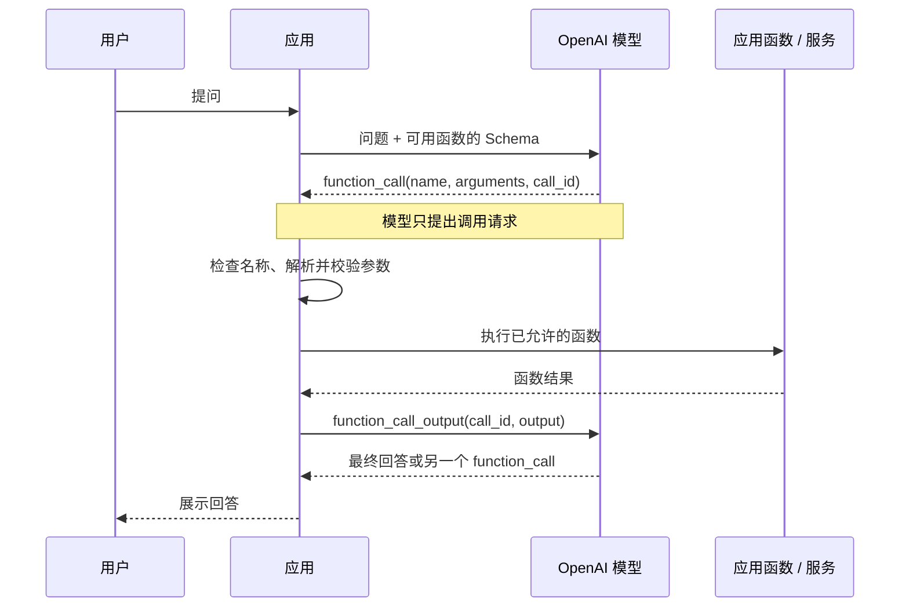

# 第 20 课：Function Calling 怎样从工具请求走到应用执行？

**目标：** 能解释 Function Calling 的请求—执行—回传闭环；能从 Responses 输出中读取 `function_call`、解析参数并用 `call_id` 关联结果；能说明工具 Schema 不等于函数实现，也不等于授权。

## 本课问题

模型给应用的到底是执行结果，还是一条“请调用这个函数”的请求？应用如何把真实函数结果交回模型？

## 前置知识

- [第 7 课](../s07_first_responses_request/README.md)：发出 Responses API 请求。
- [第 8 课](../s08_responses_request_response/README.md)：读取 `response.output` 中的不同项目。
- [第 9 课](../s09_structured_outputs/README.md)：JSON Schema 怎样约束结构化数据。

## 官方资料

- [Function calling](https://developers.openai.com/api/docs/guides/function-calling)：查看工具描述、完整调用闭环、`tool_choice`、严格模式和多个工具调用。
- [Create a model response](https://developers.openai.com/api/reference/resources/responses/methods/create)：核对 Responses 请求字段和 `tools` 格式。
- [Responses API Reference](https://developers.openai.com/api/reference/resources/responses)：查询 `function_call`、`function_call_output` 和 `call_id` 等项目结构。
- [Structured Outputs](https://developers.openai.com/api/docs/guides/structured-outputs)：了解 Strict Mode 所使用的 Schema 约束。

## 1. Function Calling 返回的是调用请求

应用在请求中告诉模型有哪些函数可用，并给每个函数提供名称、用途说明和 JSON Schema。模型看到用户问题后，可以选择输出一个 `function_call` 项；该项包含函数名、JSON 字符串形式的 `arguments` 和唯一的 `call_id`。

这一步**没有运行应用里的函数**。应用需要检查函数名、解析并验证参数，再由自己的代码调用数据库、服务或本地逻辑。执行完成后，应用把结果作为 `function_call_output` 传回，并使用原来的 `call_id` 关联请求；模型随后可以给出最终回答，或提出下一次工具调用。[Function calling](https://developers.openai.com/api/docs/guides/function-calling)



## 2. 三部分不要混为一谈

| 部分 | 由谁提供 | 负责什么 |
| --- | --- | --- |
| Function Schema | 应用开发者 | 告诉模型函数叫什么、何时适合调用、参数应该是什么结构 |
| `function_call` | 模型 | 提出函数名和参数；不是函数运行结果 |
| 函数实现与授权检查 | 应用 | 确认名称和参数有效、检查用户权限，再执行真实业务逻辑 |
| `function_call_output` | 应用 | 把本次执行结果交回模型，`call_id` 必须对应原调用 |

Function Calling 是一种让模型与应用配合的接口。函数定义不会把应用代码上传给模型，也不会自动把数据库连接、环境变量或浏览器权限交给模型。要由 OpenAI 托管执行的内置工具属于另一种工具类型，后续课程再比较两者。[Using tools](https://developers.openai.com/api/docs/guides/tools)

## 3. Responses API 的一次完整往返

以下用一个静态库存表模拟应用函数。这个示例不会访问真实库存服务；关键是观察模型输出 `function_call` 后，应用如何自行调用 `lookupInventory`，再把结果交还给模型。

```ts
import OpenAI from "openai";

const client = new OpenAI();
const model = "gpt-6-astra";

const tools = [
  {
    type: "function",
    name: "lookup_inventory",
    description: "查询一个商品 SKU 的可售库存。",
    parameters: {
      type: "object",
      properties: {
        sku: {
          type: "string",
          description: "商品 SKU，例如 SKU-42。",
        },
      },
      required: ["sku"],
      additionalProperties: false,
    },
    strict: true,
  },
];

function lookupInventory(sku: string) {
  const demoInventory: Record<string, number> = { "SKU-42": 12 };
  return { sku, available: demoInventory[sku] ?? 0 };
}

const firstResponse = await client.responses.create({
  model,
  input: "SKU-42 还有多少库存？",
  tools,
  tool_choice: { type: "function", name: "lookup_inventory" },
});

const toolCall = firstResponse.output.find(
  (item) => item.type === "function_call" && item.name === "lookup_inventory",
);
if (!toolCall || toolCall.type !== "function_call") {
  throw new Error("响应中没有 lookup_inventory 调用");
}

const args = JSON.parse(toolCall.arguments) as { sku: string };
if (!/^SKU-[A-Z0-9-]+$/.test(args.sku)) {
  throw new Error("无效的商品 SKU");
}

const inventory = lookupInventory(args.sku);
const finalResponse = await client.responses.create({
  model,
  previous_response_id: firstResponse.id,
  input: [
    {
      type: "function_call_output",
      call_id: toolCall.call_id,
      output: JSON.stringify(inventory),
    },
  ],
  tools,
});

console.log(finalResponse.output_text);
```

代码里 `tool_choice` 指定某个函数，是为了让演示聚焦在完整往返。默认 `auto` 时，模型可以选择调用零个、一个或多个函数；应用不能假设每次响应一定含有 `function_call`。Strict Mode 帮助模型按 Schema 生成参数，但应用仍需做业务校验和权限检查。[Function calling：tool choice and strict mode](https://developers.openai.com/api/docs/guides/function-calling)

## 4. 用 `call_id` 把输入和结果配对

Responses API 中的一次调用可能长这样：

```json
{
  "type": "function_call",
  "call_id": "call_abc123",
  "name": "lookup_inventory",
  "arguments": "{\"sku\":\"SKU-42\"}"
}
```

应用把结果作为新的输入项目发回：

```json
{
  "type": "function_call_output",
  "call_id": "call_abc123",
  "output": "{\"sku\":\"SKU-42\",\"available\":12}"
}
```

`arguments` 虽然内容看起来像 JSON，但 API 项目里的字段类型是字符串；应用要先解析，再做输入校验。`output` 通常也是字符串，可以放纯文本、JSON 字符串或错误说明。不要把本次工具结果连到别的调用的 `call_id` 上。[Responses API Reference](https://developers.openai.com/api/reference/resources/responses)

## 5. 控制模型何时调用工具

| `tool_choice` | 效果 | 常见用途 |
| --- | --- | --- |
| `"auto"`（默认） | 模型可不调用，也可调用一个或多个可用函数 | 常规问答，只有需要时才查询或操作 |
| `"required"` | 要求模型调用一个或多个工具 | 任务必须经过工具查询或处理 |
| 指定函数对象 | 指定某个函数 | 已确定必须由某个特定函数处理，或用于教学演示 |
| `"none"` | 本轮不调用工具 | 需要暂时关闭工具调用 |

如果模型一次返回多个 `function_call`，应用要逐个处理，并为每个结果带回正确的 `call_id`。只有确认工具之间互不依赖时才适合并行执行；对扣款、退款、发信、删除等有副作用的工具，要由应用检查用户身份、授权和业务规则，必要时先要求人工确认。[Function calling：parallel function calling](https://developers.openai.com/api/docs/guides/function-calling)

## 观察练习

逐步追踪示例中的变量，并回答：

1. 哪个对象定义 `lookup_inventory` 的名字和参数？
2. 模型返回的哪三个字段告诉应用该调用什么、用什么参数、如何关联结果？
3. 哪一行真正执行 `lookupInventory`？这段代码由模型还是应用运行？
4. 如果 `firstResponse.output` 没有函数调用，应用应该如何处理？
5. Strict Mode 已开启时，为什么仍需要检查 SKU 格式并核对库存查询权限？

## 本课检查

完成本课后，能解释：

- Function Calling 的 Schema 是给模型看的接口描述，函数实现仍由应用提供。
- 模型返回 `function_call`，其中 `arguments` 是 JSON 字符串，`call_id` 用于匹配结果。
- 应用代码负责解析、校验、授权和实际执行；结果用 `function_call_output` 交还模型。
- `tool_choice` 控制工具选择方式；模型可能不调用工具，也可能提出多个调用。
- Strict Mode 约束参数形状，不保证参数的业务正确性、安全性或用户权限。

## 简化与边界

- 示例只展示一个只读库存查询和一次函数调用；生产环境还要处理多个调用、错误返回、超时、重试、日志、访问控制与副作用审批。
- 示例使用 Responses API 的 Function Calling 结构；Chat Completions、Agents API 会话和 OpenAI 内置工具有各自的编排方式。
- 示例假设 SDK、API Key 和模型访问已配置；没有实际发送 API 请求。字段和模型可用性以开始实践时的官方 Function Calling 指南与 API Reference 为准。
