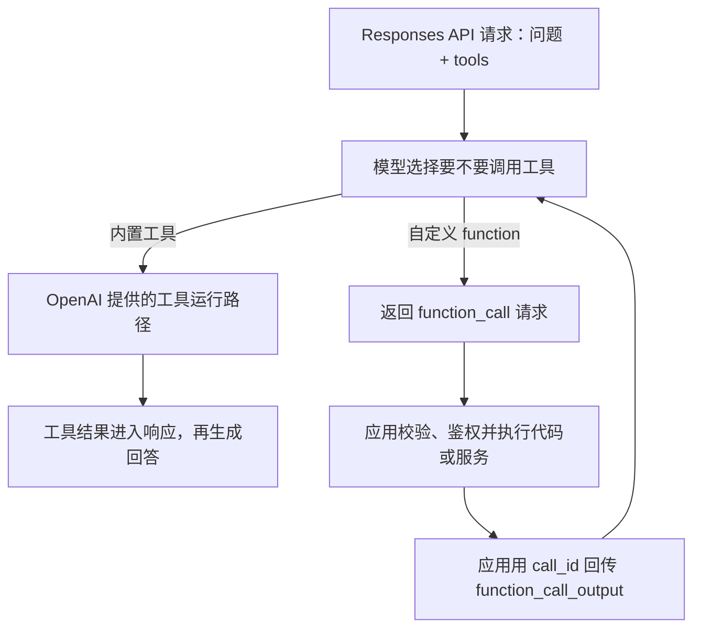

# 第 21 课：OpenAI 内置工具和自定义函数怎样选择？

**目标：** 能按能力提供方、数据归属和执行责任选择工具；能区分 OpenAI 提供的内置工具与应用定义的 Function Calling；能说明两种工具同时开放时，应用仍需按不同返回类型处理结果。

## 本课问题

已有 Web Search、File Search 或 Code Interpreter 时，什么时候直接用 OpenAI 内置工具？什么时候应该给模型一个由应用执行的自定义函数？

## 前置知识

- [第 20 课](../s20_function_calling_loop/README.md)：模型如何提出函数调用，应用如何执行并回传结果。
- [第 18 课](../s18_file_search_vector_stores_rag/README.md)：File Search 如何检索自己的文件库。

## 官方资料

- [Using tools](https://developers.openai.com/api/docs/guides/tools)：查看 Responses API、Agents API 与 Agents SDK 的工具接入方式。
- [Function calling](https://developers.openai.com/api/docs/guides/function-calling)：查看自定义函数 Schema、应用执行流程与 `function_call_output`。
- [Web search](https://developers.openai.com/api/docs/guides/tools-web-search)：查看 Responses API 的托管网页搜索和引用结果。
- [File search](https://developers.openai.com/api/docs/guides/tools-file-search)：查看搜索 Vector Store 文件所需的准备和调用方式。
- [API deployment checklist](https://developers.openai.com/api/docs/guides/deployment-checklist)：查看内置工具的范围和部署注意事项。

## 1. 都叫 Tool，执行路径却不同

Responses API 请求都可以在 `tools` 中声明模型本轮可用的能力，但内置工具和自定义函数并不是同一种执行方式：



内置工具把某项通用能力接入 API，例如搜索网页、检索 Vector Store 或运行代码。应用按该工具文档配置输入、资源和运行环境，OpenAI API 工具路径负责相应的调用流程。具体配置仍因工具而异：File Search 要准备 Vector Store；代码和界面操作也可能需要相应执行环境。

自定义函数描述的是应用自己的能力。模型返回 `function_call` 后，应用代码要自己解析参数、检查权限、访问业务系统并返回结果。这是第 20 课的调用闭环。[Using tools](https://developers.openai.com/api/docs/guides/tools)、[Function calling](https://developers.openai.com/api/docs/guides/function-calling)

## 2. 根据能力归属选择

| 任务 | 优先考虑 | 原因与边界 |
| --- | --- | --- |
| 搜索公开网页的最新信息并给出处 | 内置 `web_search` | 面向互联网搜索；模型可在回答中附上来源引用 |
| 查找已上传到 Vector Store 的内部文档 | 内置 `file_search` | 复用托管的文件解析与检索；要先准备文件库，并在应用侧限制用户可访问的 Vector Store |
| 分析用户上传的表格、运行 Python 或生成图表 | 内置 `code_interpreter` | 适合受支持的代码执行与文件分析任务；需核对容器、文件和工具限制 |
| 查询用户订单、读取库存、提交退款 | 自定义函数 | 数据与动作属于应用业务系统；应用可沿用现有身份、权限、审计与审批规则 |
| 调用公司已有的专用天气或物流供应商 API | 自定义函数，或按服务接口考察 MCP | 应用或外部服务掌握凭据和数据；不要把密钥交给模型 |
| 通过屏幕点击操作自有软件 | 内置 Computer Use 或自有 UI 函数 | 取决于需要通用界面操作，还是应用已有稳定业务接口；应给操作配置合适的执行环境和确认路径 |

OpenAI 官方部署清单建议：内置工具能满足工作流时，先评估直接使用；原生能力不覆盖时，再构建自定义工具。工具清单会持续变化，具体可用工具和所需模型应以当前官方目录为准。[API deployment checklist](https://developers.openai.com/api/docs/guides/deployment-checklist)

## 3. 一个请求里配置内置工具和自定义函数

下面把两类工具放进同一个 Responses 请求。工具选择使用默认的 `auto`：模型可能搜索网页、提出订单查询函数调用，也可能判断无需调用工具。

```ts
import OpenAI from "openai";

const client = new OpenAI();

const response = await client.responses.create({
  model: "gpt-6-astra",
  input: "搜索这款产品的公开召回公告，并确认订单 ORD-2042 的状态。",
  tools: [
    { type: "web_search" },
    {
      type: "function",
      name: "lookup_order_status",
      description: "查询当前已登录用户有权访问的订单状态。",
      parameters: {
        type: "object",
        properties: {
          order_id: {
            type: "string",
            description: "订单编号。",
          },
        },
        required: ["order_id"],
        additionalProperties: false,
      },
      strict: true,
    },
  ],
  tool_choice: "auto",
});

console.log(response.output_text);
console.dir(response.output, { depth: null });
```

这个片段只展示声明和第一份响应；如果响应里有 `function_call`，应用必须检查登录用户是否有权访问对应订单、执行自己的订单服务，并通过原 `call_id` 回传结果。不要让模型自行提供可信的用户身份或数据库凭据。完整往返见[第 20 课](../s20_function_calling_loop/README.md)。

两类工具需要分别观察和处理：

| 响应内容 | 谁负责执行 | 应用要做什么 |
| --- | --- | --- |
| `web_search_call`，以及带来源注释的回答消息 | Responses API 中的 Web Search 工具路径 | 读取回答和引用；按需要检查 `response.output` 中的搜索项目 |
| `function_call` | 应用 | 校验函数名和参数、做鉴权、执行业务函数，再用 `function_call_output` 与原 `call_id` 回传 |

内置工具并不都等于“无需配置的黑盒”：File Search 需要事先准备 Vector Store；Computer Use 需要合适的界面操作环境。工具是否可用、如何返回结果、需要谁提供执行环境，都要查看各自指南。[Using tools](https://developers.openai.com/api/docs/guides/tools)、[Web search](https://developers.openai.com/api/docs/guides/tools-web-search)

`tool_choice: "auto"` 时，模型可以不调用工具，也可能调用多个工具。若某个步骤不可跳过，使用官方支持的工具选择配置或由应用显式安排流程；即便指定了某个函数，权限校验和副作用审批仍由应用负责。[Function calling：Tool choice](https://developers.openai.com/api/docs/guides/function-calling)

MCP 是接入外部工具服务器的另一种方式；它既不等同于一个 OpenAI 内置工具，也不要求把每个外部能力都重新写成自定义函数。MCP 的连接和审批边界会在第 25 课展开。

## 5. 做选择时问四个问题

1. **这个能力是否已有合适的内置工具？** 例如，公开网页搜索优先试 `web_search`；公司内部 Vector Store 优先看 `file_search`。
2. **谁拥有数据和事实来源？** 如果只有自己的订单、权限或库存服务知道答案，应用必须保留它们的访问控制与数据校验。
3. **谁执行工具并负责失败处理？** 内置工具按工具文档的运行方式和错误响应处理；自定义函数要由应用处理参数、超时、失败和重试。
4. **这个调用会不会改变外部状态？** 发退款、写数据库、发邮件或删除资源前，要在应用侧核对权限、规则，并按风险加入审批或二次确认。

## 观察练习

每题选一个起点，并说明执行者与数据归属：

| 场景 | 你的选择 |
| --- | --- |
| 用户问今天的公开新闻，希望回答带来源链接 | 待填写 |
| 用户问公司手册里报销上限是多少，文件已上传至 Vector Store | 待填写 |
| 用户问自己的订单是否已发货 | 待填写 |
| 用户要求对上传的 CSV 求平均值并画图 | 待填写 |
| 用户确认后要对其账号执行退款 | 待填写 |

再回答：一个 Responses 请求里同时配置 `web_search` 和订单函数时，哪一项由模型提出后必须交给应用执行？

## 本课检查

完成本课后，能解释：

- 内置工具提供 API 已定义的通用能力；其所需资源、参数与运行环境仍要按工具文档配置。
- 自定义 Function Calling 为应用代码和业务服务提供模型可读的接口描述；应用负责执行、鉴权和返回结果。
- 公开搜索、托管文件检索、代码执行等适合优先评估对应内置工具；公司业务数据和有副作用的操作由应用工具接入更容易保留业务权限。
- 同一请求可以同时开放内置工具和自定义函数，但模型选择行为及结果处理流程并不相同。
- `tool_choice` 控制调用行为，不能代替业务权限检查或副作用审批。

## 简化与边界

- 本课用 Web Search 和订单查询示意两类工具；没有展开 Web Search、File Search、Code Interpreter、Computer Use、MCP 或 Agents SDK 的完整配置。
- 内置工具目录、模型支持、访问条件和参数可能变化；实现前查阅当前工具指南与模型目录。
- 代码展示请求形状，没有实际发送 Responses API 请求；订单函数只展示 Schema，没有连接真实业务服务。
