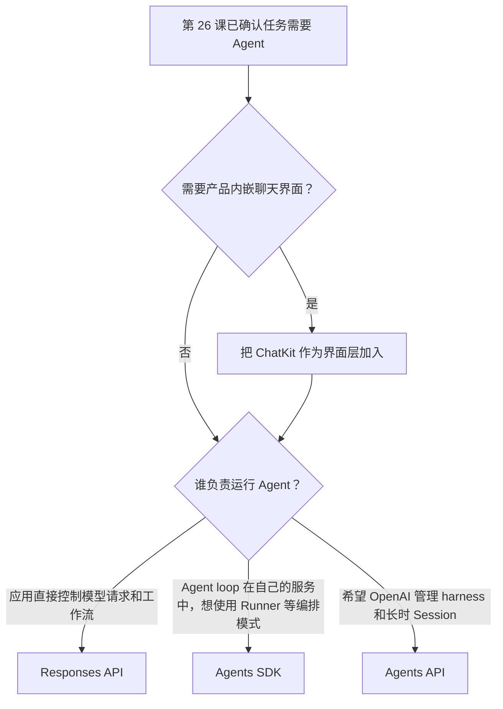

# 第 27 课：Responses API、Agents SDK、Agents API 和 ChatKit 如何选择？

**目标：** 能按工作流由谁编排、运行状态由谁管理来选择 Responses API、Agents SDK 或 Agents API；能把 ChatKit 识别为可搭配这些运行时的聊天界面。

## 本课问题

要构建 Agent 时，应该从 Responses API、Agents SDK 还是 Agents API 开始？如果产品还需要一个内嵌聊天界面，ChatKit 又处在哪一层？

## 前置知识

- [第 20 课](../s20_function_calling_loop/README.md)：了解模型提出工具请求、应用执行和结果回传。
- [第 26 课](../s26_when_to_use_agents/README.md)：先判断任务是否需要 Agent 工作流。
- [第 25 课](../s25_mcp_tools/README.md)：理解应用与外部工具服务器的连接边界。

## 官方资料

- [Agents](https://developers.openai.com/api/docs/guides/agents)：官方入口总览，直接比较 Agents API、Agents SDK 和 Responses API，并将 ChatKit 列为聊天界面入口。
- [Agents API](https://developers.openai.com/api/docs/guides/agents-api/overview)：了解 OpenAI 管理的 harness、Session、事件和执行环境。
- [Agents API quickstart](https://developers.openai.com/api/docs/guides/agents-api/quickstart)：核对当前访问权限与 API 接口要求。
- [Agents SDK](https://developers.openai.com/api/docs/guides/agents/sdk)：了解在应用中运行 Agent loop、工具、Handoff、护栏和状态的 SDK 路径。
- [Create a model response](https://developers.openai.com/api/reference/resources/responses/methods/create) 与 [Conversation state](https://developers.openai.com/api/docs/guides/conversation-state)：了解 Responses API 的请求能力和对话状态选项。
- [ChatKit](https://developers.openai.com/api/docs/guides/chatkit) 与 [Advanced integrations](https://developers.openai.com/api/docs/guides/custom-chatkit)：了解嵌入式聊天界面以及自建服务端集成。

## 1. 先分清它们处在哪一层

这四个名字不是四种同类“Agent 框架”。前三者决定怎样调用模型或运行 Agent；ChatKit 解决的是用户如何在产品中与 Agent 对话。[Agents](https://developers.openai.com/api/docs/guides/agents)

| 入口 | 属于哪一层 | 谁负责什么 |
| --- | --- | --- |
| Responses API | 模型交互 API | 应用直接发出 Responses 请求，使用内置工具或接收函数调用；应用按自己的需要编排请求和应用逻辑 |
| Agents SDK | 应用内的 Agent 编排库 | SDK 的 `Runner` 管理 Agent loop、工具调用与交接；应用仍控制运行环境、业务集成、存储和审批 |
| Agents API | OpenAI 管理的 Agent 运行时 | OpenAI 运行托管的 Codex harness 并管理 Session；应用提交任务、接收事件，并提供业务函数和所需集成 |
| ChatKit | 聊天界面 | 为自建 Agent 服务提供可嵌入、可定制的对话体验；已有 Agent Builder 托管流程处于迁移过渡期 |

**关键关系：** Agents SDK 是放在应用里的代码库，不是新的模型。它对 OpenAI 模型默认使用 Responses API；主要增加的是 Agent 定义与运行编排。Agents API 则是另一条由 OpenAI 管理 Agent harness 和 Session 的运行时路径。ChatKit 可以与自建服务端的 Agent（包括 Agents SDK）搭配使用。[Agents SDK](https://developers.openai.com/api/docs/guides/agents/sdk) · [Agents API](https://developers.openai.com/api/docs/guides/agents-api/overview) · [Advanced integrations with ChatKit](https://developers.openai.com/api/docs/guides/custom-chatkit)

## 2. 选择运行时：谁拥有工作流控制权？

| 你的主要需求 | 优先考虑 | 原因 |
| --- | --- | --- |
| 直接构造模型请求；希望自己决定每次请求、工具返回、状态传递和应用逻辑 | Responses API | 直接面向模型交互；可先做简单请求，也可以由应用自行组装更复杂的 Agent 工作流 |
| 在自己的服务里以 TypeScript 或 Python 编写 Agent，复用工具、Handoff、护栏和 Runner | Agents SDK | SDK 在应用中运行，方便接入现有业务代码，并由应用决定存储、部署、审批与运行方式 |
| 希望 OpenAI 管理长时 Agent 的 harness、Session、运行进度和恢复，并可选沙箱环境 | Agents API | 应用发送任务并观察事件；OpenAI 管理 Agent 运行时和 Session，环境可按需选择 |
| 为 Web 或产品内的 Agent 增加聊天窗口、输入和交互组件 | ChatKit | 它是聊天 UI 层，可以连接自有 Agent 服务；不负责替你决定应选哪种 Agent 运行时 |

OpenAI 的当前选型指南把主要分界放在编排运行位置和任务状态归属：Responses API 适合直接调用模型或自行构建 Agent；Agents SDK 适合由应用控制 Agent loop；Agents API 适合由 OpenAI 管理 Agent 运行时并保存长时 Session。[Agents](https://developers.openai.com/api/docs/guides/agents)

### 决策流程

实际项目可以组合这些层。例如，一个产品可以用 ChatKit 展示聊天界面，由自己的服务端调用 Agents SDK；也可以不用 ChatKit，直接把 Agent 能力接入现有 UI。[Advanced integrations with ChatKit](https://developers.openai.com/api/docs/guides/custom-chatkit)

## 3. 用场景校准选择

| 场景 | 合理起点 | 需要关注 |
| --- | --- | --- |
| 现有后端调用模型，将一段文本转换为结构化 JSON | Responses API | 按第 9 课使用结构化输出；不需要为了 Agent 而增加编排库 |
| 客服 Agent 要查询自有 CRM、按业务规则处理函数结果，并由应用决定高风险审批 | Agents SDK | 自定义函数、业务权限和审批逻辑留在应用控制范围内 |
| Agent 需要运行脚本、编辑文件、报告进度，之后还可能在同一任务上继续工作 | Agents API | 选择合适的执行环境，保存 Session ID，并核验每个 Turn 的结果 |
| 已有自建 Agent 服务，希望快速给 Web 用户提供聊天组件 | ChatKit + 已选运行时 | ChatKit 负责交互界面；认证、服务端 Agent 和状态存储仍要配置 |

不要只看任务规模来选入口：先问哪些部分必须由你的服务控制、哪些运行状态需要跨任务保存、Agent 是否要使用沙箱，再选编排路径。

## 4. 容易混淆的边界

- **Responses API 不等于只能做单轮问答。** 它支持工具、流式响应和对话状态；应用也可以用它自己构建 Agent loop。[Create a model response](https://developers.openai.com/api/reference/resources/responses/methods/create) · [Conversation state](https://developers.openai.com/api/docs/guides/conversation-state)
- **Agents SDK 不会把模型托管到应用之外。** SDK 的运行循环在应用环境中，应用继续负责自己的网络、数据存储、密钥与业务服务。[Agents SDK](https://developers.openai.com/api/docs/guides/agents/sdk)
- **Agents API 不意味着所有业务工具都由 OpenAI 执行。** 应用函数仍由应用代码处理；沙箱环境是可选项，要根据文件、命令和网络需求选择。[Agents API architecture](https://developers.openai.com/api/docs/guides/agents-api/architecture)
- **ChatKit 不是 Agent Builder 的新名称。** 截至 **2026-11-10**，官方文档指出 Agent Builder 正在弃用，计划于 **2026-11-30** 关闭。ChatKit 本身仍可用；新项目应采用自建服务端集成，旧的 Agent Builder 托管工作流只处于迁移过渡期。[ChatKit](https://developers.openai.com/api/docs/guides/chatkit) · [Agent Builder](https://developers.openai.com/api/docs/guides/agent-builder)

## 观察练习

为每项需求选一个主要运行时；如果需要聊天界面，再单独决定是否增加 ChatKit。写下每项选择中“谁运行 Agent loop、谁保存状态、谁执行自定义函数”。

| 需求 | 你的选择 |
| --- | --- |
| 现有 API 服务只需要分析一次图片并返回 JSON | 待填写 |
| 应用有自有订单系统，希望在应用内控制工具与审批流程 | 待填写 |
| 研究任务需要运行一段时间、生成文件、持续报告进度并支持之后续做 | 待填写 |
| 已经有自建的 Agent 后端，产品希望提供品牌一致的嵌入聊天体验 | 待填写 |

## 本课检查

完成本课后，能解释：

- Responses API、Agents SDK 和 Agents API 的核心差异是模型交互方式、编排运行位置和状态由谁管理。
- Agents SDK 在应用中运行；Agents API 提供 OpenAI 管理的 Agent harness 与 Session。
- Responses API 既能支持简单请求，也能作为应用自建 Agent 工作流的基础。
- ChatKit 是可嵌入的用户界面，可与自建 Agent 服务配合，不是一个 Agent 运行时。
- Agent Builder 托管工作流处在明确的弃用过渡期；ChatKit 本身仍可使用，项目状态应以授课时的官方文档为准。

## 简化与边界

- 本课只建立选型框架，不深入 SDK 配置、Session 生命周期、工具接线和 ChatKit UI 实现；后续课程分别拆解这些主题。
- API 权限、Beta 标记、SDK 版本、定价和产品生命周期可能变化。当前 Agents API quickstart 的原始 HTTP 示例要求 `OpenAI-Beta: agents=v1`；使用 SDK 时由 SDK 添加。开始实现前应核对最新接口要求和项目权限。[Agents API quickstart](https://developers.openai.com/api/docs/guides/agents-api/quickstart)
- 本课没有安装 SDK、创建 Session、发送 API 请求或运行聊天界面。
