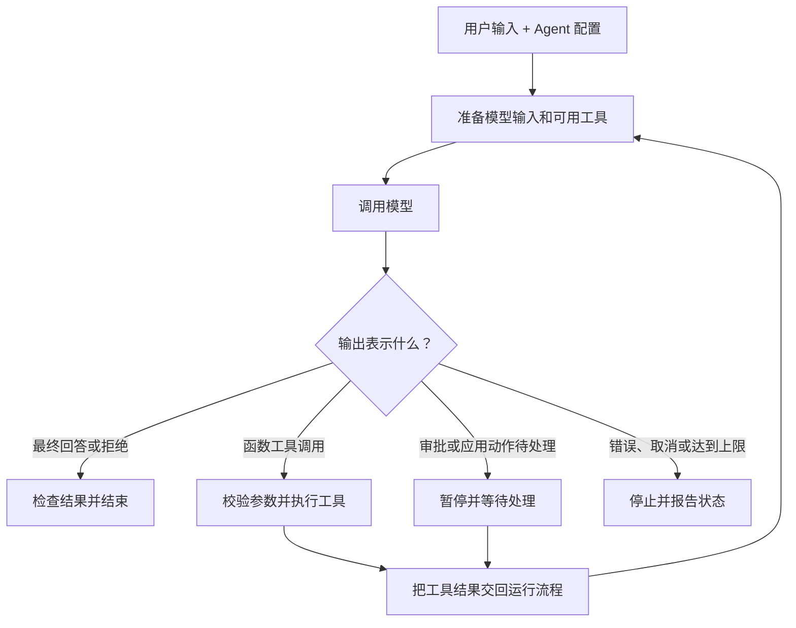

# 第 29 课：Agent 的运行循环怎样从输入走到最终结果？

**目标：** 能追踪 Agent 如何接收输入、调用模型、执行工具、带着结果继续运行，并区分完成、暂停和失败等停止状态。

## 本课问题

模型先返回一个工具调用时，任务算完成了吗？Agent 怎样利用工具结果继续，最后又怎样判断应该停下来？

## 前置知识

- [第 20 课](../s20_function_calling_loop/README.md)：了解 Function Calling 的工具请求、应用执行和结果回传。
- [第 27 课](../s27_choose_agent_runtime/README.md)：区分 Responses API、Agents SDK 和 Agents API 的运行位置。
- [第 28 课](../s28_single_agent_configuration/README.md)：了解 Agent 配置中的模型、指令和工具。

## 官方资料

- [Agents SDK：Running agents](https://developers.openai.com/api/docs/guides/agents/running-agents)：阅读 “The agent loop” 和 “Handle pauses and failures deliberately”。
- [Function calling](https://developers.openai.com/api/docs/guides/function-calling)：查看模型工具调用如何经过应用执行并继续请求，直到最终回答或更多工具调用。
- [Agents API：Run and continue sessions](https://developers.openai.com/api/docs/guides/agents-api/sessions)：了解 Session、Turn、终态和等待应用处理的动作。
- [Agents API：Events and items](https://developers.openai.com/api/docs/guides/agents-api/sessions/events)：查看运行过程事件与完成、失败、取消等结果。

## 1. 先区分几种“回合”

一个用户任务通常会经历不止一次模型调用。模型返回工具调用，Agent runtime 安排工具执行，再把工具结果交给模型继续判断；只有达到停止条件，整个任务运行才返回结果。

| 名称 | 表示什么 | 不要误认为 |
| --- | --- | --- |
| 模型调用 | 模型处理一次输入并返回一个 Response | 不一定已经是用户能看到的最终答案 |
| 工具调用 | 模型请求某个可用工具执行一项工作 | 工具还没有因此自动执行 |
| SDK run | Agents SDK 中一次较高层的 Agent 运行 | 只发生了一次模型调用 |
| Agents API Turn | Session 中一次任务工作周期 | 整个 Session 已经结束 |
| Session | 保存 Agent 配置、对话与工作结果的持续对象 | 一次模型调用或一次工具调用 |

Responses API 的一个 Response 可能包含工具请求，而不是最终回答。Agents SDK 的一个 run 通常会在内部循环处理模型与工具；Agents API 的 Session 中，一个 Turn 也可以包含多次模型和工具活动。[Running agents](https://developers.openai.com/api/docs/guides/agents/running-agents) · [Run and continue sessions](https://developers.openai.com/api/docs/guides/agents-api/sessions)

## 2. Agent loop 的共同骨架

下面是逻辑流程。每个入口对工具由谁执行、状态如何传递会有差异，但“检查模型结果；需要更多工作就继续；达到终态才结束”的骨架相同。

一次模型调用可能要求零个、一个或多个工具；如果工具结果还不足以完成任务，模型可以继续请求其他工具。运行循环要依照实际输出内容判断下一步，不要假定固定的“模型一次、工具一次、答案一次”。[Function calling](https://developers.openai.com/api/docs/guides/function-calling)

## 3. 用天气查询追踪一次完整运行

用户问：“巴黎现在天气怎么样？”假设 Agent 配置了 `get_weather` 工具：

| 步骤 | 发生什么 | 运行流程如何继续 |
| --- | --- | --- |
| 输入 | Agent 收到天气问题和当前可用工具 | 把用户任务、必要上下文与工具说明交给模型 |
| 模型输出 | 模型提出 `get_weather(location="Paris")` 调用 | 这是工具请求，还不是天气答案 |
| 工具执行 | 运行环境调用天气服务，得到温度和天气状况 | 执行者可以是应用，也可以是由平台托管的工具服务 |
| 结果回传 | 运行流程把工具结果关联到对应的工具调用 | Responses API 函数调用通常使用原始 `call_id` 交回结果 |
| 模型继续 | 模型阅读天气结果，判断是否还需要其他工具 | 若仍需要工作，再发起工具调用并继续 |
| 最终输出 | 模型根据工具返回生成面向用户的回答 | 没有待执行的工具工作时，运行流程返回结果 |

在 Responses API 的应用函数调用路径中，应用收到 `function_call` 后执行自有代码，把结果作为 `function_call_output` 发送给模型；模型随后可以返回最终文本，也可以提出更多工具调用。[Function calling](https://developers.openai.com/api/docs/guides/function-calling)

## 4. 三种入口怎样运行这段循环

| 入口 | 谁推进循环 | 应用需要关注什么 |
| --- | --- | --- |
| Responses API | 应用根据每个 Response 的输出决定是否执行函数、回传结果并继续请求 | 不能把函数调用当答案；检查所有工具请求，逐一执行并用相应 ID 回传结果 |
| Agents SDK | Runner 管理模型调用、工具调用和继续运行，直到最终输出或运行错误 | 查看 Run Result；配置 `max_turns` 等边界，处理工具失败、暂停或超过上限 |
| Agents API | OpenAI 管理 Agent harness 与运行循环；应用通过事件观察 Session 与 Turn | 应用函数或环境连接需要处理时，响应 required action；检查 Turn 是 completed、failed 还是 cancelled |

Agents SDK 的一个 run 会自动循环：调用模型、检查结果、执行工具或交接，然后继续，直到产生最终输出；设置的最大 Turn 数也可能让运行以 `MaxTurnsExceeded` 结束。[Running agents](https://developers.openai.com/api/docs/guides/agents/running-agents)

Agents API 的事件流展示的是 Session 工作进度。`agent.session.idle` 或流连接关闭本身不代表成功；检查根 Agent Turn 的 `completed`、`failed` 或 `cancelled` 状态，并查看实际输出。若 Session 等待应用函数结果或环境连接，先处理该动作才能继续。[Run and continue sessions](https://developers.openai.com/api/docs/guides/agents-api/sessions) · [Events and items](https://developers.openai.com/api/docs/guides/agents-api/sessions/events)

## 5. 哪些情况会让运行停止或暂停？

- **当前运行的最终输出：** 没有待处理的工具工作，Agent 返回答案、澄清问题或拒绝，当前运行结束；应用还应判断任务是否实际完成。用户补充信息后，通常再开始下一次输入。
- **等待处理：** 需要人工审批或 Agents API 应用函数结果等 required action 时，运行可能暂停；相应处理完成后再继续。审批路径将在第 35 课展开。
- **失败或取消：** 模型、工具、运行环境或调用方可能让运行失败或取消；区分失败与正常完成。
- **运行上限：** 最大模型 Turn 数、超时或应用预算可以限制循环；超限后应报告并走明确恢复或停止路径。

**关键检查：** “模型已经返回内容”“Session 变为 idle”或“事件流断开”都不能单独证明任务成功。按所用入口检查完整运行结果和错误状态。[Running agents](https://developers.openai.com/api/docs/guides/agents/running-agents) · [Events and items](https://developers.openai.com/api/docs/guides/agents-api/sessions/events)

## 观察练习

假设“查订单 Agent”使用只读 `lookup_order` 工具。用户问订单是否发货，模型先发出工具调用，工具返回 `{"status":"shipped"}`，模型再生成最终答复。

1. 工具调用返回后，为什么还需要再次让模型处理结果？
2. Responses API 中，应用如何把工具结果关联到刚才那次调用？
3. 如果模型根据结果又提出第二个工具请求，运行流程应怎样做？
4. SDK run 和模型调用各对应上表中的哪种单位？
5. 如果工具失败，系统应该把错误当作最终成功答案吗？应用还需要检查什么？

## 本课检查

完成本课后，能解释：

- Agent 的一次高层运行可能包含多次模型调用和工具执行。
- 工具调用是模型提出的请求；工具执行者运行能力并把结果交回流程。
- SDK Runner 可以自动推进工具循环；Responses API 函数调用路径通常需要应用执行函数并继续请求。
- Agents API 用 Session 事件报告运行进度，但应用函数或环境连接仍可能需要应用处理。
- 最终回答、等待处理、失败、取消和达到运行上限是不同状态；完成判断要查看真正的终态和输出。

## 简化与边界

- 本课讲单 Agent 的执行循环；不深入自定义工具 schema 与执行代码（第 30 课）、Session 状态管理（第 32 课）、暂停恢复（第 33 课）、人工审批（第 35 课）或 Handoff（第 36 课）。
- Responses API、Agents SDK 和 Agents API 的事件类型与状态字段并不完全相同；实现时应使用对应入口的最新文档。
- 本课没有安装 SDK、调用真实工具或发送 API 请求。
