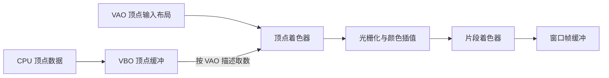

# 第 1 课：第一个三角形

这一课先跑通一次最小绘制：把三个顶点送进 GPU，经过两个着色器，最后显示到窗口。目标是看清整条路径；VAO、VBO 和 shader 的细节会在后续课程分别练习。

## 学完后你能

- 说出一帧中清屏、提交绘制和显示窗口的顺序。
- 指出顶点数据、顶点着色器、片段着色器各自做什么。
- 解释三角形为什么会出现红绿蓝渐变。

## 一帧的绘制路径



本课的顶点坐标直接写入 `gl_Position`，所以它们已经处于裁剪空间；这里还没有模型、相机或投影矩阵。

## 运行

需要 CMake 3.20 或更新版本、C++17 编译器、OpenGL 开发库、GLFW 3，以及为 OpenGL 3.3 Core 生成的 GLAD 1。依赖必须由本机预先提供，课程不会下载或安装依赖。

在本目录运行：

```sh
cmake -S . -B build
cmake --build build
./build/learn_opengl_s01_triangle
```

预期结果：深色窗口中央出现一个彩色三角形。调整窗口大小时，视口会跟着更新；按 Esc 关闭窗口。

## 跟着代码走

示例代码在 [`src/main.cpp`](src/main.cpp)，构建配置在 [`CMakeLists.txt`](CMakeLists.txt)。建议按下面顺序读，不必一开始记住每个 OpenGL 名称。

### 1. 创建窗口和 OpenGL 上下文

`glfwInit` 和 `glfwCreateWindow` 准备窗口，并请求 OpenGL 3.3 Core Profile。调用 `glfwMakeContextCurrent` 后，GLAD 才能通过 GLFW 加载 OpenGL 函数。没有当前上下文时，OpenGL 调用无法对目标设备工作。

窗口尺寸变化时，`framebufferSizeCallback` 调用 `glViewport`，让 OpenGL 把绘制区域对应到新的帧缓冲尺寸。

### 2. 准备三个顶点

`vertices` 数组里每个顶点有 6 个 `float`：前三个是位置，后三个是 RGB 颜色。坐标范围落在 `[-1, 1]`，适合直接作为本课的裁剪空间位置。

### 3. 上传数据并描述顶点布局

`glBufferData` 把 CPU 数组复制到 VBO。VAO 记录顶点输入方式：位置从每组数据的开头读取 3 个 `float`，颜色从偏移 3 个 `float` 的位置读取 3 个。

本课只先记住：VBO 保存数据，VAO 记录 OpenGL 怎样读取这些数据。第 3、4 课会分别拆开练习顶点属性和缓冲布局。

### 4. 编译着色器并连接程序

顶点着色器把位置写进 `gl_Position`，并把顶点颜色传给下一阶段。片段着色器输出片段颜色。`createProgram` 将两个已编译的 shader 链接成一个可用于绘制的 program；若编译或链接失败，程序会打印驱动日志。

三角形覆盖的片段会收到顶点颜色的插值结果，因此三个顶点颜色不同，内部就形成连续渐变。

### 5. 每帧清屏并提交三角形

循环每帧执行这几步：

1. `glClear` 清除上一帧的颜色。
2. `glUseProgram` 选择刚链接好的 shader 程序。
3. `glBindVertexArray` 选择顶点输入布局。
4. `glDrawArrays(GL_TRIANGLES, 0, 3)` 请求绘制 3 个顶点组成的三角形。
5. `glfwSwapBuffers` 显示已完成的帧，`glfwPollEvents` 处理窗口事件。

## 动手观察

每次只改一项，然后运行观察：

1. 修改 `glClearColor`，看窗口背景如何变化。
2. 修改顶点数组里的一个位置，观察三角形形状如何变化。
3. 把一个顶点的 RGB 值改成白色，观察颜色插值区域如何变化。
4. 注释掉 `glUseProgram` 或 `glBindVertexArray`，观察绘制为何不再正常，并在恢复代码后重新运行。

## 检查理解

- 哪行代码发起一次三角形绘制？
- 颜色渐变由哪两个阶段共同产生？
- 这节课为什么可以不创建相机？

参考答案：`glDrawArrays` 提交绘制；顶点颜色由顶点着色器传出，再由光栅化阶段插值，片段着色器输出插值颜色；顶点位置直接写到 `gl_Position`，本课暂时使用裁剪空间坐标。

## 对照引擎源码

- [Cocos2d-x `BufferGL.cpp`](../../engine/cocos2d-x-4/cocos/renderer/backend/opengl/BufferGL.cpp)：创建缓冲并上传顶点数据。
- [Cocos2d-x `ProgramGL.cpp`](../../engine/cocos2d-x-4/cocos/renderer/backend/opengl/ProgramGL.cpp) 和 [`ShaderModuleGL.cpp`](../../engine/cocos2d-x-4/cocos/renderer/backend/opengl/ShaderModuleGL.cpp)：创建 program、编译并关联 shader。
- [Cocos2d-x `CommandBufferGL.cpp`](../../engine/cocos2d-x-4/cocos/renderer/backend/opengl/CommandBufferGL.cpp)：准备绘制状态、设置顶点输入并调用 `drawArrays`/`drawElements`。
- [Creator 3.8.7 WebGL2 命令实现](../../engine/3.8.7engine/cocos/gfx/webgl2/webgl2-commands.ts)：观察 GFX 命令如何在 WebGL2 后端落到图形 API。
- [Creator 2.4.15 渲染路径](../../docs/2.x/06-graphics-rendering.md)：对照 Sprite 几何、批处理、相机视图和设备绘制之间的上层流程。

Cocos 还会在底层绘制调用前处理场景遍历、相机可见性、材质 Pass 和批次。本课只把这些当作后续路线，不要求现在全部掌握。
