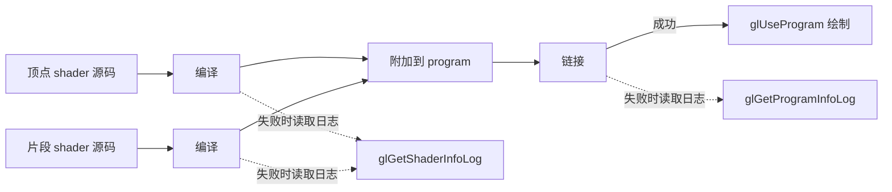

# 第 2 课：编译与链接着色器

第 1 课已经画出三角形。本课沿着同一条绘制路径，专门区分 shader 编译和 program 链接：先分别检查顶点/片段着色器，再把它们连接成可绘制的 program。

## 学完后你能

- 说明 `glCompileShader` 和 `glLinkProgram` 分别检查什么。
- 从驱动日志判断失败发生在 shader 编译阶段还是 program 链接阶段。
- 解释 shader 对象与链接后 program 的关系。

## 两个阶段



## 运行

需要 CMake 3.20 或更新版本、C++17 编译器、OpenGL 开发库、GLFW 3，以及为 OpenGL 3.3 Core 生成的 GLAD 1。依赖由本机提供，课程不会自动下载或安装。

在本目录运行：

```sh
cmake -S . -B build
cmake --build build
./build/learn_opengl_s02_shader
```

默认模式会打开窗口并画出一个三角形。按 Esc 关闭窗口。

## 观察两种错误

### 编译错误

```sh
./build/learn_opengl_s02_shader --bad-compile
```

程序会向顶点着色器加入一处语法错误。它应在链接和绘制之前失败，并打印类似 `Vertex shader compilation failed` 的提示及驱动日志。

阅读日志时先找出失败的 shader 阶段，再找错误行号和错误类别。日志的具体格式由 OpenGL 驱动决定，不同显卡和系统可能不同。

### 链接错误

```sh
./build/learn_opengl_s02_shader --bad-link
```

这个模式里的两个 shader 都能编译，但顶点 shader 输出 `vec3 vertexColor`，片段 shader 却输入 `vec2 vertexColor`。类型不匹配发生在阶段接口连接时，因此应看到 `Program link failed`，而不是 shader 编译失败。

两个错误模式会在打印日志后以非零状态退出，这是预期结果。

## 跟着代码走

示例代码在 [`src/main.cpp`](src/main.cpp)，构建配置在 [`CMakeLists.txt`](CMakeLists.txt)。

1. `compileShader` 调用 `glCreateShader`、`glShaderSource` 和 `glCompileShader`。
2. 随后查询 `GL_COMPILE_STATUS`。失败时调用 `glGetShaderInfoLog` 读取驱动诊断，并返回空句柄。
3. `createProgram` 将两个编译成功的 shader 附加到 program，再调用 `glLinkProgram`。
4. `GL_LINK_STATUS` 检查阶段接口能否连接；失败时 `glGetProgramInfoLog` 给出链接日志。
5. 链接成功后可以删除独立 shader 对象；链接结果保留在 program 中，绘制时通过 `glUseProgram` 选择它。

几何数据用 `gl_VertexID` 在顶点 shader 中生成，窗口只绑定一个空 VAO。这样本课能专注于 shader 生命周期；顶点属性、VBO 和 EBO 已在第 1 课先跑通，并会在第 3–5 课分别拆解。

## 动手观察

1. 运行 `--bad-compile`，修复顶点 shader 的语法错误，再确认成功日志。
2. 运行 `--bad-link`，把片段 shader 的输入类型改为 `vec3`，确认链接错误消失。
3. 改变 varyings 的变量名但保持类型一致，观察接口名称也必须匹配。

## 检查理解

- 两个 shader 都编译成功，为什么 program 仍可能不能使用？
- 编译失败与链接失败分别查询哪个状态和日志？
- 为什么链接成功后仍要保留 program 对象？

## 对照引擎源码

- [Cocos2d-x `ShaderModuleGL.cpp`](../../engine/cocos2d-x-4/cocos/renderer/backend/opengl/ShaderModuleGL.cpp)：创建并编译图形 API 的 shader 模块。
- [Cocos2d-x `ProgramGL.cpp`](../../engine/cocos2d-x-4/cocos/renderer/backend/opengl/ProgramGL.cpp)：创建 program、关联 shader 并处理链接。
- [Creator 3.8.7 `webgl2-shader.ts`](../../engine/3.8.7engine/cocos/gfx/webgl2/webgl2-shader.ts)：观察 WebGL2 后端如何编译 shader 并维护 GPU shader 对象。
- [Creator 2.4.15 渲染研究](../../docs/2.x/06-graphics-rendering.md)：从材质 Effect/Pass 追到最终绘制所用的 program。

本课日志来自当前 OpenGL 驱动。驱动文本、行号格式和报错措辞不是跨平台固定接口。
