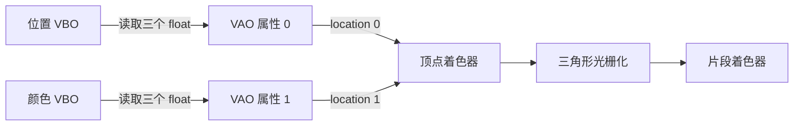

# 第 3 课：VAO 与顶点属性

本课专门看 shader 输入如何接到顶点数据。一个顶点的坐标和颜色分别放在两个 VBO 里；VAO 记录读取方式，并把位置属性绑定到 shader 的 location 0、颜色属性绑定到 location 1。

## 学完后你能

- 解释 `layout(location = N)` 如何指定 shader 输入编号。
- 解释 `glVertexAttribPointer(N, ...)` 和 `glEnableVertexAttribArray(N)` 如何设置同一个编号的顶点属性。
- 分清 VBO 保存数据、VAO 保存顶点输入布局。

## 顶点输入对应关系



## 运行

需要 CMake 3.20 或更新版本、C++17 编译器、OpenGL 开发库、GLFW 3，以及为 OpenGL 3.3 Core 生成的 GLAD 1。依赖由本机提供，课程不会自动下载或安装。

在本目录运行：

```sh
cmake -S . -B build
cmake --build build
./build/learn_opengl_s03_vao
```

预期结果是一个 RGB 渐变三角形。按 Esc 关闭窗口。

## 跟着代码走

示例代码在 [`src/main.cpp`](src/main.cpp)，构建配置在 [`CMakeLists.txt`](CMakeLists.txt)。

1. 顶点 shader 声明 `layout(location = 0) in vec3 aPosition` 和 `layout(location = 1) in vec3 aColor`。
2. `positionBuffer` 保存三个顶点的位置，`colorBuffer` 保存对应颜色。
3. 绑定 VAO 后，先绑定位置 VBO，再用 `glVertexAttribPointer(0, ...)` 定义属性 0 的格式，并启用属性 0。
4. 再绑定颜色 VBO，用 `glVertexAttribPointer(1, ...)` 定义属性 1，并启用属性 1。
5. 绘制时绑定这个 VAO。OpenGL 根据属性编号把数据送入 shader 的对应输入。

`glVertexAttribPointer` 会把当时绑定的 `GL_ARRAY_BUFFER` 关联到当前 VAO 的该属性，同时记录分量数、类型、步长和偏移。本课把位置和颜色分开放在两个 VBO 中，因此步长和偏移都很简单；第 4 课再比较交错布局和分离布局。

## 动手观察

每次只改一侧，观察属性编号必须对应：

1. 把颜色 shader 输入和 `glVertexAttribPointer`/`glEnableVertexAttribArray` 的编号同时从 1 改为 2，画面应保持不变。
2. 只改其中一侧的编号，观察颜色或位置输入不再匹配时的结果。
3. 注释掉 `glEnableVertexAttribArray(1)`，观察颜色属性退回默认值后，三角形颜色如何变化。
4. 交换位置 VBO 和颜色 VBO 的配置编号，观察错误映射怎样改变三角形位置和颜色。

## 检查理解

- `layout(location = 1)` 与 `glVertexAttribPointer(1, ...)` 为什么必须使用同一个编号？
- VAO 保存了哪些顶点输入信息？VBO 保存了什么？
- 为什么改变同一个属性的 VBO 绑定后，要重新调用 `glVertexAttribPointer`？

## 对照引擎源码

- [Cocos2d-x `CommandBufferGL.cpp`](../../engine/cocos2d-x-4/cocos/renderer/backend/opengl/CommandBufferGL.cpp)：`bindVertexBuffer` 根据 program 的顶点输入格式绑定 buffer 并设置属性。
- [Creator 3.8.7 `webgl2-input-assembler.ts`](../../engine/3.8.7engine/cocos/gfx/webgl2/webgl2-input-assembler.ts)：GFX 输入装配器保存顶点输入描述。
- [Creator 3.8.7 `webgl2-commands.ts`](../../engine/3.8.7engine/cocos/gfx/webgl2/webgl2-commands.ts)：WebGL2 后端绑定顶点 buffer 并配置顶点属性。

引擎在这些底层属性之外还会管理 shader 反射、顶点格式和资源生命周期。本课先聚焦 location 与输入数据之间的对应关系。
