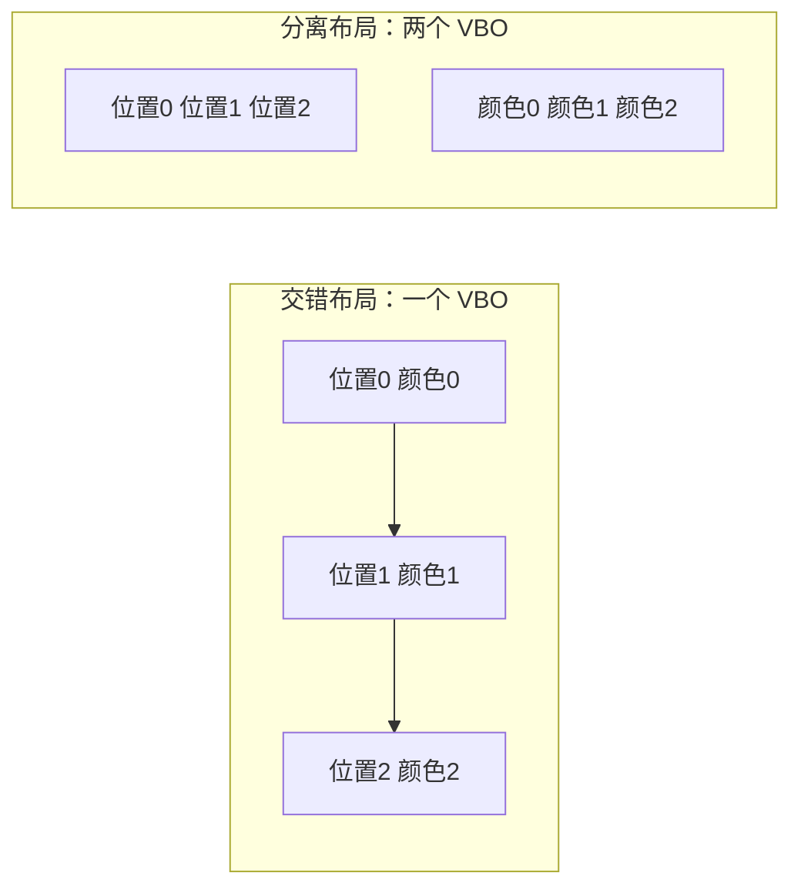

# 第 4 课：VBO 布局与数据上传

同一组三角形顶点可以按不同方式放进 GPU 缓冲。本课用交错布局和分离布局绘制相同画面，再局部更新顶点位置，观察数据布局怎样决定 buffer、步长和字节偏移。

## 学完后你能

- 说明 `glBufferData` 如何创建或替换 VBO 数据。
- 根据交错/分离布局计算 `glVertexAttribPointer` 的 stride 和 offset。
- 使用 `glBufferSubData` 更新一段已有顶点数据。

## 两种布局



两种布局提供相同的位置和颜色，因此默认画面一致。区别在 CPU/GPU 缓冲的组织方式以及读取属性时使用的 stride、offset。

## 运行

需要 CMake 3.20 或更新版本、C++17 编译器、OpenGL 开发库、GLFW 3，以及为 OpenGL 3.3 Core 生成的 GLAD 1。依赖由本机提供，课程不会自动下载或安装。

在本目录运行：

```sh
cmake -S . -B build
cmake --build build
./build/learn_opengl_s04_vbo
```

默认使用交错布局。用 `--separate` 切换为分离布局：

```sh
./build/learn_opengl_s04_vbo --separate
```

两种模式都显示同一个渐变三角形。按空格抬高或放低顶点，程序通过 `glBufferSubData` 只更新位置数据；按 Esc 关闭窗口。

## 跟着代码走

示例代码在 [`src/main.cpp`](src/main.cpp)，构建配置在 [`CMakeLists.txt`](CMakeLists.txt)。

### 交错布局

每个 `Vertex` 连续保存位置和颜色。位置属性的 stride 是整个 `Vertex` 的大小，offset 是 `position` 字段的偏移；颜色属性使用相同 stride 和 `color` 字段偏移。

```cpp
struct Vertex {
    float position[3];
    float color[3];
};
```

### 分离布局

位置和颜色分别放在两个 VBO。每个属性按连续的 3 个 `float` 读取，所以 stride 是 3 个 `float`，offset 为 0。

### 局部更新

按空格时，程序只更新第三个顶点的位置。交错布局的 offset 是：

```text
2 * sizeof(Vertex) + offsetof(Vertex, position)
```

分离布局的位置 VBO 中，offset 是：

```text
2 * 3 * sizeof(float)
```

两种布局都用 `glBufferSubData` 写入同样的 3 个 `float`，颜色数据保持不变。`GL_DYNAMIC_DRAW` 是使用提示，不会阻止后续更新。

## 动手观察

1. 分别运行默认模式和 `--separate`，确认视觉结果一致。
2. 修改 `position` 中一个顶点的 x 坐标，再检查交错模式的 `offsetof` 和分离模式的数组位置。
3. 把局部更新的 stride 偏移少算或多算一个字段，观察更新到颜色或错误顶点时的画面变化，再恢复正确偏移。
4. 改变按空格时写入的 y 值，观察 `glBufferSubData` 怎样改变已有 VBO 的内容。

## 检查理解

- 交错布局为什么需要非零 stride 和字段 offset？
- 分离布局为什么可以用 offset 0？
- `glBufferSubData` 的 offset 是元素下标还是字节数？
- 更新位置 VBO 时，为什么颜色属性不需要重新上传？

## 对照引擎源码

- [Cocos2d-x `BufferGL.cpp`](../../engine/cocos2d-x-4/cocos/renderer/backend/opengl/BufferGL.cpp)：`glBufferData` 创建/替换数据，`glBufferSubData` 更新已有缓冲的一段范围。
- [Creator 3.8.7 `webgl2-buffer.ts`](../../engine/3.8.7engine/cocos/gfx/webgl2/webgl2-buffer.ts)：GFX Buffer 的 WebGL2 资源封装。
- [Creator 3.8.7 `webgl2-commands.ts`](../../engine/3.8.7engine/cocos/gfx/webgl2/webgl2-commands.ts)：缓冲数据创建、更新和顶点输入绑定的 WebGL2 命令。

第 3 课关注属性编号怎样接到 shader 输入；本课进一步看这些属性背后的 buffer 字节如何排列和更新。
