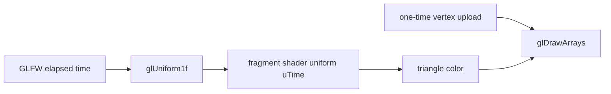

# 第 6 课：Uniform 与逐帧变化数据

顶点位置在初始化时上传一次，随后 CPU 每帧只更新一个 `float` uniform。片段着色器用这个时间值混合两种颜色，让三角形持续变色。

## 学完后你能

- 说明 uniform 如何把 CPU 侧数据传给当前 shader program。
- 区分每个顶点的 attribute 数据与一次绘制中共享的 uniform 数据。
- 在绘制前更新 uniform，而不重复上传顶点缓冲。

## 数据流



本例把 `glfwGetTime()` 的秒数发送给 `uTime`。片段着色器对它取正弦，并在冷色和暖色之间平滑混合。一次绘制中的所有片段共享同一个 `uTime`，因此三角形整体变色；顶点位置没有变化。

## 运行

需要 CMake 3.20 或更新版本、C++17 编译器、OpenGL 开发库、GLFW 3，以及为 OpenGL 3.3 Core 生成的 GLAD 1。依赖由本机提供，课程不会自动下载或安装。

在本目录运行：

```sh
cmake -S . -B build
cmake --build build
./build/learn_opengl_s06_uniform
```

窗口中会显示一个颜色随时间往复变化的三角形。按 Esc 关闭窗口。

## 跟着代码走

示例代码在 [`src/main.cpp`](src/main.cpp)，构建配置在 [`CMakeLists.txt`](CMakeLists.txt)。

### 声明 uniform

片段着色器声明 `uniform float uTime`，用它计算 0 到 1 之间的混合系数：

```glsl
uniform float uTime;

void main() {
    float blend = 0.5 + 0.5 * sin(uTime);
    fragmentColor = vec4(mix(coolColor, warmColor, blend), 1.0);
}
```

### 每帧更新

程序链接后用 `glGetUniformLocation` 查找一次 `uTime` 的位置。每帧激活 program 后，再把当前秒数传给它：

```cpp
glUseProgram(program);
glUniform1f(timeLocation, static_cast<GLfloat>(glfwGetTime()));
glBindVertexArray(vertexArray);
glDrawArrays(GL_TRIANGLES, 0, 3);
```

`glUniform1f` 更新的是当前 program 的 uniform 状态，不会改写 VBO。uniform location 在链接后查询；如果 shader 没有使用某个 uniform，它可能被优化掉并返回 `-1`。

## 动手观察

1. 把 `sin(uTime)` 改成 `sin(uTime * 3.0)`，比较颜色变化速度。
2. 把混合系数替换为 `0.0` 或 `1.0`，观察两种颜色端点。
3. 暂时固定传给 `glUniform1f` 的值，再恢复 `glfwGetTime()`，区分 CPU 每帧更新与 shader 内部计算。
4. 在循环里临时重复调用 `glBufferData`，观察它与只更新 uniform 的数据路径有什么不同，然后移除这次实验改动。

## 检查理解

- uniform 和顶点 attribute 分别适合传递哪类数据？
- 为什么每帧设置 uniform 前要先激活对应的 program？
- `glGetUniformLocation` 为什么放在循环外？
- 本例的动画为什么不需要重新上传顶点位置？

## 对照引擎源码

- [Cocos2d-x `ProgramState.h`](../../engine/cocos2d-x-4/cocos/renderer/backend/ProgramState.h)：声明 `setUniform` 与 uniform location 查询接口。
- [Cocos2d-x `ProgramState.cpp`](../../engine/cocos2d-x-4/cocos/renderer/backend/ProgramState.cpp)：按 shader 阶段保存 uniform 数据。
- [Cocos2d-x `CommandBufferGL.cpp`](../../engine/cocos2d-x-4/cocos/renderer/backend/opengl/CommandBufferGL.cpp)：绘制准备阶段调用 `setUniforms`，并按 uniform 类型调用对应的 `glUniform*` 函数。

第 5 课用 EBO 改变绘制时读取的顶点编号；本课保持几何数据不变，只更新 shader 使用的逐绘制参数。
