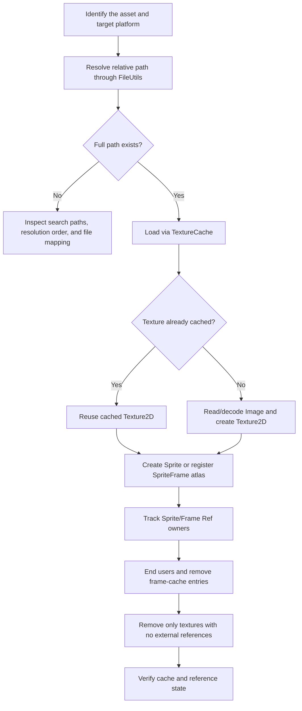

# Cocos2d-x 4.x resource loading and release

Use this skill for image/texture loading, sprite-frame atlases, path lookup, cache misses, and texture/frame lifetime in the local Cocos2d-x 4.0 source tree. It does not apply to Creator AssetDB, `.meta` UUIDs, Bundle build settings, audio, or arbitrary serialized assets.

## Workflow

1. Identify whether the task concerns a single image, a plist sprite atlas, or another resource type. For textures, obtain the cache from `Director::getInstance()->getTextureCache()`; the local header says `TextureCache` is Director-owned.
2. Trace the exact input path through `FileUtils::fullPathForFilename()`. Check the filename mapping, search path list, resolution order, and final path. `TextureCache::addImage()` returns `nullptr` when path resolution or image decoding fails.
3. For single images, use `TextureCache::addImage()` or the relevant `Sprite::create()` path. For atlases, load with `SpriteFrameCache::addSpriteFramesWithFile()` and resolve the requested frame by name. The plist may provide a texture path relative to the plist; inspect the actual metadata and fallback extension behavior.
4. For async loads, handle `nullptr`, and ensure callback owners are still valid. The worker path decodes off-thread and schedules texture creation/callback, but cache-hit and missing-path branches call the callback directly. Use `unbindImageAsync()` when its lifetime contract applies; do not assume every callback is deferred.
5. Trace ownership before cleanup. SpriteFrame retains its Texture2D; Sprite may retain its SpriteFrame/texture. Remove frame cache entries and texture cache entries separately. `removeUnusedSpriteFrames()` and `removeUnusedTextures()` only remove entries whose cache is the remaining reference owner.
6. Verify using the target platform and the actual resolved full path. Check cache identity and reference counts before and after the requested action; do not claim GPU memory was freed merely because a cache key disappeared.

Avoid `removeAllTextures()` as a routine scene transition cleanup: it clears the whole texture map even when active content may still use those textures. `removeTextureForKey()` removes the cache's map entry and releases its ownership reference; it does not prove no other owner remains.

## Local evidence

The source map is [Cocos2d-x 4.0 resource addressing, caching, and release](../../../../docs/cocos2d-x/03-assets-loading-and-release.md). It links to `CCFileUtils`, `CCTextureCache`, `CCSpriteFrameCache`, `CCSpriteFrame`, and the relevant `cpp-tests` source.

Current evidence is static source review and existing test entry points. This topic has not had a Cocos2d-x runtime resource/release probe in this round. For a Creator port or direct comparison, read the [resource comparison](../../../../docs/comparisons/cocos2d-x-4-vs-creator-2.4/05-assets-loading-and-release.md); ordinary Cocos2d-x implementation work does not need the comparison MD.

Static skill routing check: a normal “load one PNG into a Sprite” request routes through FileUtils and TextureCache; a likely mis-mapping request that supplies a Creator `.meta` UUID must not be translated directly into a Cocos2d-x path, and should consult the comparison MD. This check did not execute either runtime.
