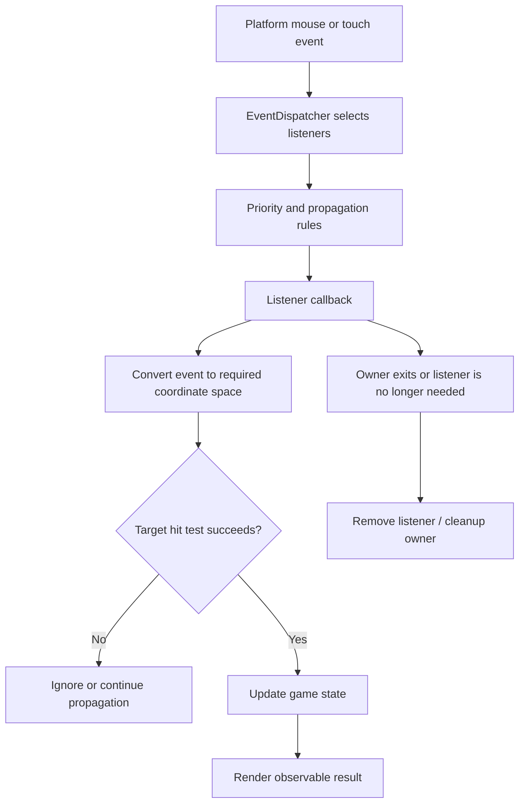

# Cocos2d-x 4.x input events

Use when a Cocos2d-x input callback is missing, targets the wrong object, or needs a new mouse/touch interaction.

1. Confirm target platform and event type. Inspect the platform event source and the appropriate `EventListener`/`EventDispatcher` path; desktop mouse evidence does not establish mobile touch behavior.
2. Register with the intended dispatcher priority and lifecycle target. Check event propagation and swallowing behavior, then remove or let the owning Node remove listeners according to the actual cleanup/destructor path.
3. Verify event coordinates and convert between screen, world, and node-local spaces before hit testing. Use the target node's current transform and bounds; do not infer a hit from screen position alone.
4. Keep the callback's visible state change small and observable. Build and exercise the target event, including a miss/outside click and teardown if those are part of the requested behavior.

## Verified local example

The paired sample registers `EventListenerMouse` against the Sprite, checks left-button input, converts to scene-node space, performs a bounding-box hit test, increments a Label, and moves the Sprite. The 2026-10-17 macOS desktop run verified two clicks and the resulting visible state. See [the demo notes](../../../../docs/cocos2d-x-creator2x-demo.md), [the comparison record](../../../../docs/comparisons/cocos2d-x-4-vs-creator-2.4.md), and `engine/cocos2d-x-4/templates/cpp-template-default/Classes/HelloWorldScene.cpp`.

That slice does not verify touch devices, propagation edge cases, event latency, or every platform dispatcher implementation. Consult the [Cocos2d-x v4 event guide](https://docs.cocos2d-x.org/cocos2d-x/v4/en/event_dispatcher/registering.html) and the local `cocos/event_dispatcher/` implementation for the exact target.

For a Creator comparison or port, consult the [topic comparison](../../../../docs/comparisons/cocos2d-x-4-vs-creator-2.4/04-input-events.md). Ordinary Cocos2d-x input work does not need that cross-engine reference.
