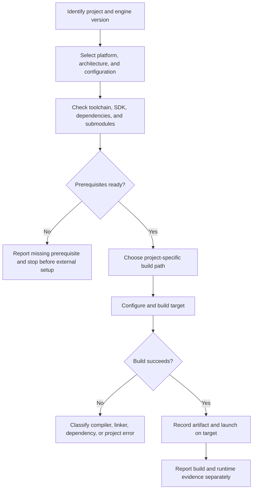

# Cocos2d-x 4.x project build

Use for Cocos2d-x project setup, native builds, and build failures. Identify the project and target platform before choosing a build path; engine source builds, generated game projects, and IDE platform projects are not interchangeable.

1. Confirm the engine snapshot/version, project root, target platform/architecture, build configuration, and actual entry point. In this repository, `engine/cocos2d-x-4/` is the local 4.0 source tree; check its README, CHANGELOG, CMake files, and project files.
2. Inspect the target's CMake/project files, launcher, `Classes/`, `Resources/`, dependency payload, and submodule state. Check compiler, CMake/IDE, SDK, and required Python version before configuration.
3. Use the build path documented by the selected template/platform. Keep generated output outside tracked source. Do not assume a generic desktop `main.cpp` describes mobile or other desktop platform launchers.
4. Do not download dependencies, install toolchains, or change global environment as an implicit step. Report missing prerequisites and the smallest required user action when setup needs external changes.
5. Record the exact configure/build command, target, architecture, configuration, and artifact. A successful engine test target does not prove the game template target built; a build does not prove the app launched.

## Repository evidence

- The local default C++ template is `engine/cocos2d-x-4/templates/cpp-template-default/`.
- The [demo build record](../../../../docs/cocos2d-x-creator2x-demo.md) documents a successful macOS x86_64 `HelloCpp` build and launch, including the local wrapper/toolchain setup and limits. Its temporary paths describe that recorded run, not portable defaults.
- The [Cocos2d-x source study plan](../../../../docs/cocos2d-x-creator2x-source-study-plan.md) records dependency and platform boundaries. Recheck current machine state instead of reusing historical availability claims.

When comparing build responsibilities with Creator or planning a port, read the [topic comparison](../../../../docs/comparisons/cocos2d-x-4-vs-creator-2.4/01-project-build.md). It is reference evidence, not a required step for ordinary Cocos2d-x builds.

The demonstrated build covers the recorded macOS x86_64 setup only. Do not infer Android, iOS, Windows, Linux, arm64, release, or store-package success from it.
